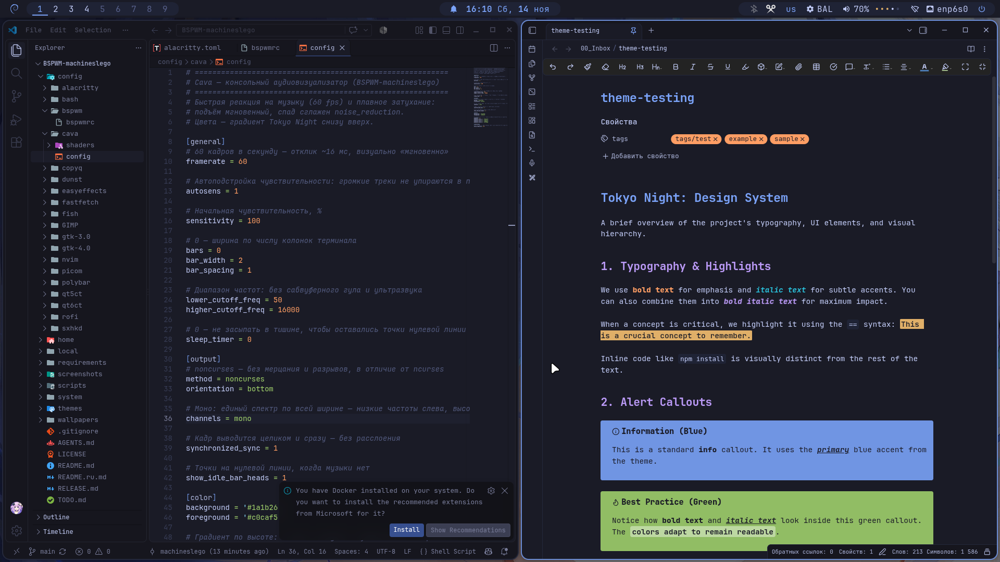

# BSPWM-machineslego


Дотфайлы и райс для Debian 13 Trixie в палитре Tokyo Night.
Основная сессия — Sway/Wayland, BSPWM/X11 остаётся запасной: в неё можно уйти, если Wayland сломался.

Планы, отвергнутые идеи и известные ограничения — в [TODO.md](./TODO.md).


<details>
<summary>Ещё скриншоты</summary>





</details>

## 🧭 Правило репозитория

> Если задача решается стоковым модулем — не пиши скрипт.
> Если скрипт нужен — запускай по требованию и сразу завершай.
> Без фоновых циклов и мёртвого кода.

## ✨ Что внутри

- **Sway:** waybar, mako, rofi, swaylock, wf-recorder, cliphist.
- **BSPWM:** polybar, dunst, rofi, picom, sxhkd, i3lock-fancy, CopyQ.
- **Общее:** alacritty, Fish + Tide, Neovim (vim.pack) и Vim, GTK/Qt, GIMP, btop, cava — в Tokyo Night.
- Команды по требованию лежат в `local/bin` и вызываются с хоткея.

## 🛠 Установка

Нужны Debian 13, `git`, `sudo` и интернет.

```bash
git clone https://github.com/machineslego-wq/BSPWM-machineslego ~/BSPWM-machineslego
cd ~/BSPWM-machineslego
./scripts/install.sh                 # пакеты, шрифты, конфиги, Flatpak, Neovim
./scripts/install-sway.sh --session  # пакеты Sway + сессия в GDM
```

- Только конфиги, без правок в `/etc`: `./scripts/link.sh`
- Откат: `./scripts/unlink.sh`
- Остальные установщики (`software.sh`, `install-node.sh`, `install-laravel.sh`, `install-lamp.sh`) — в `scripts/`.

`install.sh` идемпотентен. `link.sh` делает бэкап старых файлов в `~/.dotfiles-backup-*`.

## ⌨️ Горячие клавиши

Клавиши совпадают в обеих сессиях; отличия и полный список — в шпаргалке.

| Действие | BSPWM | Sway |
|---|---|---|
| Терминал | `Super + Return` | `Super + Return` |
| Лаунчер | `Super + D` | `Super + D` |
| Закрыть окно | `Super + W` | `Super + W` |
| Меню питания | `Super + Shift + Q` | `Super + Shift + Q` |
| Полный список | `Super + /` | `Super + /` |

## 🖼 Обои

Выборщика нет, обои статичные.

- **X11:** `feh` в `~/.config/bspwm/bspwmrc` — landscape на основной монитор, portrait на повёрнутый (на ПК с двумя экранами).
- **Sway:** `sway-display` (`exec_always` в `config/sway/config`) — те же файлы через `output ... bg`.

Пути захардкожены как `$HOME/BSPWM-machineslego/wallpapers/`: если клонировать в другое место, поправь их. Сменить обои — заменить файл в этих вызовах.

## 🎨 Темы

Вся система в Tokyo Night. GTK и Qt переключаются целиком:

```bash
theme on|off|status
```

`off` возвращает стоковую Adwaita для GNOME, `on` — тему репозитория. GIMP, Telegram, CopyQ, btop, cava и Midnight Commander оформлены отдельными файлами в `config/`, `local/share/mc/skins` и `themes/`.

## 🧰 Команды

| Команда | Что делает |
|---|---|
| `wifi rofi` | Wi-Fi: сети, пароль, хотспот |
| `battery rofi` | заряд, здоровье, потребление |
| `powermenu rofi` | блокировка, выход, выключение |
| `screenshot` / `sway-screenshot` | скриншоты (X11 / Sway) |
| `sway-record full\|region` | запись экрана |
| `theme` | GTK/Qt: `on`, `off`, `status` |
| `rice-help` | все команды репозитория |
| `rice-doc <имя>` | документация из `docs/` |

## 🔄 Обновление

```bash
git pull
./scripts/link.sh
rice-check
```

Применить без перелогина: Sway — `Super + Escape`, BSPWM — `Super + Alt + R`, конфиг SXHKD — `Super + Escape`.

## 📄 Лицензия

MIT
