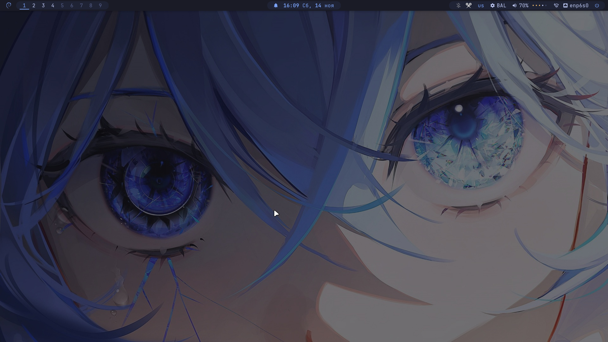
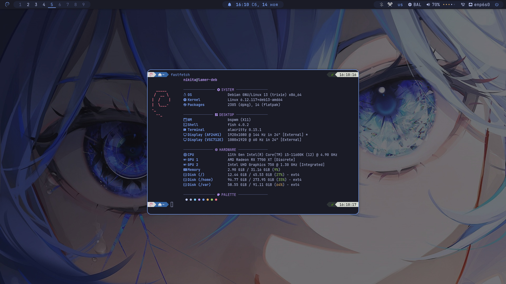
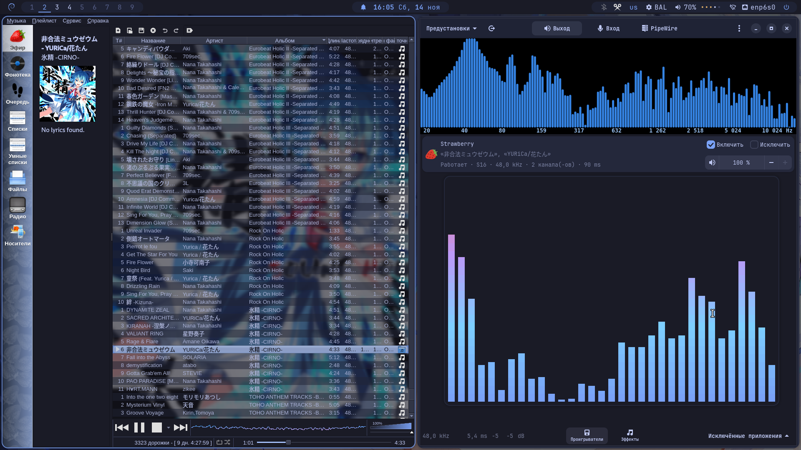
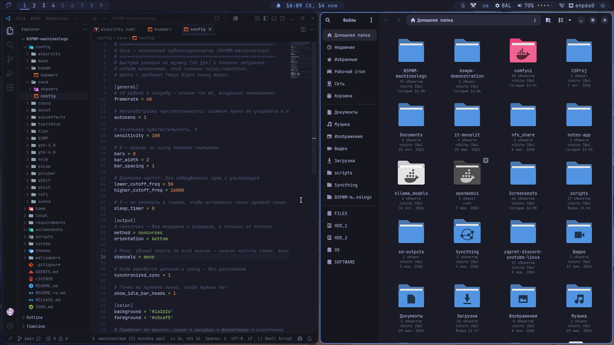

# BSPWM-machineslego

**English** | [Русский](./README.ru.md)


A strict, flat desktop environment for Debian 13 Trixie in the Tokyo Night palette. Sway/Wayland is being adopted step by step; BSPWM/X11 stays as the fallback session.

> **Status:** the setup is gradually moving to Sway; BSPWM/X11 remains fully configured and is started whenever Wayland breaks. Current tasks and rejected ideas are in [TODO.md](./TODO.md).

---

## 🧭 Rule of the repository

> **If a stock module solves it, don't write a script.**
> **If a script is needed, run it on-demand and exit immediately.**
> **No background loops. No dead code.**

Every line of code and every running process must justify its existence. This rule is the reason why some features are intentionally **not** implemented — and why others were removed after being tried (see [TODO.md](./TODO.md) for the list of rejected ideas).

---



<details>
<summary><b>Show more screenshots</b></summary>
<br>







</details>

## ✨ Features

- **Native Modules First:** Polybar uses stock `internal/bspwm`, `internal/xwindow`, `internal/battery`, `internal/backlight`, `internal/network`, `internal/pulseaudio`, `internal/xkeyboard`, and `internal/date`. Zero background bash loops; the only exception is the Bluetooth status script — Polybar 3.7 has no `internal/bluetooth`.
- **On-Demand Commands:** `wifi`, `powermenu`, `battery`, `bluetooth`, `unblock-bt`, `power-profile`, `screenshot`, `wpctl-volume`, `dunst-history`, `session-restart`, `cheatsheet-bspwm`, `rice-check`, and `rice-help` live in `~/.local/bin` (PATH); the Sway set (`sway-cheatsheet {wofi|rofi}`, `sway-display`, `sway-record`, `sway-screenshot`, `sway-session`, plus the wofi menu `wofi-clipboard`) lives there too; `wifi`, `battery` and `powermenu` take the menu backend as their argument (`wifi rofi`/`battery rofi`/`powermenu rofi` in BSPWM, `wifi wofi`/`battery wofi`/`powermenu wofi` in Sway); window flags — in `config/sxhkd/scripts`. They run on a hotkey and exit immediately.
- **Machine Utilities:** `start-llm` (Ollama + OpenWebUI), `start-comfy` (ComfyUI), `mount-nas` (NFS), `openrgb-i2c-fix`, `sddm-avatar`, `check-hardware`, `check-strawberry`. Docker commands are machine-specific; they check for the daemon and print usage when an argument is missing. The Apache helpers `vhost-add` / `vhost-remove` create and delete a virtual host (interactive, need `sudo`, write to `/etc/apache2` and `/etc/hosts`; `apache2` is not in `requirements/`).
- **Hardware Autodetection:** `polybar/launch.sh` finds the battery (`POLYBAR_BAT`), AC adapter (`POLYBAR_AC`), and backlight device (`POLYBAR_BACKLIGHT`) in `/sys/class/…` — no hardcoded names.
- **Wallpapers — `feh` only:** no picker script, no state file, no previews. Two static `feh` calls in `bspwmrc`: landscape on the main monitor, portrait on the rotated one. Change a wallpaper = edit one line.
- **Screen locking:** `xss-lock` + `i3lock-fancy` — after 10 minutes idle, with DPMS monitor blanking and proper locking before sleep (`--transfer-sleep-lock`).
- **Modern Shell:** Fish + Tide prompt (Fisher). Autosuggestions, syntax highlighting, git status without background daemons. `eza` for file listings, `fastfetch` with separate X11 and TTY configs.
- **Smooth & Flat:** Picom with window animations, rounded corners, and shadows; no blur and no dimming of inactive windows. Strict Tokyo Night colors.
- **Power Profiles:** Performance / Balanced / Power Saver via PPD. In `power-saver` Picom automatically switches to `picom-eco.conf` — no animations, no shadows.
- **One Consistent Style:** Polybar, Rofi, Dunst, Picom, Alacritty, Fish, Cava, Btop, GTK3/GTK4, Qt5/Qt6, GIMP 3, CopyQ, Midnight Commander, and Telegram are all themed in Tokyo Night.
- **Workflow:** clipboard history (CopyQ on BSPWM, cliphist + wofi on Sway), notification history (Rofi), screenshots straight into the clipboard, instant screenshot annotations (swappy), hotkey screen recording (wf-recorder), keybinding cheatsheets (Rofi for BSPWM, wofi for Sway), and a Neovim setup styled after base VS Code with its own cheatsheet.
- **Stock Vim as a fallback:** plain `vim` from `apt.txt` with no plugins — syntax highlighting for nearly everything, hybrid numbering (absolute number on the cursor line, relative around it), and persistent undo. Config: `~/.vimrc` (`home/vimrc`).
- **Stability:** autostart in `bspwmrc` is guarded against duplicates via `pgrep`/`pkill`, so `Super + Alt + R` and a full session restart never spawn extra processes.
- **Multi-machine:** hostname branches in `bspwmrc` (a dual-monitor desktop and laptops); easy to trim down to a single machine.
- **Screen capture & OBS (Sway):** hotkey screenshots use `grim`/`slurp` directly; quick recording uses `wf-recorder` (`Super + Shift + R` — full screen, `Super + Shift + Alt + R` — region, pressing again stops) and is silent — use OBS for recording with sound; clips are encoded with `libx264` (VAAPI removed: it was unused on Intel and an untested branch on AMD). Every state is reported by notification, including the exit code. Heavy recording and screen sharing go through `xdg-desktop-portal-wlr` + PipeWire; Sway exports its environment to systemd/dbus on startup, and `portals.conf` routes `ScreenCast`/`Screenshot` to `wlr`. OBS must run as a native Wayland client. Screenshot annotations are handled by `swappy` (`Super + Shift + A`), clipboard history by `cliphist` (`Super + Shift + V`, last 100 entries).

## 📦 Structure

```text
BSPWM-machineslego/
├── config/                      # symlinks to ~/.config/*
│   ├── alacritty/               # terminal: Tokyo Night palette, font size 10
│   ├── bash/themes/             # prompt presets: tokyo-night, tokyo-night-minimal
│   ├── bspwm/bspwmrc            # autostart, monitors, wallpapers, window borders
│   ├── btop/                    # system monitor: config + Tokyo Night theme
│   ├── cava/config              # spectrum: 60 fps, Tokyo Night gradient
│   ├── copyq/                   # Tokyo Night theme + command menu
│   ├── dunst/dunstrc            # notifications: stack 7, history 20
│   ├── easyeffects/output/      # equalizer/effects presets
│   ├── fastfetch/               # graphical.jsonc and tty.jsonc
│   ├── fish/                    # config.fish, fish_plugins, rustup
│   ├── foot/foot.ini            # terminal for Sway: no padding, Tokyo Night
│   ├── GIMP/3.0/themes/         # TokyoNight theme for GIMP 3
│   ├── gtk-3.0/ gtk-4.0/        # gtk.css: Tokyo Night over Adwaita-dark, gtk-light.css: day
│   ├── mako/config              # notifications for Sway: dunst-style
│   ├── nvim/                    # Lua config, vim.pack, CHEATSHEET.md
│   ├── picom/                   # picom.conf + picom-eco.conf
│   ├── polybar/                 # config.ini, launch.sh
│   ├── qt5ct/ qt6ct/            # tokyo-night.conf + tokyo-night-day.conf palettes
│   ├── quickshell/shell/        # QML sources (not connected)
│   ├── rofi/config.rasi         # launcher/windows/commands
│   ├── swappy/config            # screenshot editor: saves to the Pictures folder
│   ├── sway/config              # Sway session: borders, hotkeys, autostart
│   ├── swaylock/config          # lock screen: Tokyo Night, desktop wallpapers
│   ├── xdg-desktop-portal/      # portals.conf: ScreenCast/Screenshot → wlr
│   ├── sxhkd/                   # sxhkdrc + hotkey helpers (scripts/)
│   ├── waybar/                  # config.jsonc + style.css: Sway panel
│   └── wofi/                    # config + style.css: Sway launcher and menus
├── home/                        # symlinks to ~/*: .bashrc, .vimrc, .xinitrc, .xprofile, .Xresources
├── local/bin/                   # commands in ~/.local/bin: wifi, screenshot, wpctl-volume, ...
├── local/share/mc/skins/        # Midnight Commander skin
├── system/etc/                  # copied to /etc: touchpad, NetworkManager, interfaces
├── scripts/                     # install.sh, link.sh, unlink.sh, software.sh, install-node.sh, install-laravel.sh, install-sway.sh
├── requirements/                # package lists: apt.txt, apt-system.txt, software.txt, sway.txt
├── screenshots/                 # README previews
├── themes/telegram/             # Telegram themes: .tdesktop-palette + .attheme (dark + light)
├── wallpapers/                  # 1080p/4K and portrait wallpapers
├── RELEASE.md                   # release notes for the current tag (EN + RU)
├── TODO.md                      # plans, rejected ideas, limitations
└── LICENSE                      # MIT
```

## 🧩 Project core

The minimal set of dotfiles without which the session does not come up or the
rice falls apart: startup, hotkeys, panel, launcher, notifications, terminal and
styles. Everything else is scaffolding around this core: on-demand commands,
the installer, application themes and system tweaks.

```text
BSPWM-machineslego/
├── config/
│   ├── bspwm/bspwmrc               # X11: session start, autostart, monitors, wallpaper, borders
│   ├── sxhkd/sxhkdrc               # X11: every hotkey
│   ├── polybar/
│   │   ├── config.ini              # X11: panel — modules, colors, fonts
│   │   └── launch.sh               # X11: start the panel per monitor
│   ├── picom/picom.conf            # X11: shadows, rounded corners, blur
│   ├── rofi/config.rasi            # X11: launcher, window and command menus
│   ├── dunst/dunstrc               # X11: notifications
│   ├── alacritty/alacritty.toml    # X11: terminal
│   ├── sway/config                 # Wayland: session start, borders, hotkeys, autostart
│   ├── waybar/
│   │   ├── config.jsonc            # Wayland: panel — modules
│   │   └── style.css               # Wayland: panel — colors and islands
│   ├── wofi/
│   │   ├── config                  # Wayland: launcher and menus
│   │   └── style.css               # Wayland: launcher — colors and sizes
│   ├── mako/config                 # Wayland: notifications
│   ├── foot/foot.ini               # Wayland: terminal
│   ├── swaylock/config             # Wayland: lock screen
│   ├── gtk-3.0/                    # shared GTK3 styles: settings.ini + gtk.css
│   ├── gtk-4.0/                    # shared GTK4/libadwaita styles: settings.ini + gtk.css
│   └── qt5ct/colors/ qt6ct/colors/ # Qt palettes: tokyo-night.conf (+ day)
├── home/
│   ├── xinitrc                     # X11: startx → BSPWM, PATH with ~/.local/bin
│   └── xprofile                    # X11: same environment when logging in via a DM
├── local/bin/
│   ├── sway-session                # Wayland: launch wrapper — PATH, environment, workspace map
│   └── sway-display                # Wayland: monitors, geometry, wallpaper
└── wallpapers/                     # wallpapers referenced by bspwmrc and sway-display
```

What is deliberately not here:

- `local/bin/*` other than `sway-session` and `sway-display` — on-demand
  commands (`wifi`, `screenshot`, `powermenu`): the session and panel work
  without them, some hotkeys just do nothing.
- `config/nvim`, `btop`, `cava`, `copyq`, `GIMP`, `themes/` — applications, not
  the desktop itself.
- `scripts/`, `requirements/`, `system/` — installation and system tweaks, not
  runtime.
- Fonts (JetBrainsMono Nerd Font), icons (Papirus-Dark) and cursor (Bibata) are
  packages, not dotfiles; without them the rice looks broken, but the session
  still starts.

## 📋 Requirements

- **OS:** Debian 13 Trixie, **Wayland** (Sway is the target session; BSPWM/X11 stays as the fallback).
- **Utilities:** `git`, `sudo`, internet access for the first install.
- **Audio:** PipeWire (`pipewire`, `pipewire-audio`, `pipewire-pulse`, `wireplumber`). Polybar's `internal/pulseaudio` works through `pipewire-pulse`; the volume script uses `wpctl`.
- **Fonts:** JetBrainsMono Nerd Font (installed by `install.sh`), Papirus-Dark and Bibata (from `apt.txt`).
- **Flatpak:** optional. Installed by `install.sh` together with Flathub; `link.sh` grants Flatpak apps access to the themes.
- **Neovim:** `ripgrep` for Telescope (`find_files`, `live_grep`) — it is in `requirements/software.txt`.
- **Vim:** the stock `vim` from `apt.txt` — a plugin-free fallback editor for configs; its config is `home/vimrc` → `~/.vimrc`.

## 🛠 Installation

```bash
git clone https://github.com/machineslego-wq/BSPWM-machineslego ~/BSPWM-machineslego
cd ~/BSPWM-machineslego
chmod +x scripts/*.sh
./scripts/install.sh
```

- **Configs only (no `/etc` changes):** `./scripts/link.sh`
- **Extra software:** `./scripts/software.sh`
- **Node.js / npm:** `./scripts/install-node.sh` (separate, see below)
- **PHP / Composer / Laravel:** `./scripts/install-laravel.sh` (separate, see below)
- **Sway (main session):** `./scripts/install-sway.sh` — packages from `requirements/sway.txt`, installed on top of the base setup: fonts, icons, Qt themes, network (`nmcli`/`nmtui` from `network-manager`) and audio (`wpctl` from `wireplumber`) come from `apt.txt`. Adds your user to the `input` group (Caps/Num Lock indicators in waybar), configs untouched; `--session` also adds a GDM entry that starts `sway-session` (environment wrapper, no `xinitrc`/`xprofile` under Wayland). BSPWM is not removed: it stays the X11 fallback. Sway itself is configured in `config/sway`: pixel borders only, no gaps, Tokyo Night border colors, `foot` as the terminal (`config/foot`), waybar instead of Polybar, wofi instead of Rofi, monitors and wallpapers via `sway-display`, while the workspace-to-output map is generated by `sway-session` per host (the PC pins 1–7 to `DP-2` and 8–10 to `HDMI-A-4`; laptops and netbooks get an empty map, so workspaces spread over the current output) and included by the Sway config, because Sway has no hostname conditions and the map must be known before the first workspaces are created, screen locking via `swaylock` (`config/swaylock`: blue input ring, orange password text, the same wallpapers as the desktop), screenshots via `sway-screenshot`, and the wifi/battery/power menus via `wifi wofi`, `battery wofi`, `powermenu wofi` (wofi styled after Rofi, 2 px rounding); notifications come from `mako` (`config/mako`) styled after `dunst`
- **Rollback:** `./scripts/unlink.sh`
- **Launch:** `sway-session` from a TTY, or the GDM entry added by `install-sway.sh --session`; `startx` still brings up the BSPWM fallback.

`install.sh` is idempotent: re-running it does not break what is already installed. `link.sh` can be run at any time — it backs up existing files to `~/.dotfiles-backup-YYYYMMDD-HHMMSS` and re-creates the symlinks.

### What `install.sh` does

1. **User level (no sudo):** Neovim AppImage to `~/.local/bin/nvim`, `tree-sitter` CLI ≥ 0.26.1 to `~/.local/bin`, JetBrainsMono Nerd Font to `~/.local/share/fonts`, config linking via `link.sh`, Fisher + Tide.
2. **Packages (sudo):** everything from `requirements/apt.txt`; if **TLP** is present it is removed to avoid a conflict with `power-profiles-daemon`. PPD and Flatpak are installed, Flathub is added.
3. **System configs:** `system/**` is copied to `/etc/**` with a backup in `/etc/dotfiles-backup-YYYYMMDD-HHMMSS`.
4. **Laptop lid:** if a battery exists, `/etc/systemd/logind.conf.d/10-lid-suspend.conf` is written (`HandleLidSwitch=suspend`); on a desktop this step is skipped.

### What `link.sh` does

- `config/<pkg>` → `~/.config/<pkg>`
- `home/<file>` → `~/.<file>`
- `local/bin/<command>` → `~/.local/bin/<command>` — one link per file, foreign files in `~/.local/bin` (nvim, tree-sitter) stay untouched
- `local/share/mc/skins/*.ini` → `~/.local/share/mc/skins/`
- sets `+x` on `local/bin` commands, SXHKD scripts, and `bspwmrc`
- sets the GTK cursor theme in gsettings (`Bibata-Modern-Ice`, 24) — without it GTK apps draw the default Adwaita cursor while Sway and XWayland show Bibata
- with Flatpak installed, adds overrides: read-only access to `xdg-config/gtk-3.0`, `gtk-4.0`, `qt5ct`, `qt6ct`, `xdg-data/themes`, and `QT_QPA_PLATFORMTHEME=qt5ct`

## ⚙️ Post-Install

**Fish & Tide.**
The Tide prompt is installed automatically. After installation, open a terminal and run:

```bash
tide configure
```

The wizard sets style, colors, and icons. `config.fish` already defines Tokyo Night colors and `eza` aliases; `fastfetch` has a separate TTY config.

**Bash prompt.**
`~/.bashrc` sources a preset from `~/.config/bash/themes/<name>.bash`; the name comes from `BASH_PROMPT`, default `tokyo-night` (Debian → directory → git → arrow). Two more presets: `tokyo-night-minimal` (a single line with no `git` calls) and `empty` — an empty template with commented examples for writing your own.

To switch for good, edit the `BASH_PROMPT=` line in `~/.bashrc`; to try it for one shell, run `BASH_PROMPT=tokyo-night-minimal bash`. If the file is missing, the stock `\u@\h:\w\$` stays.

**GNOME Terminal.**
Colors live in a dconf profile rather than a file, so the repo ships a command instead: `gnome-terminal-palette` (`~/.local/bin`) applies the Tokyo Night palette to the default profile — background, foreground, 16 ANSI colors, cursor and selection, matching Alacritty/Foot/Konsole. `gnome-terminal-palette --reset` restores the GNOME theme colors. New windows pick it up immediately, open ones after a restart.

**Wi-Fi.**
The `wifi` command (`~/.local/bin`) takes the menu backend as its first argument: `wifi rofi` for BSPWM (terminal — Alacritty) and `wifi wofi` for Sway (terminal — Foot). The adapter is chosen by `nmcli`, so there is no interface table; set `HOTSPOT_SSID` / `HOTSPOT_PASSWORD` at the top of the file.

**Network, Bluetooth and power without a launcher.**
If rofi/wofi are unavailable, the same actions live in the terminal — via the aliases in `~/.bashrc` / `config.fish`:

| Action | Command |
|---|---|
| Wi-Fi menu (TUI) | `net` (nmtui) |
| List networks | `wifi-list` |
| Connect (saved password) | `wifi-connect "SSID"` |
| Connect (ask for password) | `wifi-connect-ask "SSID"` |
| Wi-Fi on/off | `wifi-on` / `wifi-off` |
| Bluetooth shell | `bt` (bluetoothctl) |
| Bluetooth on/off | `bt-on` / `bt-off` |
| Bluetooth: clear rfkill block | `unblock-bt` |
| Power profile | `pp` / `pp-set bal` (also `eco`, `perf`) |
| Power off / reboot | `systemctl poweroff` / `reboot` |

Under the hood these are `nmtui`, `nmcli`, `bluetoothctl` and `powerprofilesctl`. Full list of commands and aliases — `rice-help` (or `rh`), search it with `rice-help wifi`.

If the adapter is locked (`bluetoothctl show` → `PowerState: off-blocked`), `bluetoothctl power on` fails — `unblock-bt` clears the rfkill block (sudo in a terminal, pkexec from a hotkey) and powers the adapter on.

`nmtui` is recolored to Tokyo Night: `config/newt/colors` (symlinked to `~/.config/newt`) is wired up from `~/.bashrc` / `config.fish` through two variables. `NEWT_COLORS_FILE` is the libnewt palette (`nmtui`, `whiptail`); `NMT_NEWT_COLORS_FILE` covers nmtui's own extra sets (`badLabel`, `plainLabel`, `disabledButton`, `textboxWithBackground`), which otherwise render as light patches. Colors are ANSI names, so the shades come from the terminal palette and the background stays the terminal's own.

For nmtui's compact buttons (`<OK>`, `<Back>`, `<Edit>`) libnewt paints the focused one with the `button` color and the unfocused ones with `compactbutton`; `actbutton` is not used for them. The accent fill therefore lives on `button`, while `compactbutton` is the muted chip.

**Wallpapers.**
There is no picker. Edit the `feh` calls in `~/.config/bspwm/bspwmrc`:

- `lamer-deb` (desktop): `xrandr` sets up `DisplayPort-1` (primary, 144 Hz) and `HDMI-A-3` (left, rotated), `bspc` assigns workspaces I–IX and X, and `feh` applies landscape and portrait wallpapers.
- any other host: all 10 workspaces on one screen and a single landscape wallpaper.

Paths are hardcoded as `$HOME/BSPWM-machineslego/wallpapers/` — if you clone the repo elsewhere, update them. Window borders: `#24283b` (normal), `#6b8dd6` (focused), `#bb9af7` (preselect).

**Midnight Commander skin.**
Installed to `~/.local/share/mc/skins/tokyo-night.ini`. Switch with `mc` → `F9` → `Setup` → `Colors` → `tokyo-night`.

**Laptop lid behavior.**
By default, closing the lid suspends the system (the screen is locked via `xss-lock`). To **lock without suspend**:

```bash
sudo rm /etc/systemd/logind.conf.d/10-lid-suspend.conf
sudo tee /etc/systemd/logind.conf.d/10-lid-lock.conf > /dev/null <<'EOF'
[Login]
HandleLidSwitch=lock
HandleLidSwitchExternalPower=lock
EOF
sudo systemctl kill -s HUP systemd-logind
```

**Power Profiles.**
`Super + Alt + P` or a click on the Polybar module. The menu offers Performance / Balanced / Power Saver, switches via `powerprofilesctl`, and immediately restarts Picom with the matching profile. Limitation: on Celeron N4120 the `performance` profile is unavailable — only `balanced` and `power-saver`.

**Neovim.**
The config is written in Lua, plugins are managed by the built-in `vim.pack` (Neovim 0.12). The list lives in `lua/plugins.lua`, versions are pinned by `nvim-pack-lock.json`. The first launch needs network: `vim.pack` downloads plugins and Mason installs LSP servers into `~/.local/share/nvim/mason/bin`. Update plugins with `:lua vim.pack.update()` and `:restart`; Treesitter parsers with `:TSUpdate`. Full cheatsheet: `config/nvim/CHEATSHEET.md`.

**Vim.**
A plugin-free fallback editor: `home/vimrc` → `~/.vimrc`. Syntax highlighting and `filetype plugin indent on` are enabled, numbering is hybrid (absolute number on the cursor line, relative distances around it), persistent undo lives in `~/.vim/undo`, indentation is 4 spaces by default (2 for json/yaml/html/css/scss/js/ts/vue), and extension-less configs get a filetype (`sxhkdrc`, `bspwmrc`, `xinitrc`, `dunstrc`, `picom*.conf`, `qt5ct.conf`, `qt6ct.conf`, `NetworkManager.conf`, `copyq*.conf`, `*.tdesktop-palette`). Colors come from the terminal palette (Tokyo Night in Alacritty); no colorscheme is overridden. Apply changes with `:source ~/.vimrc`.

**Node.js and npm.**
`./scripts/install-node.sh` adds the NodeSource repository and installs LTS. Variables: `NODE_CHANNEL=lts|current|<major>` (default `lts`), `UPDATE_NPM=1` also installs `npm@latest`. Global packages go to `~/.npm-global` (`prefix` in `~/.npmrc`), and PATH is added by both Fish and bash. If NVM is installed, it is sourced at the end of `~/.bashrc` and may shadow the NodeSource `node`/`npm`.

**PHP, Composer, and Laravel.**
`./scripts/install-laravel.sh` installs `php-cli` and the extensions (`mbstring`, `xml`, `curl`, `zip`, `sqlite3`, `intl`, `mysql`), Composer 2 into `~/.local/bin/composer`, and `laravel/installer` globally. The `laravel` binary lives in `~/.config/composer/vendor/bin`, which is usually missing from PATH, so the script adds it for bash and fish (the `composer-global` block). `UPDATE_COMPOSER=1` reinstalls Composer. New project: `laravel new <name>`; alternative: `composer create-project laravel/laravel <name>`.

**Themes.**
- **GTK3/GTK4:** `config/gtk-3.0/gtk.css` is a full stylesheet over `Adwaita-dark`: `@define-color` plus direct selectors (Adwaita hardcodes its colors, so they have to be overridden by hand). `config/gtk-4.0/gtk.css` contains only libadwaita variables (`:root` with `--*-color`) and a compatibility `@define-color` layer. `gtk-light.css` in both folders is a 1:1 light variant over `Adwaita` (background `#e1e2e7`, text `#3760bf`, accent `#2b6fd4`) and is off by default: copy it over `gtk.css` and switch `gtk-theme` / `color-scheme` in gsettings to enable it. `gtk-theme-name` is unchanged, only colors are repainted. Apply by restarting the app; Flatpak apps pick up the CSS after re-running `link.sh`.
- **Qt5/Qt6:** palettes in `config/qt5ct/colors/tokyo-night.conf` and `config/qt6ct/colors/tokyo-night.conf` (21 `QPalette` roles, `#AARRGGBB` format), `style=Fusion`, Papirus-Dark icons. `tokyo-night-day.conf` is the matching light palette (same roles: window `#e1e2e7`, text `#3760bf`, accent `#2b6fd4`); enable it by pointing `color_scheme_path` at that file and switching `icon_theme` to `Papirus`. In Sway and BSPWM the platform theme is `kde`: it takes palette, style and icons from `kdeglobals`, because KF6 apps (Dolphin, Okular, Ark) ignore the qt6ct palette and keep gray Breeze widgets. qt6ct stays as the fallback for systems without Plasma. Apply with `qt5ct`/`qt6ct` or by restarting the app.
- **GIMP 3:** `config/GIMP/3.0/themes/TokyoNight/` is picked up as a user theme — enable it in GIMP: Preferences → Interface → Theme.
- **CopyQ:** `tokyo-night.ini` theme plus a command menu (pin, tags). History and window geometry never reach git.
- **Cava:** `config/cava/config` — a terminal spectrum. 60 fps for instant response, `noise_reduction = 40`: bars rise without delay and fall sharply but smoothly. One mono spectrum across the width — low frequencies on the left, high on the right; the gradient follows bar height — blue → cyan → purple → coral. Run `cava` (in Alacritty); the config is read at startup.
- **Btop:** `config/btop/btop.conf` plus `config/btop/themes/tokyo-night.theme`. The theme uses the same palette as Polybar/Waybar: background `#1a1b26`, text `#c0caf5`, accent `#7aa2f7`, muted `#565f89`. CPU and process graphs run blue → purple → coral, temperature and disk meters green → yellow → red. `color_theme = "tokyo-night"` resolves to the user theme directory, so no system path is hardcoded. Run `btop`; the config is read at startup.
- **EasyEffects:** presets in `config/easyeffects/output/*.json`. The service starts from `bspwmrc` if the binary exists; some effects may need `calf-plugins` from `requirements/software.txt`.
- **Telegram:** themes live in `themes/telegram/` — dark `tokyo-night.*` (Tokyo Night with an orange accent) and light `tokyo-night-light.*` (Tokyo Night Day, blue accent). Each comes in two formats: `.tdesktop-palette` (Desktop) and `.attheme` (mobile/legacy). No automated install, to avoid breaking Flatpak paths:
  1. copy the file to `~/.var/app/org.telegram.desktop/data/TelegramDesktop/tdata/theme/` (Flatpak) or `~/.local/share/TelegramDesktop/tdata/theme/` (native);
  2. restart Telegram;
  3. **Chat background** → **Edit theme** → `tokyo-night` (or `tokyo-night-light`).
- **Midnight Commander:** see the skin above.

**System configs (`system/etc/`).**
- `X11/xorg.conf.d/30-touchpad.conf` — libinput: tap-to-click, natural scrolling, clickfinger, two-finger scroll, disable-while-typing.
- `NetworkManager/NetworkManager.conf` — `plugins=ifupdown,keyfile` and `managed=true` so NM does not ignore interfaces from `/etc/network/interfaces`.
- `network/interfaces` — standard `lo` + `source /etc/network/interfaces.d/*`.

**Tinting wallpapers to match the palette** (optional, ImageMagick):

```bash
# dark palette (#1a1b26) — dim:
convert /path/to/original.jpg -fill "#1a1b26" -colorize 50% -modulate 80,80,100 /path/to/tokyo-night-wallpaper.jpg

# light palette (#e1e2e7) — brighten:
convert /path/to/original.jpg -fill "#e1e2e7" -colorize 50% -modulate 120,80,100 /path/to/tokyo-night-light-wallpaper.jpg
```

`-colorize N%` blends the palette colour in (higher = closer to the panel tone), `-modulate brightness,saturation,100` sets the overall tone. For the light theme, drop brightness below 120 (e.g. 110) if the wallpaper ends up too close to the panels.
**Sway portals (OBS, screen sharing, PipeWire).**
Portals are D-Bus activated on the first request, so no `graphical-session.target` is required. The only thing that breaks the chain is the environment: `xdg-desktop-portal-wlr.service` has `ConditionEnvironment=WAYLAND_DISPLAY`, and `systemd --user` does not know Sway's variables until they are imported.

- `config/sway/config` runs `dbus-update-activation-environment --systemd --all` at startup, so `WAYLAND_DISPLAY`, `SWAYSOCK`, `DISPLAY`, `XDG_CURRENT_DESKTOP` and the theme/cursor variables from `sway-session` land in systemd and dbus. Check with `systemctl --user show-environment | grep WAYLAND`.
- `config/xdg-desktop-portal/portals.conf` → `~/.config/xdg-desktop-portal/portals.conf`. Routes `ScreenCast` and `Screenshot` to `wlr`, everything else to `gtk` (this keeps `xdg-desktop-portal-hyprland` from claiming `sway` through `UseIn`).

Launch OBS as a Wayland client — `QT_QPA_PLATFORM=wayland obs` — otherwise it falls back to XWayland. `slurp` must be installed.

## ⌨️ Keybindings

**Full cheatsheet:** `Super + /` — `cheatsheet-bspwm` (Rofi) in BSPWM, `sway-cheatsheet` (wofi, `rofi` fallback) in Sway; both are searchable through hidden tags, and the BSPWM window is sized so they are not clipped. Neovim cheatsheet: `config/nvim/CHEATSHEET.md`; Vim cheatsheet: the comments in `~/.vimrc`.

### BSPWM: system & launch

| Keybinding | Action |
|---|---|
| `Super + Return` | Terminal (Alacritty) |
| `Super + D` | Launcher (Rofi drun) |
| `Super + /` | Cheatsheet |
| `Alt + Tab` | Window switcher (Rofi) |
| `Super + E` / `B` / `V` | Thunar / Firefox / VS Code |
| `Super + A` | Audio mixer (pavucontrol-qt) |
| `Super + X` | Sensors (`watch sensors`) |
| `Super + Alt + N` | Wi-Fi Manager |
| `Super + Alt + T` | Telegram (Flatpak) + WS proxy |
| `Super + Alt + B` | Battery Details (Rofi) |
| `Super + Alt + P` | Power Profile Selector |
| `Super + Alt + H` | Notification History |
| `Super + Ctrl + V` | Clipboard History (CopyQ) |
| `Super + Shift + Q` | Power Menu (Rofi) |
| `Super + Alt + L` | Lock screen |
| `Super + Escape` | Reload SXHKD config |
| `Super + Alt + Shift + R` | Full session restart (SXHKD, BSPWM, Polybar, Dunst, Picom, applets) |

### BSPWM: screenshots & media

| Keybinding | Action |
|---|---|
| `Super + F1` | Whole screen |
| `Super + F2` | Active window |
| `Super + F3` | 3-second delay |
| `Super + F4` | Active monitor |
| `Super + Shift + S` | Selected area |
| `Fn + brightness` | `brightnessctl` ±5% |
| `Fn + volume` | Volume OSD ±2% |

Screenshots are saved to the `Screenshots` subfolder of the system Pictures folder (`~/Изображения/Screenshots` under a Russian locale — the path comes from `xdg-user-dir`, not hardcoded) and copied to the CopyQ clipboard (fallback: `xclip`).

### Sway: screenshots, recording & clipboard

| Keybinding | Action |
|---|---|
| `Super + F1` | Whole screen |
| `Super + F3` | 3-second delay |
| `Super + F4` | Active monitor |
| `Super + Shift + S` | Selected area |
| `Print` | Whole screen |
| `Super + Shift + A` | Edit the screenshot in the clipboard (swappy) |
| `Super + Shift + R` | Record the whole screen on/off |
| `Super + Shift + Alt + R` | Record a region on/off |
| `Super + Shift + V` | Clipboard history (cliphist) |

Screenshots go to the `Screenshots` subfolder of the system Pictures folder, recordings to `Screencasts` inside the system Videos folder — both resolved with `xdg-user-dir`, so a Russian locale gives `~/Изображения/Screenshots` and `~/Видео/Screencasts`. In swappy, `Ctrl+S` saves, `Ctrl+C` copies to the clipboard, `Esc` quits; tools are `a` arrow, `t` text, `r` rectangle, `o` ellipse, `b` brush, `d` blur. Quick recording is silent — use OBS for recording with sound. Clipboard history keeps the last 100 entries, images included.

### Sway: session & windows

Launch, media and clipboard keys repeat the BSPWM tables above — except the `Alt + Tab` window switcher, which Sway does not have. The full list is `sway-cheatsheet` (`Super + /`); below are the session and window keys that differ.

| Keybinding | Action |
|---|---|
| `Super + Escape` / `Super + Shift + C` | Reload the Sway config |
| `Super + Shift + E` | Exit Sway (swaynag) |
| `Super + T` / `Super + Shift + T` | Toggle split / tabbed layout |
| `Super + M` | Stacking layout |
| `Super + S` / `Super + F` | Floating / fullscreen |
| `Super + C` | Toggle focus between floating and tiled |
| `Super + W` | Close window |
| `Super + R` | Resize mode (arrows or HJKL, `Esc` to leave) |
| `Super + Minus` / `Super + Shift + Minus` | Show / move to the scratchpad |
| `Super + arrows` or `H/J/K/L` | Focus a window |
| `Super + Shift + arrows` or `Shift + H/J/K/L` | Move the window |
| `Super + 1…0` / `Super + Shift + 1…0` | Switch workspace / move the window there |
| `Super + [` / `]` / `Tab` | Previous / next / last workspace |

### BSPWM: windows & workspaces

| Keybinding | Action |
|---|---|
| `Super + arrows` | Focus a window |
| `Super + Shift + arrows` | Swap with a neighbor |
| `Super + H/J/K/L` | Move floating window (vim-style) |
| `Super + C` / `Super + Shift + C` | Next / previous window |
| `Super + backtick` / `Super + Tab` | Previous window / previous workspace |
| `Super + O` / `I` | Focus history back / forward |
| `Super + P/B/,/.` | Parent / brother / first / second window |
| `Super + [` / `]` | Previous / next workspace |
| `Super + 1…0` | Switch workspaces |
| `Super + Shift + 1…0` | Move window to workspace |
| `Super + W` / `Super + Shift + W` | Close window / kill process |
| `Super + T` / `Super + Shift + T` | Tiled / pseudo-tiled |
| `Super + S` / `Super + F` | Floating / fullscreen |
| `Super + M` | Monocle |
| `Super + G` | Swap with the biggest window |
| `Super + Alt + Q` / `R` | Quit BSPWM / restart BSPWM |

### BSPWM: preselect, flags & resizing

| Keybinding | Action |
|---|---|
| `Super + Ctrl + arrows` | Preselect direction |
| `Super + Ctrl + 1…9` | Preselect ratio |
| `Super + Ctrl + Space` | Cancel preselect for the window |
| `Super + Ctrl + Shift + Space` | Cancel preselect for the workspace |
| `Super + Y` | Send the marked window into preselect |
| `Super + Ctrl + M/X/Y/Z` | Flags: marked / locked / sticky / private |
| `Super + Alt + arrows` | Grow the window |
| `Super + Alt + Shift + arrows` | Shrink the window |

## 🔄 Updating & applying changes

Configs live as symlinks: editing a file in the repo changes the live system immediately. After `git pull`, just run `./scripts/link.sh` (new symlinks are created, replaced files go to a backup).

| What changed | How to apply |
|---|---|
| BSPWM | `bspc wm -r` or `Super + Alt + R` |
| SXHKD | `pkill -USR1 -x sxhkd` or `Super + Escape` |
| Polybar | `~/.config/polybar/launch.sh` |
| Picom | `pkill -x picom`, then `picom --config <profile>` |
| Dunst | `pkill -x dunst && dunst &` |
| Vim | `:source ~/.vimrc` |
| Alacritty | automatically (`live_config_reload = true`) |
| GTK3/GTK4, Qt | restart the app |
| Everything | `Super + Alt + Shift + R` |

## 🐛 Known Issues (Picom & UI)

- **Dunst Stack Animation:** only the first notification animates. Second and subsequent notifications in the stack appear instantly due to a known **Picom 12.5** conflict with Dunst's positioning.
- **Context Menu Shadows:** Telegram (Flatpak) and Firefox context menus have poorly rendered shadows. This is why they are explicitly excluded in `picom.conf` (`shadow = false`).
- **AMD Sleep:** on Ryzen 7000-series, suspend may fail. Add `mem_sleep_default=s2idle` to GRUB if the laptop shuts down instead of sleeping.
- **Dunst on multiple monitors:** notifications appear only on monitor `0` (`monitor = 0` in `dunstrc`).
- **`window-height` in Picom:** the unary minus is not parsed — rules must use `"0 - window-height"` written by hand.
- **Sway portals on Debian 13:** `xdg-desktop-portal-wlr` is skipped with `unmet condition check ConditionEnvironment=WAYLAND_DISPLAY` if Sway's environment never reaches `systemd --user`. The `dbus-update-activation-environment` line in `config/sway/config` is what keeps it working; `graphical-session.target` stays inactive by design.

## 🗺 Plans

- `1.8.1` is out. Notes for the current release live in [RELEASE.md](./RELEASE.md), history — in [Releases](https://github.com/machineslego-wq/BSPWM-machineslego/releases). The next stop is `1.9.0`.
- The setup is moving to Sway/Wayland step by step. BSPWM/X11 is not going away: it stays as a working session to fall back on when Wayland breaks, so the earlier "no Wayland" decision has been reversed (see [TODO.md](./TODO.md)).
- Current tasks, "Done", rejected ideas, and known limitations live in [TODO.md](./TODO.md).

## 📄 License

MIT
