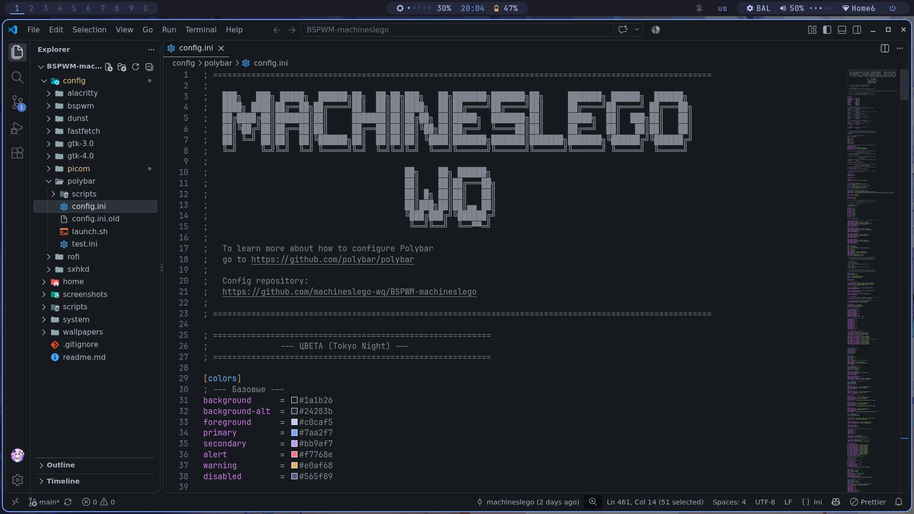
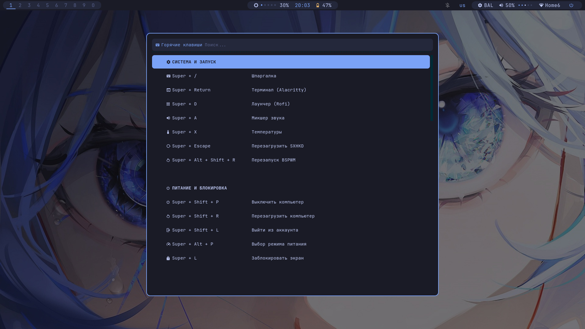
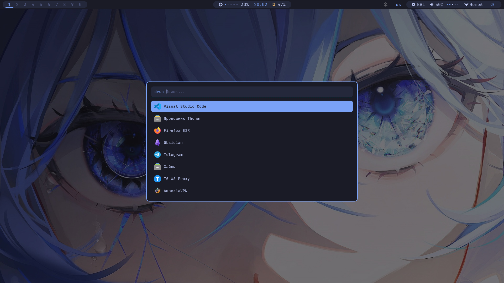
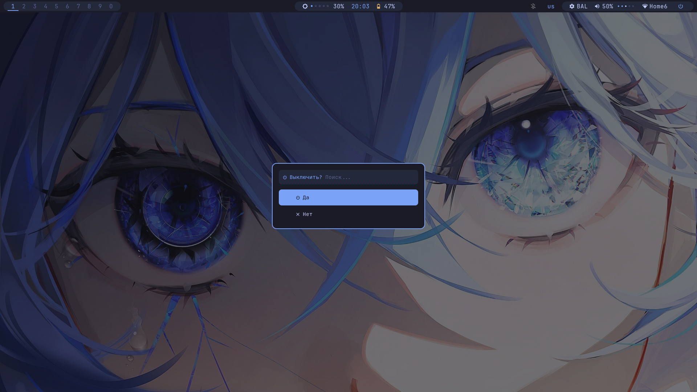
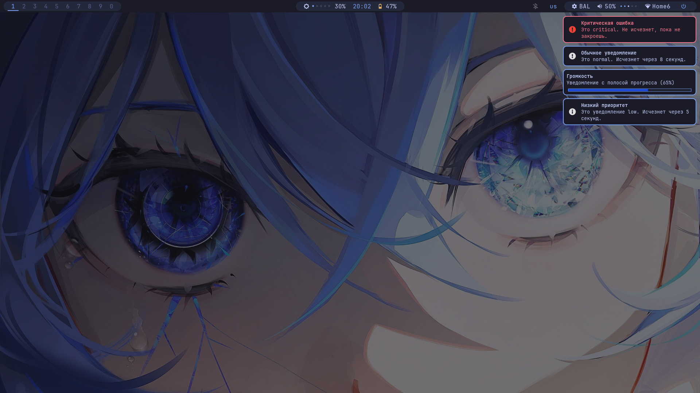
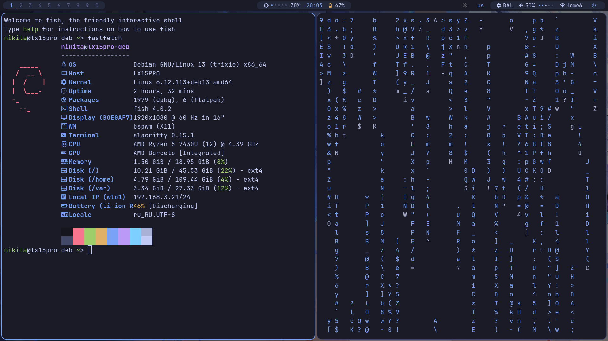

# BSPWM-machineslego


Конфигурация рабочего окружения на базе BSPWM для Debian 13 Trixie с оформлением в палитре Tokyo Night.




<details>
<summary><b>Показать остальные скриншоты</b></summary>
<br>







</details>

## Todo
- **Поменять дизайн вывода индикации капс лока**
- ...

## Особенности

- **Native Modules First:** Для батареи, сети и звука используются стоковые модули `internal/battery`, `internal/network`, `internal/pulseaudio`.
- **Отказ от прозрачности:** Убраны все эффекты прозрачности и размытия (в Alacritty, Polybar и Picom). Это снижает нагрузку на видеокарту и делает интерфейс строже.
- **Затемненные обои:** Оригинальные обои затемняются через ImageMagick и подкрашиваются в цвет фона панели (`#1a1b26`), чтобы глаза не уставали, а интерфейс выглядел монолитно.
- **Статичная шпаргалка:** Меню `Super + /` — это красивый статичный список с иконками и скрытыми тегами для мгновенного поиска (работает через Rofi).
- **Универсальное железо:** Переменные окружения в `launch.sh` (автоопределение `BAT0`/`BAT1`, `AC`/`ADP1`) позволяют конфигурации работать на разных ноутбуках без правок.
- **Управление без лишних апплетов:** Отказались от `nm-applet` и `pasystray`. Wi-Fi — через `nmcli`, звук — через `pavucontrol`. Исключение — `blueman` для Bluetooth (в трее), так как полноценной замены без потери функциональности нет.
- **Фикс сетевых интерфейсов:** Установщик копирует исправленный `/etc/network/interfaces` и настройки NetworkManager. Это решает проблемы с определением сети (особенно Wi-Fi), которые часто возникают при чистой установке.

## 📦 Структура репозитория

```text
BSPWM-machineslego/
├── config/                 # Симлинки в ~/.config/*
│   ├── alacritty, bspwm, dunst, fastfetch, picom, rofi
│   ├── gtk-3.0, gtk-4.0    # Настройки тем GTK
│   ├── polybar/
│   │   ├── config.ini      # Стоковые модули + кастомная яркость
│   │   └── scripts/
│   │       ├── battery.sh          # Фолбэк-скрипт батареи
│   │       ├── brightness.sh       # Скрипт яркости (с точечным индикатором)
│   │       ├── power-profile-ppd.sh # Профиль питания для PPD
│   │       └── power-profile-tlp.sh # Профиль питания для TLP
│   └── sxhkd/
│       ├── sxhkdrc         # Горячие клавиши
│       └── scripts/        # autocheatsheet, powermenu, sensors, volume
├── home/                   # Симлинки в ~/*
├── system/                 # Копируется в /etc (тачпад, NetworkManager, фикс сети)
├── scripts/                # install.sh, link.sh, unlink.sh
├── screenshots/
└── wallpapers/
```

## 📋 Требования

- **ОС:** Debian 13 Trixie (или совместимый дистрибутив на базе Debian).
- **Графическая подсистема:** **X11 (Xorg)**. BSPWM не работает под Wayland — установка через `startx`.
- **Базовые утилиты:** `git`, `sudo`, `curl`/`wget`, доступ в интернет (для загрузки пакетов и шрифтов).
- **Nerd Font обязателен** для корректного отображения иконок в Polybar и Rofi. Устанавливается автоматически с официального релиза Nerd Fonts; при ручной установке проверьте наличие через `fc-list | grep -i "nerd"`.
- **Права sudo** понадобятся для установки пакетов `apt` и копирования файлов в `/etc`.

Всё остальное (BSPWM, Polybar, Rofi, Dunst, Alacritty, Picom, ImageMagick, xclip и т.д.) установщик ставит сам.

## 🛠 Установка

### Шаг 1. Клонирование и запуск

```bash
git clone https://github.com/machineslego-wq/BSPWM-machineslego ~/BSPWM-machineslego
cd ~/BSPWM-machineslego
chmod +x scripts/*.sh
./scripts/install.sh
```

Установщик:
- ставит пакеты из `apt`;
- скачивает **Nerd Font с официального релиза Nerd Fonts** и кладёт его в `~/.local/share/fonts`;
- настраивает `sudoers` для управления профилем питания;
- создаёт симлинки `~/.config/*` и `~/*`.

**Что именно копируется в `/etc`:** конфиг тачпада (`/etc/X11/xorg.conf.d/`), настройки NetworkManager и фикс для `/etc/network/interfaces` (решает проблемы с сетью). Если менять системные файлы не нужно — используйте `./scripts/link.sh` (он создаёт только симлинки, без правок в `/etc`).

**Откат изменений:** `./scripts/unlink.sh` удаляет созданные симлинки. Системные файлы в `/etc`, установленные пакеты и шрифты автоматически **не** удаляются — это делается вручную, чтобы не задеть чужие настройки.

### Шаг 2. Запуск

```bash
startx
```
Или можете поставить LightDM и входить через него.

## 🖼️ Обои и тема

Чтобы обои не выделялись, они **затемняются и подкрашиваются** в базовый цвет темы (`#1a1b26`) через ImageMagick:

```bash
convert /path/to/original_wallpaper.jpg -fill "#1a1b26" -colorize 50% -modulate 80,80,100 /path/to/tokyo-night-wallpaper.jpg
```

## ⌨️ Горячие клавиши и шпаргалка

**Полная шпаргалка:** нажмите **`Super + /`**. Откроется меню Rofi со всеми комбинациями, иконками и цветными заголовками. Поиск работает по скрытым тегам (начните печатать «окно», «скрин» или «звук»).

### Основные бинды

| Комбинация | Действие |
|---|---|
| `Super + Enter` | Терминал (Alacritty) |
| `Super + /` | Шпаргалка (Rofi) |
| `Super + W` | Закрыть окно |
| `Super + 1…9` | Переключение рабочих столов |
| `Super + Shift + 1…9` | Переместить окно на рабочий стол |
| `Super + D` | Запуск Rofi (drun) |
| `Print` | Скриншот всего экрана |
| `Shift + Print` | Скриншот окна |
| `Super + Shift + S` | Скриншот области |

> Точный список — в `config/sxhkd/sxhkdrc` и в шпаргалке `Super + /`.

### Управление системами (без апплетов)

**1. Wi-Fi и звук**
- Сети: `nmtui` в терминале.
- Звук: `pavucontrol` (микшер) или горячие клавиши `XF86Audio...`.
- *Индикация:* стоковые модули Polybar `[module/wlan]`, `[module/eth]`, `[module/pulseaudio]`.

**2. Питание**
- **Ноутбук (TLP):** клик по модулю в Polybar открывает меню Rofi.
- **Ноутбук (GNOME/PPD):** используется `power-profiles-daemon`.
- **ПК:** управление через Polybar не настраивается.

**3. Скриншоты**
Снимки (`Print`, `Shift+Print`, `Super+Shift+S`) сохраняются в системную папку изображений (автоопределение через `xdg-user-dir PICTURES`, например `~/Изображения/Screenshots/`) и **сразу копируются в буфер обмена** (через `xclip`).

## 🔧 Устранение неполадок

- **Квадратики вместо иконок в Polybar/Rofi** → не установлен Nerd Font. Проверьте: `fc-list | grep -i "nerd"`. Если пусто — переустановите шрифт: `./scripts/install.sh`.
- **`startx` не запускается / чёрный экран** → убедитесь, что в `~/.xinitrc` есть строка `exec bspwm`, и что `xorg` установлен (`sudo apt install xorg`).
- **Не работают горячие клавиши** → проверьте, что `sxhkd` запущен (`pgrep sxhkd`); перезапустите через `launch.sh` из конфига BSPWM.
- **Не работает звук или яркость** → проверьте наличие `pavucontrol` и `brightnessctl`; для яркости нужен доступ к `/sys/class/backlight/*`.
- **Polybar не стартует** → проверьте, что `~/.config/polybar` — симлинк на репозиторий, а `~/.config/polybar/launch.sh` исполняемый (`chmod +x`).
- **Конфликт профилей питания (TLP vs PPD)** → одновременно должен быть активен только один. Проверьте `systemctl status tlp` и `systemctl status power-profiles-daemon`.
- **Пропал Wi-Fi/Интернет** → проверьте, что `install.sh` успешно скопировал фикс в `/etc/network/interfaces`, и перезапустите NetworkManager: `sudo systemctl restart NetworkManager`.

## 📄 Лицензия

- Конфигурации и скрипты в этом репозитории распространяются по лицензии **MIT**.
- Шрифты (JetBrains Mono Nerd Font) распространяются по своим лицензиям — **SIL Open Font License 1.1**.
