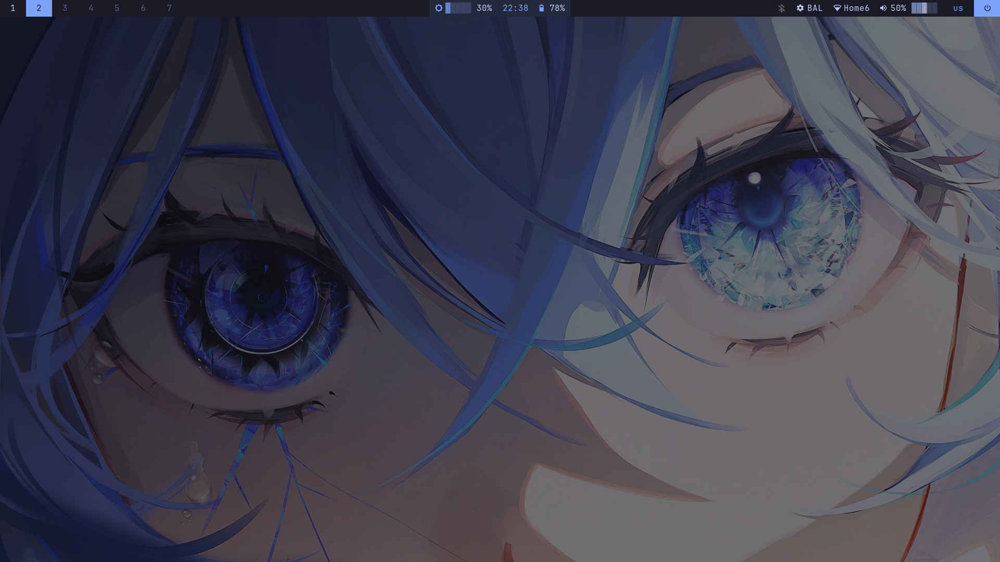
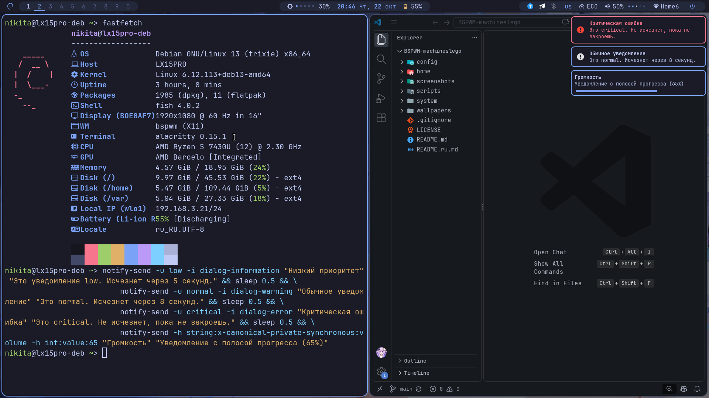
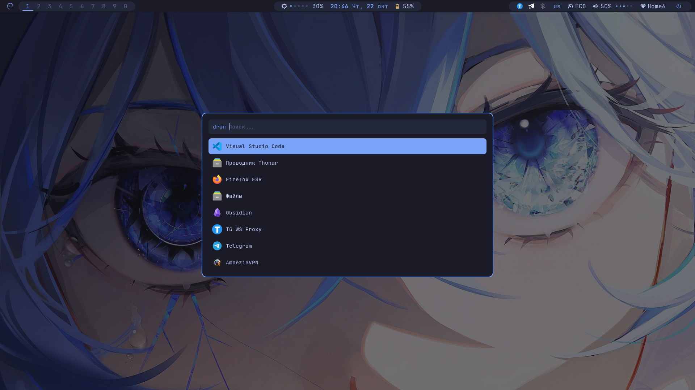
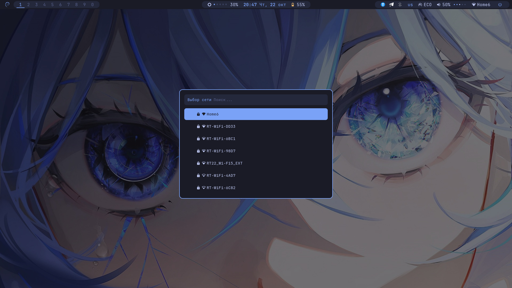
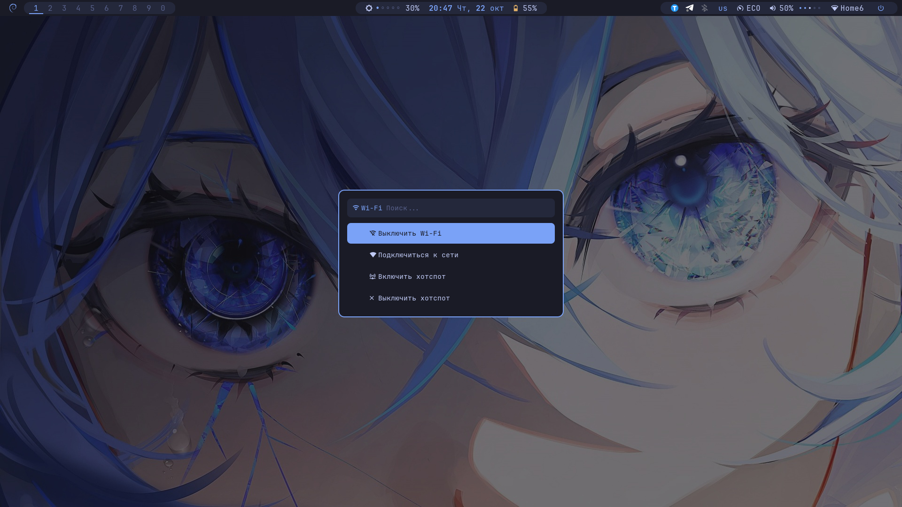
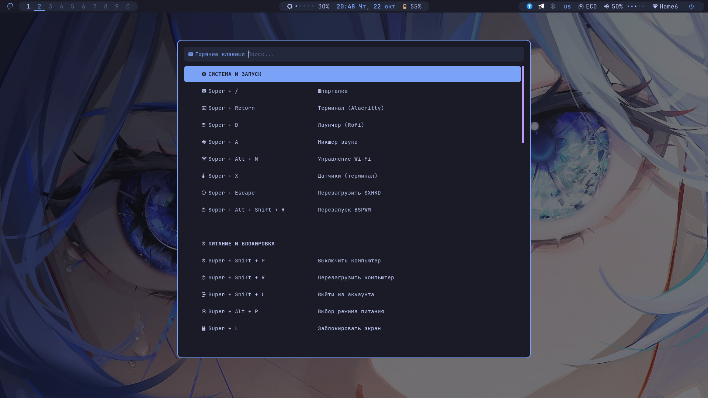
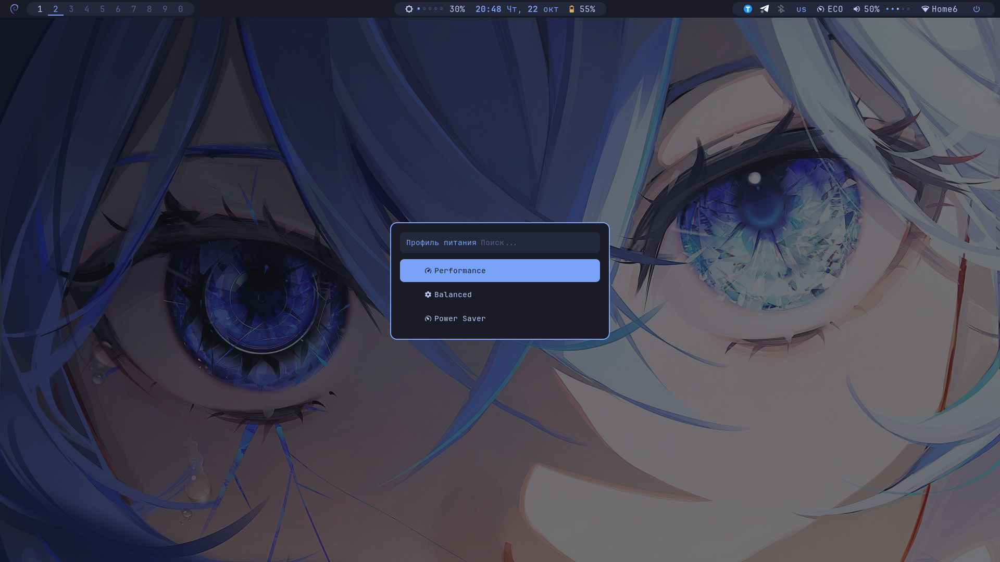
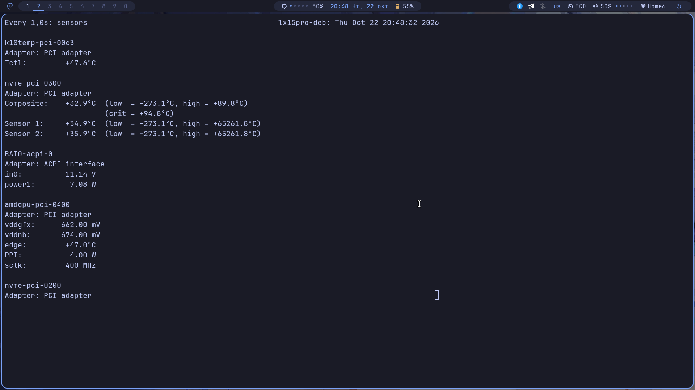

# BSPWM-machineslego

**English** | [Русский](./README.ru.md)


A strict, flat desktop environment based on BSPWM for Debian 13 Trixie, styled in the Tokyo Night palette.

> **Status:** the setup lives on BSPWM/X11 and stays here for good — Debian stability matters more, and the Wayland compositors worth switching to ship as rolling releases. Current tasks and rejected ideas are in [TODO.md](./TODO.md).

---

## 🧭 Rule of the repository

> **If a stock module solves it, don't write a script.**
> **If a script is needed, run it on-demand and exit immediately.**
> **No background loops. No dead code.**

Every line of code and every running process must justify its existence. This rule is the reason why some features are intentionally **not** implemented — and why others were removed after being tried (see [TODO.md](./TODO.md) for the list of rejected ideas).

---



<details>
<summary><b>Show more screenshots</b></summary>
<br>










</details>

## ✨ Features

- **Native Modules First:** Polybar uses stock `internal/bspwm`, `internal/battery`, `internal/backlight`, `internal/network`, `internal/pulseaudio`, `internal/xkeyboard`, and `internal/date`. Zero background bash loops.
- **On-Demand Commands:** `wifi`, `powermenu`, `battery`, `screenshot`, `volume`, `cheatsheet`, `rice-check`, and `rice-help` live in `~/.local/bin` (PATH); window flags — in `config/sxhkd/scripts`. They run on a hotkey and exit immediately.
- **Machine Utilities:** `start-llm` (Ollama + OpenWebUI), `start-comfy` (ComfyUI), `vllm-setup`, `yacht`, `mount-nas` (NFS), `openrgb-i2c-fix`, `sddm-avatar`, `check-hardware`, `check-strawberry`. Docker/ROCm commands are machine-specific; they check for the daemon and print usage when an argument is missing.
- **Hardware Autodetection:** `polybar/launch.sh` finds the battery (`POLYBAR_BAT`), AC adapter (`POLYBAR_AC`), and backlight device (`POLYBAR_BACKLIGHT`) in `/sys/class/…` — no hardcoded names.
- **Wallpapers — `feh` only:** no picker script, no state file, no previews. Two static `feh` calls in `bspwmrc`: landscape on the main monitor, portrait on the rotated one. Change a wallpaper = edit one line.
- **Screen locking:** `xss-lock` + `i3lock-fancy` — after 10 minutes idle, with DPMS monitor blanking and proper locking before sleep (`--transfer-sleep-lock`).
- **Modern Shell:** Fish + Tide prompt (Fisher). Autosuggestions, syntax highlighting, git status without background daemons. `eza` for file listings, `fastfetch` with separate X11 and TTY configs.
- **Smooth & Flat:** Picom with window animations, rounded corners, and shadows; no blur and no dimming of inactive windows. Strict Tokyo Night colors.
- **Power Profiles:** Performance / Balanced / Power Saver via PPD. In `power-saver` Picom automatically switches to `picom-eco.conf` — no animations, no shadows.
- **One Consistent Style:** Polybar, Rofi, Dunst, Picom, Alacritty, Fish, GTK3/GTK4, Qt5/Qt6, GIMP 3, CopyQ, Midnight Commander, and Telegram are all themed in Tokyo Night.
- **Workflow:** clipboard history (CopyQ with custom commands), notification history (Rofi), screenshots straight into the CopyQ clipboard, a keybinding cheatsheet in Rofi, and a Neovim setup styled after base VS Code with its own cheatsheet.
- **Stock Vim as a fallback:** plain `vim` from `apt.txt` with no plugins — syntax highlighting for nearly everything, hybrid numbering (absolute number on the cursor line, relative around it), and persistent undo. Config: `~/.vimrc` (`home/vimrc`).
- **Stability:** autostart in `bspwmrc` is guarded against duplicates via `pgrep`/`pkill`, so `Super + Alt + R` and a full session restart never spawn extra processes.
- **Multi-machine:** hostname branches in `bspwmrc` and `wifi` (a dual-monitor desktop and laptops); easy to trim down to a single machine.

## 📦 Structure

```text
BSPWM-machineslego/
├── config/                      # symlinks to ~/.config/*
│   ├── alacritty/               # terminal: Tokyo Night palette, font size 10
│   ├── bash/themes/             # prompt presets: tokyo-night, tokyo-night-minimal
│   ├── bspwm/bspwmrc            # autostart, monitors, wallpapers, window borders
│   ├── copyq/                   # Tokyo Night theme + command menu
│   ├── dunst/dunstrc            # notifications: stack 7, history 20
│   ├── easyeffects/output/      # equalizer/effects presets
│   ├── fastfetch/               # graphical.jsonc and tty.jsonc
│   ├── fish/                    # config.fish, fish_plugins, rustup
│   ├── GIMP/3.0/themes/         # TokyoNight theme for GIMP 3
│   ├── gtk-3.0/ gtk-4.0/        # gtk.css: Tokyo Night palette over Adwaita-dark
│   ├── nvim/                    # Lua config, vim.pack, CHEATSHEET.md
│   ├── picom/                   # picom.conf + picom-eco.conf
│   ├── polybar/                 # config.ini, launch.sh
│   ├── qt5ct/ qt6ct/            # tokyo-night.conf palettes
│   ├── rofi/config.rasi         # launcher/windows/commands
│   └── sxhkd/                   # sxhkdrc + hotkey helpers (scripts/)
├── home/                        # symlinks to ~/*: .bashrc, .vimrc, .xinitrc, .xprofile, .Xresources
├── local/bin/                   # commands in ~/.local/bin: wifi, screenshot, volume, ...
├── local/share/mc/skins/        # Midnight Commander skin
├── system/etc/                  # copied to /etc: touchpad, NetworkManager, interfaces
├── scripts/                     # install.sh, link.sh, unlink.sh, software.sh, install-node.sh
├── requirements/                # package lists: apt.txt, apt-system.txt, software.txt
├── screenshots/                 # README previews
├── themes/telegram/             # .tdesktop-palette (manual install)
├── wallpapers/                  # 1080p/4K and portrait wallpapers
├── RELEASE.md                   # release notes for the current tag (EN + RU)
├── TODO.md                      # plans, rejected ideas, limitations
└── LICENSE                      # MIT
```

## 📋 Requirements

- **OS:** Debian 13 Trixie, **X11** (this setup is not designed for Wayland).
- **Utilities:** `git`, `sudo`, internet access for the first install.
- **Audio:** PipeWire (`pipewire`, `pipewire-audio`, `pipewire-pulse`, `wireplumber`). Polybar's `internal/pulseaudio` works through `pipewire-pulse`; the volume script uses `wpctl` with a `pactl` fallback.
- **Fonts:** JetBrainsMono Nerd Font (installed by `install.sh`), Papirus-Dark and Bibata (from `apt.txt`).
- **Flatpak:** optional. Installed by `install.sh` together with Flathub; `link.sh` grants Flatpak apps access to the themes.
- **Neovim:** `ripgrep` for Telescope (`find_files`, `live_grep`) — it is in `requirements/software.txt`.
- **Vim:** the stock `vim` from `apt.txt` — a plugin-free fallback editor for configs; its config is `home/vimrc` → `~/.vimrc`.

## 🛠 Installation

```bash
git clone https://github.com/machineslego-wq/BSPWM-machineslego ~/BSPWM-machineslego
cd ~/BSPWM-machineslego
chmod +x scripts/*.sh
./scripts/install.sh
```

- **Configs only (no `/etc` changes):** `./scripts/link.sh`
- **Extra software:** `./scripts/software.sh`
- **Node.js / npm:** `./scripts/install-node.sh` (separate, see below)
- **Rollback:** `./scripts/unlink.sh`
- **Launch:** `startx` (or via LightDM).

`install.sh` is idempotent: re-running it does not break what is already installed. `link.sh` can be run at any time — it backs up existing files to `~/.dotfiles-backup-YYYYMMDD-HHMMSS` and re-creates the symlinks.

### What `install.sh` does

1. **User level (no sudo):** Neovim AppImage to `~/.local/bin/nvim`, `tree-sitter` CLI ≥ 0.26.1 to `~/.local/bin`, JetBrainsMono Nerd Font to `~/.local/share/fonts`, config linking via `link.sh`, Fisher + Tide.
2. **Packages (sudo):** everything from `requirements/apt.txt`; if **TLP** is present it is removed to avoid a conflict with `power-profiles-daemon`. PPD and Flatpak are installed, Flathub is added.
3. **System configs:** `system/**` is copied to `/etc/**` with a backup in `/etc/dotfiles-backup-YYYYMMDD-HHMMSS`.
4. **Laptop lid:** if a battery exists, `/etc/systemd/logind.conf.d/10-lid-suspend.conf` is written (`HandleLidSwitch=suspend`); on a desktop this step is skipped.

### What `link.sh` does

- `config/<pkg>` → `~/.config/<pkg>`
- `home/<file>` → `~/.<file>`
- `local/bin/<command>` → `~/.local/bin/<command>` — one link per file, foreign files in `~/.local/bin` (nvim, tree-sitter) stay untouched
- `local/share/mc/skins/*.ini` → `~/.local/share/mc/skins/`
- sets `+x` on `local/bin` commands, SXHKD scripts, and `bspwmrc`
- with Flatpak installed, adds overrides: read-only access to `xdg-config/gtk-3.0`, `gtk-4.0`, `qt5ct`, `qt6ct`, `xdg-data/themes`, and `QT_QPA_PLATFORMTHEME=qt5ct`

## ⚙️ Post-Install

**Fish & Tide.**
The Tide prompt is installed automatically. After installation, open a terminal and run:

```bash
tide configure
```

The wizard sets style, colors, and icons. `config.fish` already defines Tokyo Night colors and `eza` aliases; `fastfetch` has a separate TTY config.

**Bash prompt.**
`~/.bashrc` sources a preset from `~/.config/bash/themes/<name>.bash`; the name comes from `BASH_PROMPT`, default `tokyo-night` (Debian → directory → git → arrow). Two more presets: `tokyo-night-minimal` (a single line with no `git` calls) and `empty` — an empty template with commented examples for writing your own.

To switch for good, edit the `BASH_PROMPT=` line in `~/.bashrc`; to try it for one shell, run `BASH_PROMPT=tokyo-night-minimal bash`. If the file is missing, the stock `\u@\h:\w\$` stays.

**Wi-Fi.**
The `wifi` command (`~/.local/bin`) is tailored to specific machines: the interface is chosen by `hostname` (`travelmate` → `wlp3s0`, `lx15pro`/`lx15pro-deb` → `wlo1`, `lamer-deb` → `wlp7s0`, otherwise `wlan0`). Add your interface to that block and set `HOTSPOT_SSID` / `HOTSPOT_PASSWORD` at the top of the file.

**Wallpapers.**
There is no picker. Edit the `feh` calls in `~/.config/bspwm/bspwmrc`:

- `lamer-deb` (desktop): `xrandr` sets up `DisplayPort-1` (primary, 144 Hz) and `HDMI-A-3` (left, rotated), `bspc` assigns workspaces I–IX and X, and `feh` applies landscape and portrait wallpapers.
- any other host: all 10 workspaces on one screen and a single landscape wallpaper.

Paths are hardcoded as `$HOME/BSPWM-machineslego/wallpapers/` — if you clone the repo elsewhere, update them. Window borders: `#24283b` (normal), `#6b8dd6` (focused), `#bb9af7` (preselect).

**Midnight Commander skin.**
Installed to `~/.local/share/mc/skins/tokyo-night.ini`. Switch with `mc` → `F9` → `Setup` → `Colors` → `tokyo-night`.

**Laptop lid behavior.**
By default, closing the lid suspends the system (the screen is locked via `xss-lock`). To **lock without suspend**:

```bash
sudo rm /etc/systemd/logind.conf.d/10-lid-suspend.conf
sudo tee /etc/systemd/logind.conf.d/10-lid-lock.conf > /dev/null <<'EOF'
[Login]
HandleLidSwitch=lock
HandleLidSwitchExternalPower=lock
EOF
sudo systemctl kill -s HUP systemd-logind
```

**Power Profiles.**
`Super + Alt + P` or a click on the Polybar module. The menu offers Performance / Balanced / Power Saver, switches via `powerprofilesctl`, and immediately restarts Picom with the matching profile. Limitation: on Celeron N4120 the `performance` profile is unavailable — only `balanced` and `power-saver`.

**Neovim.**
The config is written in Lua, plugins are managed by the built-in `vim.pack` (Neovim 0.12). The list lives in `lua/plugins.lua`, versions are pinned by `nvim-pack-lock.json`. The first launch needs network: `vim.pack` downloads plugins and Mason installs LSP servers into `~/.local/share/nvim/mason/bin`. Update plugins with `:lua vim.pack.update()` and `:restart`; Treesitter parsers with `:TSUpdate`. Full cheatsheet: `config/nvim/CHEATSHEET.md`.

**Vim.**
A plugin-free fallback editor: `home/vimrc` → `~/.vimrc`. Syntax highlighting and `filetype plugin indent on` are enabled, numbering is hybrid (absolute number on the cursor line, relative distances around it), persistent undo lives in `~/.vim/undo`, indentation is 4 spaces by default (2 for json/yaml/html/css/js), and extension-less configs get a filetype (`sxhkdrc`, `bspwmrc`, `xinitrc`, `dunstrc`, `picom*.conf`, `qt5ct.conf`, `*.tdesktop-palette`). Colors come from the terminal palette (Tokyo Night in Alacritty); no colorscheme is overridden. Apply changes with `:source ~/.vimrc`.

**Node.js and npm.**
`./scripts/install-node.sh` adds the NodeSource repository and installs LTS. Variables: `NODE_CHANNEL=lts|current|<major>` (default `lts`), `UPDATE_NPM=1` also installs `npm@latest`. Global packages go to `~/.npm-global` (`prefix` in `~/.npmrc`), and PATH is added by both Fish and bash. If NVM is installed, it is sourced at the end of `~/.bashrc` and may shadow the NodeSource `node`/`npm`.

**Themes.**
- **GTK3/GTK4:** `config/gtk-3.0/gtk.css` is a full stylesheet over `Adwaita-dark`: `@define-color` plus direct selectors (Adwaita hardcodes its colors, so they have to be overridden by hand). `config/gtk-4.0/gtk.css` contains only libadwaita variables (`:root` with `--*-color`) and a compatibility `@define-color` layer. `gtk-theme-name` is unchanged, only colors are repainted. Apply by restarting the app; Flatpak apps pick up the CSS after re-running `link.sh`.
- **Qt5/Qt6:** palettes in `config/qt5ct/colors/tokyo-night.conf` and `config/qt6ct/colors/tokyo-night.conf` (21 `QPalette` roles, `#AARRGGBB` format), `style=Fusion`, Papirus-Dark icons. `QT_QPA_PLATFORMTHEME=qt6ct` from `xinitrc` also applies to Qt5 apps. Apply with `qt5ct`/`qt6ct` or by restarting the app.
- **GIMP 3:** `config/GIMP/3.0/themes/TokyoNight/` is picked up as a user theme — enable it in GIMP: Preferences → Interface → Theme.
- **CopyQ:** `tokyo-night.ini` theme plus a command menu (pin, tags). History and window geometry never reach git.
- **EasyEffects:** presets in `config/easyeffects/output/*.json`. The service starts from `bspwmrc` if the binary exists; some effects may need `calf-plugins` from `requirements/software.txt`.
- **Telegram:** `themes/telegram/tokyo-night.tdesktop-palette` (Tokyo Night with an orange accent). No automated install, to avoid breaking Flatpak paths:
  1. copy the file to `~/.var/app/org.telegram.desktop/data/TelegramDesktop/tdata/theme/` (Flatpak) or `~/.local/share/TelegramDesktop/tdata/theme/` (native);
  2. restart Telegram;
  3. **Chat background** → **Edit theme** → `tokyo-night`.
- **Midnight Commander:** see the skin above.

**System configs (`system/etc/`).**
- `X11/xorg.conf.d/30-touchpad.conf` — libinput: tap-to-click, natural scrolling, clickfinger, two-finger scroll, disable-while-typing.
- `NetworkManager/NetworkManager.conf` — `plugins=ifupdown,keyfile` and `managed=true` so NM does not ignore interfaces from `/etc/network/interfaces`.
- `network/interfaces` — standard `lo` + `source /etc/network/interfaces.d/*`.

**Dimming wallpapers to match the palette** (optional, ImageMagick):

```bash
convert /path/to/original.jpg -fill "#1a1b26" -colorize 50% -modulate 80,80,100 /path/to/tokyo-night-wallpaper.jpg
```

## ⌨️ Keybindings

**Full cheatsheet:** `Super + /` (Rofi, searchable through hidden tags). Neovim cheatsheet: `config/nvim/CHEATSHEET.md`; Vim cheatsheet: the comments in `~/.vimrc`.

### System & launch

| Keybinding | Action |
|---|---|
| `Super + Return` | Terminal (Alacritty) |
| `Super + D` | Launcher (Rofi drun) |
| `Super + /` | Cheatsheet |
| `Alt + Tab` | Window switcher (Rofi) |
| `Super + E` / `B` / `V` | Thunar / Firefox / VS Code |
| `Super + A` | Audio mixer (pavucontrol-qt) |
| `Super + X` | Sensors (`watch sensors`) |
| `Super + Alt + N` | Wi-Fi Manager |
| `Super + Alt + T` | Telegram (Flatpak) + WS proxy |
| `Super + Alt + B` | Battery Details (Rofi) |
| `Super + Alt + P` | Power Profile Selector |
| `Super + Alt + H` | Notification History |
| `Super + Ctrl + V` | Clipboard History (CopyQ) |
| `Super + Shift + Q` | Power Menu (Rofi) |
| `Super + Alt + L` | Lock screen |
| `Super + Escape` | Reload SXHKD config |
| `Super + Alt + Shift + R` | Full session restart (SXHKD, BSPWM, Polybar, Dunst, Picom, applets) |

### Screenshots & media

| Keybinding | Action |
|---|---|
| `Super + F1` | Whole screen |
| `Super + F2` | Active window |
| `Super + F3` | 3-second delay |
| `Super + F4` | Active monitor |
| `Super + Shift + S` | Selected area |
| `Fn + brightness` | `brightnessctl` ±5% |
| `Fn + volume` | Volume OSD ±2% |

Screenshots are saved to `~/Screenshots` and copied to the CopyQ clipboard (fallback: `xclip`).

### Windows & workspaces

| Keybinding | Action |
|---|---|
| `Super + arrows` | Focus a window |
| `Super + Shift + arrows` | Swap with a neighbor |
| `Super + H/J/K/L` | Move floating window (vim-style) |
| `Super + C` / `Super + Shift + C` | Next / previous window |
| `Super + backtick` / `Super + Tab` | Previous window / previous workspace |
| `Super + O` / `I` | Focus history back / forward |
| `Super + P/B/,/.` | Parent / brother / first / second window |
| `Super + [` / `]` | Previous / next workspace |
| `Super + 1…0` | Switch workspaces |
| `Super + Shift + 1…0` | Move window to workspace |
| `Super + W` / `Super + Shift + W` | Close window / kill process |
| `Super + T` / `Super + Shift + T` | Tiled / pseudo-tiled |
| `Super + S` / `Super + F` | Floating / fullscreen |
| `Super + M` | Monocle |
| `Super + G` | Swap with the biggest window |
| `Super + Alt + Q` / `R` | Quit BSPWM / restart BSPWM |

### Preselect, flags & resizing

| Keybinding | Action |
|---|---|
| `Super + Ctrl + arrows` | Preselect direction |
| `Super + Ctrl + 1…9` | Preselect ratio |
| `Super + Ctrl + Space` | Cancel preselect for the window |
| `Super + Ctrl + Shift + Space` | Cancel preselect for the workspace |
| `Super + Y` | Send the marked window into preselect |
| `Super + Ctrl + M/X/Y/Z` | Flags: marked / locked / sticky / private |
| `Super + Alt + arrows` | Grow the window |
| `Super + Alt + Shift + arrows` | Shrink the window |

## 🔄 Updating & applying changes

Configs live as symlinks: editing a file in the repo changes the live system immediately. After `git pull`, just run `./scripts/link.sh` (new symlinks are created, replaced files go to a backup).

| What changed | How to apply |
|---|---|
| BSPWM | `bspc wm -r` or `Super + Alt + R` |
| SXHKD | `pkill -USR1 -x sxhkd` or `Super + Escape` |
| Polybar | `~/.config/polybar/launch.sh` |
| Picom | `pkill -x picom`, then `picom --config <profile>` |
| Dunst | `pkill -x dunst && dunst &` |
| Vim | `:source ~/.vimrc` |
| Alacritty | automatically (`live_config_reload = true`) |
| GTK3/GTK4, Qt | restart the app |
| Everything | `Super + Alt + Shift + R` |

## 🐛 Known Issues (Picom & UI)

- **Dunst Stack Animation:** only the first notification animates. Second and subsequent notifications in the stack appear instantly due to a known **Picom 12.5** conflict with Dunst's positioning.
- **Context Menu Shadows:** Telegram (Flatpak) and Firefox context menus have poorly rendered shadows. This is why they are explicitly excluded in `picom.conf` (`shadow = false`).
- **AMD Sleep:** on Ryzen 7000-series, suspend may fail. Add `mem_sleep_default=s2idle` to GRUB if the laptop shuts down instead of sleeping.
- **Dunst on multiple monitors:** notifications appear only on monitor `0` (`monitor = 0` in `dunstrc`).
- **`window-height` in Picom:** the unary minus is not parsed — rules must use `"0 - window-height"` written by hand.

## 🗺 Plans

- `1.7.0` is out. Notes for the current release live in [RELEASE.md](./RELEASE.md), history — in [Releases](https://github.com/machineslego-wq/BSPWM-machineslego/releases). The next stop is `1.8.0`.
- The BSPWM/X11 branch is the main and long-term one; a Wayland migration is not planned: Debian is stable, while Wayland compositors with the needed features ship as rolling releases. This is a deliberate choice in favour of predictability; details are in the "Rejected" section of [TODO.md](./TODO.md).
- Current tasks, "Done", rejected ideas, and known limitations live in [TODO.md](./TODO.md).

## 📄 License

MIT
