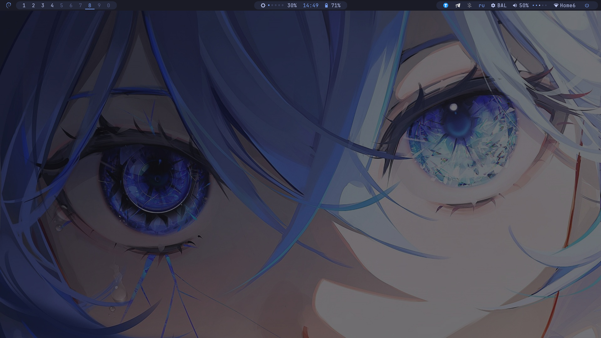
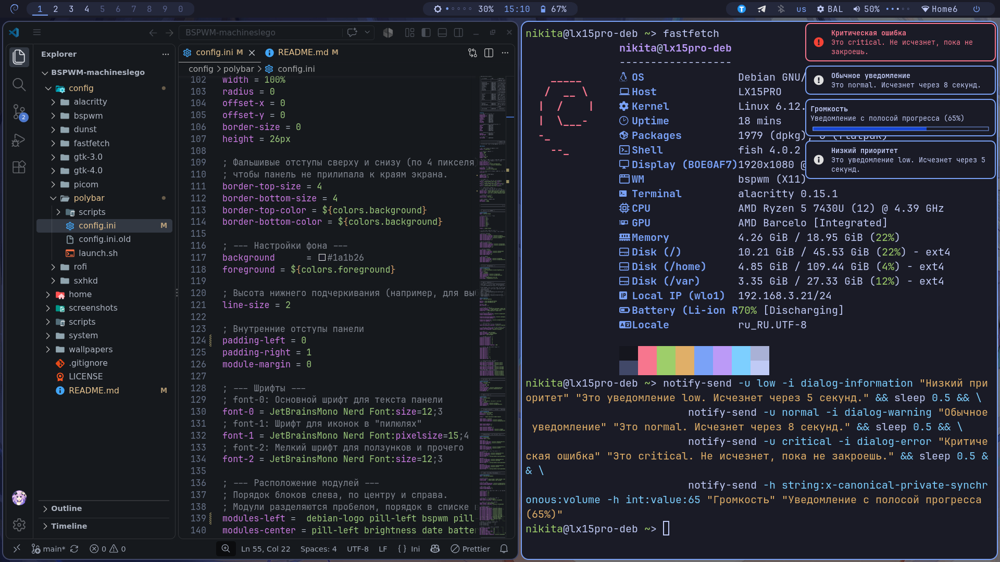
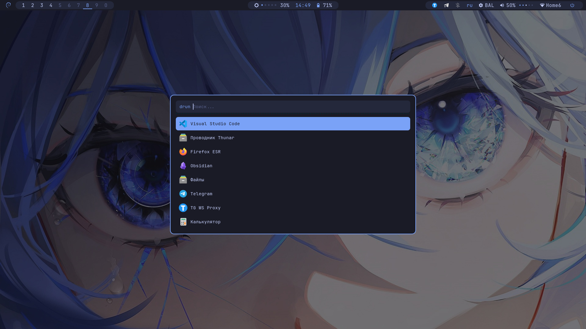
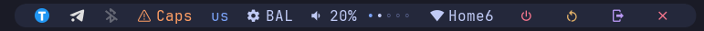

# BSPWM-machineslego

[English](./README.md) | **Русский**


Конфигурация рабочего окружения на базе BSPWM для Debian 13 Trixie в палитре Tokyo Night.





<details>
<summary><b>Показать остальные скриншоты (Развернутая Polybar)</b></summary>
<br>



</details>

## Особенности

- **Native Modules First:** Стоковые модули Polybar для батареи, сети и звука.
- **Без прозрачности и блюра:** Отключено в Alacritty, Polybar и Picom.
- **Статичная шпаргалка:** Меню `Super + /` с иконками и скрытыми тегами для поиска через Rofi.
- **Универсальное железо:** Автоопределение батарей и адаптеров питания. Яркость работает из коробки на ноутбуках.
- **Управление без лишних апплетов:** Wi-Fi через `nmtui`, звук через `pavucontrol`. Исключение — `blueman`.
- **Фикс сети:** Установщик копирует исправленный `/etc/network/interfaces`, решая проблемы с Wi-Fi.
- **Продвинутая поддержка мониторов:** Настраиваемый блок в `bspwmrc` для ПК с двумя экранами: поддержка 144 Гц, поворот в портрет, распределение столов и разные обои на каждый монитор.

## 📦 Структура

```text
BSPWM-machineslego/
├── config/                 # Симлинки в ~/.config/*
│   ├── alacritty, bspwm, dunst, fastfetch, picom, rofi
│   ├── gtk-3.0, gtk-4.0    # Настройки тем GTK
│   ├── polybar/
│   │   ├── config.ini      # Стоковые модули + кастомная яркость
│   │   └── scripts/
│   │       ├── battery.sh          # Фолбэк-скрипт батареи
│   │       ├── brightness.sh       # Скрипт яркости (с точечным индикатором)
│   │       ├── power-profile-ppd.sh # Профиль питания для PPD
│   │       └── power-profile-tlp.sh # Профиль питания для TLP
│   └── sxhkd/
│       ├── sxhkdrc         # Горячие клавиши
│       └── scripts/        # autocheatsheet, powermenu, sensors, volume
├── home/                   # Симлинки в ~/*
├── system/                 # Копируется в /etc (тачпад, NetworkManager, фикс сети)
├── scripts/                # install.sh, link.sh, unlink.sh
├── screenshots/
└── wallpapers/
```

## 📋 Требования

- **ОС:** Debian 13 Trixie (или совместимый дистрибутив).
- **Базовые утилиты:** `git`, `sudo`, интернет.
- **Nerd Font** (устанавливается автоматически).
- **Права sudo** для установки пакетов и копирования файлов в `/etc`.

## 🛠 Установка

**Способ 1: Через Git (Рекомендуемый)**
```bash
git clone https://github.com/machineslego-wq/BSPWM-machineslego ~/BSPWM-machineslego
cd ~/BSPWM-machineslego
chmod +x scripts/*.sh
./scripts/install.sh
```

**Способ 2: Через ZIP-архив**
GitHub распакует архив в папку `BSPWM-machineslego-X.X.X`. 
⚠️ **Важно:** Переименуйте папку в `BSPWM-machineslego` и переместите в `~/`.
```bash
mv ~/Downloads/BSPWM-machineslego* ~/BSPWM-machineslego
cd ~/BSPWM-machineslego
chmod +x scripts/*.sh
./scripts/install.sh
```

**Если не нужно трогать `/etc`:** используйте `./scripts/link.sh`.
**Откат:** `./scripts/unlink.sh`.
**Запуск:** `startx` (или через LightDM).

### ⚙️ Кастомизация

**Настройка мониторов (ПК)**
Если вы используете ПК с несколькими мониторами, настройте их в `~/.config/bspwm/bspwmrc`. Найдите блок `--- НАСТРОЙКА МОНИТОРОВ ---`.
1. Замените `"lamer-deb"` на ваш `hostname`.
2. Настройте порты в `xrandr` (`DisplayPort-1`, `HDMI-A-3`), частоту (`--rate 144.00`) и поворот (`--rotate right`).
3. Установите разные обои для каждого монитора через `feh --output`.
4. Распределите рабочие столы (например, `I..IX` на основном, `X` на втором).
*Если имя хоста не совпадает, применится стандартная раскладка для одного монитора.*

## 🖼️ Обои и тема

Затемнение обоев под палитру Tokyo Night через ImageMagick:
```bash
convert /path/to/original.jpg -fill "#1a1b26" -colorize 50% -modulate 80,80,100 /path/to/tokyo-night-wallpaper.jpg
```

## ⌨️ Горячие клавиши

**Полная шпаргалка:** `Super + /` (Rofi, поиск по скрытым тегам).

| Комбинация | Действие |
|---|---|
| `Super + Enter` | Терминал (Alacritty) |
| `Super + /` | Шпаргалка (Rofi) |
| `Super + W` | Закрыть окно |
| `Super + 1…9` | Переключение рабочих столов |
| `Super + Shift + 1…9` | Переместить окно на рабочий стол |
| `Super + D` | Лаунчер (Rofi drun) |
| `Print` | Скриншот всего экрана |
| `Shift + Print` | Скриншот окна |
| `Super + Shift + S` | Скриншот области |

## 🔧 Устранение неполадок

- **Нет иконок в Polybar/Rofi** → Не установлен Nerd Font. Проверьте: `fc-list | grep -i "nerd"`.
- **`startx` не запускается** → Проверьте `exec bspwm` в `~/.xinitrc` и пакет `xorg`.
- **Не работают горячие клавиши** → Перезапустите `sxhkd`: `pkill -USR1 -x sxhkd`.
- **Нет модуля яркости на ПК** → Это намеренно. На ПК используйте кнопки монитора.
- **Polybar не стартует** → Проверьте симлинк `~/.config/polybar` и права на `launch.sh`.
- **Пропал Wi-Fi** → Перезапустите NetworkManager: `sudo systemctl restart NetworkManager`.

## 📄 Лицензия

- Конфигурации и скрипты — **MIT**.
- Шрифты (JetBrains Mono Nerd Font) — **SIL Open Font License 1.1**.