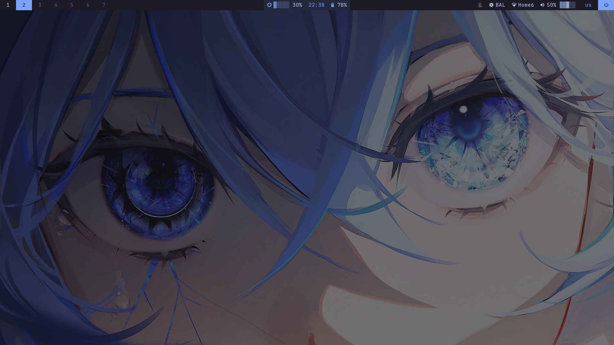
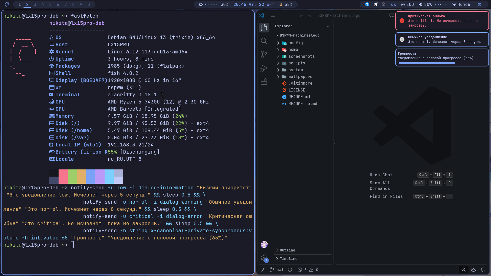
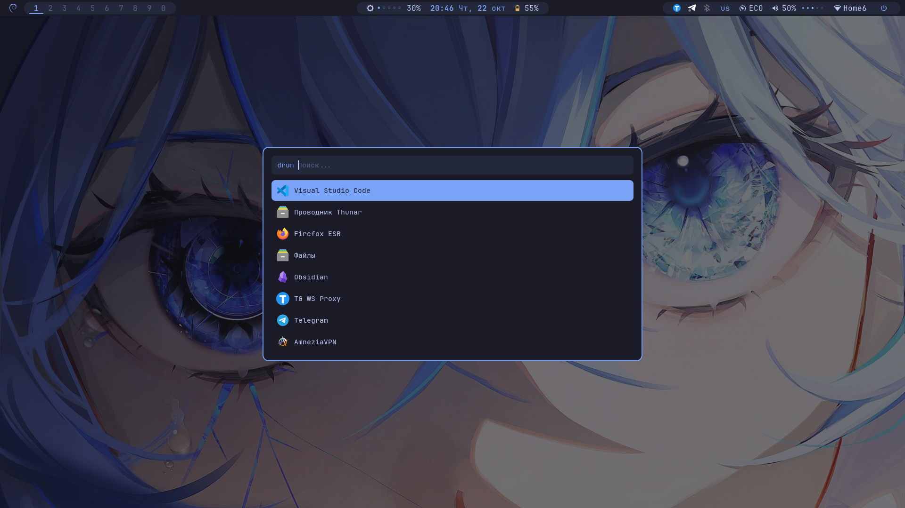
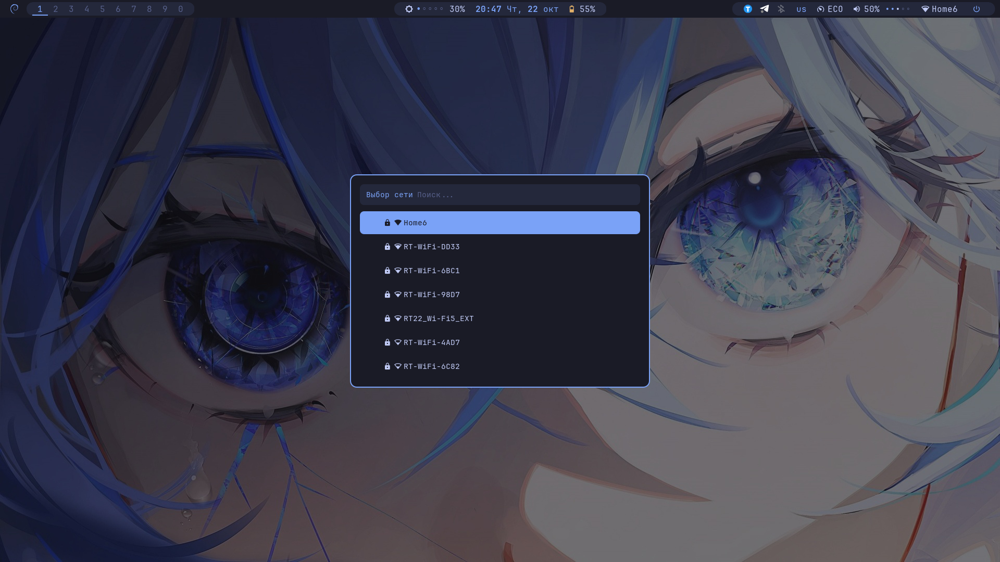
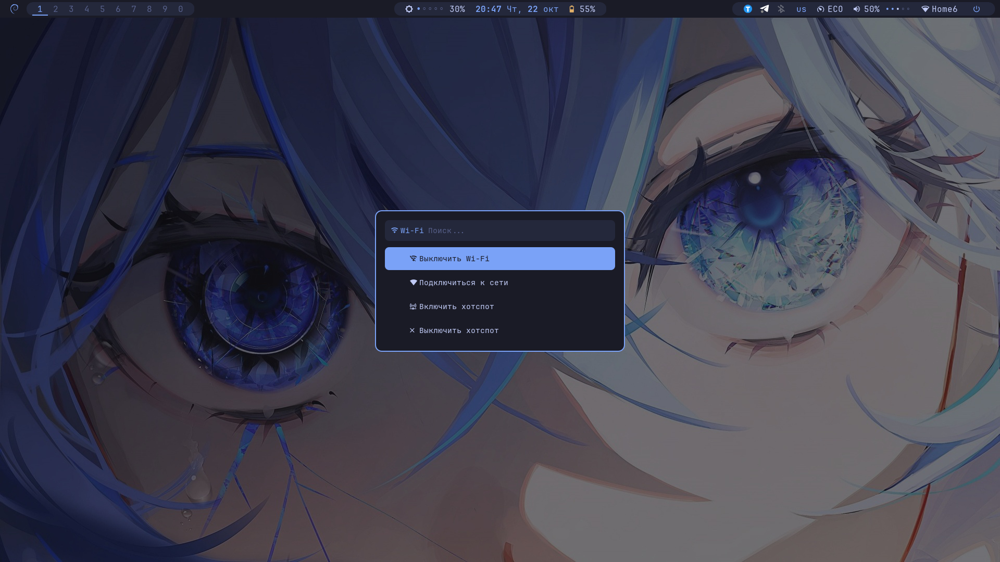
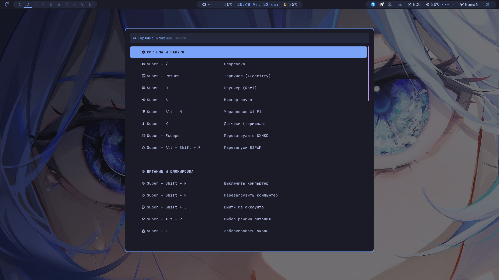
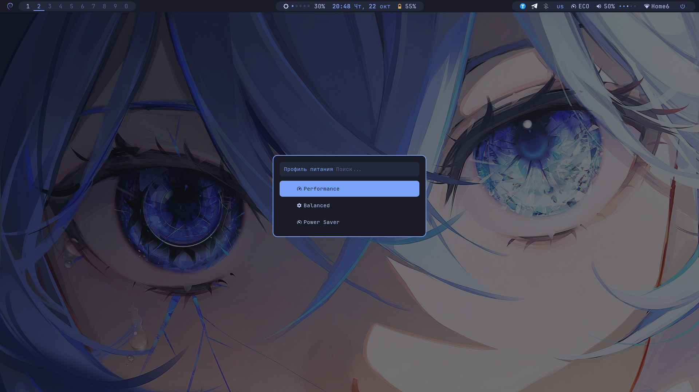
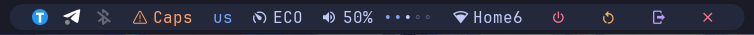
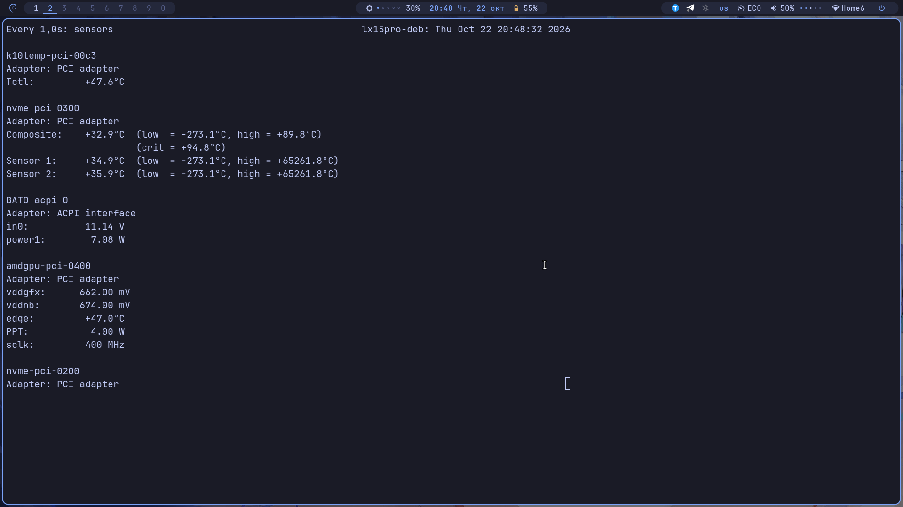

# BSPWM-machineslego

[English](./README.md) | **Русский**


Строгое, плоское рабочее окружение на базе BSPWM для Debian 13 Trixie в палитре Tokyo Night.

> **Статус:** окружение живёт на BSPWM/X11 и остаётся здесь надолго — стабильность Debian важнее, а нужные Wayland-композиторы обновляются роллингом. Ближайшие задачи и отвергнутые идеи — в [TODO.md](./TODO.md).

---

## 🧭 Правило репозитория

> **Если задача решается стоковым модулем — не пиши скрипт.**
> **Если скрипт нужен — запускай его по требованию и сразу завершай.**
> **Без фоновых циклов. Без мёртвого кода.**

Каждая строка кода и каждый запущенный процесс должны оправдывать своё существование. Именно из-за этого правила некоторые фичи **намеренно не реализованы** — а некоторые были удалены после того, как их попробовали (список отвергнутых идей — в [TODO.md](./TODO.md)).

---



<details>
<summary><b>Показать больше скриншотов</b></summary>
<br>










</details>

## ✨ Особенности

- **Native Modules First:** Polybar использует стоковые `internal/bspwm`, `internal/battery`, `internal/backlight`, `internal/network`, `internal/pulseaudio`, `internal/xkeyboard` и `internal/date`. Ноль фоновых bash-циклов.
- **Команды по требованию:** `wifi`, `powermenu`, `battery`, `screenshot`, `volume`, `cheatsheet`, `rice-check` и `rice-help` лежат в `~/.local/bin` (PATH), флаги окон — в `config/sxhkd/scripts`. Запускаются по хоткею и сразу завершаются.
- **Машинные команды:** `start-llm` (Ollama + OpenWebUI), `start-comfy` (ComfyUI), `vllm-setup`, `yacht`, `mount-nas` (NFS), `openrgb-i2c-fix`, `sddm-avatar`, `check-hardware`, `check-strawberry`. Docker/ROCm-команды рассчитаны на конкретную машину; проверяют демон и печатают справку, если не хватает аргумента.
- **Автоопределение железа:** `polybar/launch.sh` сам находит батарею (`POLYBAR_BAT`), адаптер питания (`POLYBAR_AC`) и карту подсветки (`POLYBAR_BACKLIGHT`) в `/sys/class/…` — имена не захардкожены.
- **Обои — только `feh`:** никакого скрипта-выборщика, state-файла и превью. Два статичных вызова `feh` в `bspwmrc`: landscape на основной монитор, portrait на повёрнутый. Сменить обои = поправить одну строку.
- **Блокировка экрана:** `xss-lock` + `i3lock-fancy` — через 10 минут бездействия, с гашением монитора по DPMS и корректной блокировкой перед сном (`--transfer-sleep-lock`).
- **Современная оболочка:** Fish + промпт Tide (Fisher). Автодополнения, подсветка синтаксиса, git-статус без фоновых демонов. `eza` для списков файлов, `fastfetch` с отдельными конфигами для X11 и TTY.
- **Плавность и плоский дизайн:** Picom с анимациями окон, скруглениями и тенями, без blur и без затемнения неактивных окон. Строгие цвета Tokyo Night.
- **Профили питания:** Performance / Balanced / Power Saver через PPD. В `power-saver` Picom автоматически переключается на `picom-eco.conf` — без анимаций и теней.
- **Единый стиль:** Polybar, Rofi, Dunst, Picom, Alacritty, Fish, GTK3/GTK4, Qt5/Qt6, GIMP 3, CopyQ, Midnight Commander и Telegram оформлены в Tokyo Night.
- **Workflow:** история буфера (CopyQ + меню команд), история уведомлений (Rofi), скриншоты сразу в буфер CopyQ, шпаргалка по хоткеям в Rofi, Neovim в стиле базового VS Code со своей шпаргалкой.
- **Запасной Vim:** обычный `vim` из `apt.txt` без плагинов — подсветка синтаксиса почти для всего, гибридная нумерация (абсолютный номер на строке курсора, относительные вокруг) и постоянная история изменений. Конфиг — `~/.vimrc` (`home/vimrc`).
- **Стабильность:** автозапуск в `bspwmrc` защищён от дублей через `pgrep`/`pkill`, поэтому `Super + Alt + R` и полный рестарт сессии не плодят процессы.
- **Несколько машин:** hostname-ветвления в `bspwmrc` и `wifi` (десктоп с двумя мониторами и ноутбуки), но при желании конфиг сводится к одной машине.

## 📦 Структура

```text
BSPWM-machineslego/
├── config/                      # симлинки в ~/.config/*
│   ├── alacritty/               # терминал: палитра Tokyo Night, шрифт 10
│   ├── bash/themes/             # пресеты промпта: tokyo-night, tokyo-night-minimal
│   ├── bspwm/bspwmrc            # автозапуск, мониторы, обои, рамки окон
│   ├── copyq/                   # тема Tokyo Night + меню команд
│   ├── dunst/dunstrc            # уведомления: стек 7, история 20
│   ├── easyeffects/output/      # пресеты эквалайзера/эффектов
│   ├── fastfetch/               # graphical.jsonc и tty.jsonc
│   ├── fish/                    # config.fish, fish_plugins, rustup
│   ├── GIMP/3.0/themes/         # тема TokyoNight для GIMP 3
│   ├── gtk-3.0/ gtk-4.0/        # gtk.css: палитра Tokyo Night поверх Adwaita-dark
│   ├── nvim/                    # Lua-конфиг, vim.pack, CHEATSHEET.md
│   ├── picom/                   # picom.conf + picom-eco.conf
│   ├── polybar/                 # config.ini, launch.sh
│   ├── qt5ct/ qt6ct/            # палитры tokyo-night.conf
│   ├── rofi/config.rasi         # лаунчер/окна/команды
│   └── sxhkd/                   # sxhkdrc + хелперы хоткеев (scripts/)
├── home/                        # симлинки в ~/*: .bashrc, .vimrc, .xinitrc, .xprofile, .Xresources
├── local/bin/                   # команды в ~/.local/bin: wifi, screenshot, volume, ...
├── local/share/mc/skins/        # скин Midnight Commander
├── system/etc/                  # копируется в /etc: touchpad, NetworkManager, interfaces
├── scripts/                     # install.sh, link.sh, unlink.sh, software.sh, install-node.sh
├── requirements/                # списки пакетов: apt.txt, apt-system.txt, software.txt
├── screenshots/                 # превью для README
├── themes/telegram/             # .tdesktop-palette (ручная установка)
├── wallpapers/                  # обои 1080p/4K и портретные
├── RELEASE.md                   # заметки к текущему релизу (EN + RU)
├── TODO.md                      # планы, отвергнутые идеи, ограничения
└── LICENSE                      # MIT
```

## 📋 Требования

- **ОС:** Debian 13 Trixie, **X11** (окружение не рассчитано на Wayland).
- **Утилиты:** `git`, `sudo`, интернет для первой установки.
- **Аудио:** PipeWire (`pipewire`, `pipewire-audio`, `pipewire-pulse`, `wireplumber`). Модуль Polybar `internal/pulseaudio` работает через `pipewire-pulse`; скрипт громкости использует `wpctl` с фолбэком на `pactl`.
- **Шрифты:** JetBrainsMono Nerd Font (ставит `install.sh`), Papirus-Dark и Bibata (ставятся из `apt.txt`).
- **Flatpak:** опционально. Ставится `install.sh` вместе с Flathub; `link.sh` выдаёт Flatpak-приложениям доступ к темам.
- **Neovim:** `ripgrep` для Telescope (`find_files`, `live_grep`) — есть в `requirements/software.txt`.
- **Vim:** обычный `vim` из `apt.txt` — запасной редактор для правки конфигов (без плагинов); конфиг — `home/vimrc` → `~/.vimrc`.

## 🛠 Установка

```bash
git clone https://github.com/machineslego-wq/BSPWM-machineslego ~/BSPWM-machineslego
cd ~/BSPWM-machineslego
chmod +x scripts/*.sh
./scripts/install.sh
```

- **Только конфиги (без изменений в `/etc`):** `./scripts/link.sh`
- **Дополнительный софт:** `./scripts/software.sh`
- **Node.js / npm:** `./scripts/install-node.sh` (отдельно, см. ниже)
- **Откат:** `./scripts/unlink.sh`
- **Запуск:** `startx` (или через LightDM).

`install.sh` идемпотентен: повторный запуск не ломает уже установленное. `link.sh` можно запускать в любое время — он делает бэкап старых файлов в `~/.dotfiles-backup-YYYYMMDD-HHMMSS` и переставляет симлинки.

### Что делает `install.sh`

1. **Пользовательский уровень (без sudo):** Neovim AppImage в `~/.local/bin/nvim`, `tree-sitter` CLI ≥ 0.26.1 в `~/.local/bin`, JetBrainsMono Nerd Font в `~/.local/share/fonts`, линковка конфигов через `link.sh`, Fisher + Tide.
2. **Пакеты (sudo):** всё из `requirements/apt.txt`; при наличии **TLP** он удаляется, чтобы не конфликтовать с `power-profiles-daemon`. Ставятся PPD и Flatpak, подключается Flathub.
3. **Системные конфиги:** `system/**` копируется в `/etc/**` с бэкапом в `/etc/dotfiles-backup-YYYYMMDD-HHMMSS`.
4. **Крышка ноутбука:** если есть батарея, пишется `/etc/systemd/logind.conf.d/10-lid-suspend.conf` (`HandleLidSwitch=suspend`); на десктопе шаг пропускается.

### Что делает `link.sh`

- `config/<pkg>` → `~/.config/<pkg>`
- `home/<file>` → `~/.<file>`
- `local/bin/<команда>` → `~/.local/bin/<команда>` — поштучно, чужие файлы в `~/.local/bin` (nvim, tree-sitter) не трогает
- `local/share/mc/skins/*.ini` → `~/.local/share/mc/skins/`
- выставляет `+x` командам из `local/bin`, скриптам SXHKD и `bspwmrc`
- при наличии Flatpak выдаёт override'ы: read-only доступ к `xdg-config/gtk-3.0`, `gtk-4.0`, `qt5ct`, `qt6ct`, `xdg-data/themes` и `QT_QPA_PLATFORMTHEME=qt5ct`

## ⚙️ После установки

**Fish и Tide.**
Промпт Tide ставится автоматически. После установки открой терминал и выполни:

```bash
tide configure
```

Мастер настроит стиль, цвета и иконки. `config.fish` уже задаёт цвета Fish в Tokyo Night и алиасы `eza`; для `fastfetch` есть отдельный конфиг для TTY.

**Промпт Bash.**
`~/.bashrc` подключает пресет из `~/.config/bash/themes/<имя>.bash`; имя задаёт `BASH_PROMPT`, по умолчанию `tokyo-night` (Debian → папка → git → стрелка). Ещё два пресета: `tokyo-night-minimal` (одна строка без вызовов `git`) и `empty` — пустой шаблон с закомментированными примерами для своей темы.

Сменить насовсем — поправить строку `BASH_PROMPT=` в `~/.bashrc`; примерить на один запуск — `BASH_PROMPT=tokyo-night-minimal bash`. Если файла нет, остаётся стоковый `\u@\h:\w\$`.

**Wi-Fi.**
Команда `wifi` (`~/.local/bin`) рассчитана на конкретные машины: имя интерфейса выбирается по `hostname` (`travelmate` → `wlp3s0`, `lx15pro`/`lx15pro-deb` → `wlo1`, `lamer-deb` → `wlp7s0`, иначе `wlan0`). Добавь свой интерфейс в этот блок и задай `HOTSPOT_SSID` / `HOTSPOT_PASSWORD` в начале файла.

**Обои.**
Выборщика нет. Правь вызовы `feh` в `~/.config/bspwm/bspwmrc`:

- `lamer-deb` (десктоп): `xrandr` выставляет `DisplayPort-1` (основной, 144 Гц) и `HDMI-A-3` (слева, повёрнут), `bspc` раскладывает столы I–IX и X, `feh` ставит landscape и portrait обои.
- любой другой хост: все 10 столов на одном экране и одни landscape-обои.

Пути захардкожены как `$HOME/BSPWM-machineslego/wallpapers/` — если клонируешь репозиторий в другое место, поправь их. Рамки окон: `#24283b` (обычная), `#6b8dd6` (в фокусе), `#bb9af7` (preselect).

**Скин Midnight Commander.**
Установлен в `~/.local/share/mc/skins/tokyo-night.ini`. Переключение: `mc` → `F9` → `Setup` → `Colors` → `tokyo-night`.

**Крышка ноутбука.**
По умолчанию закрытие крышки уходит в сон (экран при этом блокируется через `xss-lock`). Чтобы **блокировать без сна**:

```bash
sudo rm /etc/systemd/logind.conf.d/10-lid-suspend.conf
sudo tee /etc/systemd/logind.conf.d/10-lid-lock.conf > /dev/null <<'EOF'
[Login]
HandleLidSwitch=lock
HandleLidSwitchExternalPower=lock
EOF
sudo systemctl kill -s HUP systemd-logind
```

**Профили питания.**
`Super + Alt + P` или клик по модулю в Polybar. Меню показывает Performance / Balanced / Power Saver, переключение идёт через `powerprofilesctl` и сразу перезапускает Picom с нужным профилем. Ограничение: на Celeron N4120 профиль `performance` недоступен — только `balanced` и `power-saver`.

**Neovim.**
Конфиг на Lua, плагины ставит встроенный `vim.pack` (Neovim 0.12), список — в `lua/plugins.lua`, версии фиксирует `nvim-pack-lock.json`. Первый запуск требует сети: `vim.pack` качает плагины, Mason — LSP-серверы в `~/.local/share/nvim/mason/bin`. Обновление плагинов: `:lua vim.pack.update()` и `:restart`; парсеры Treesitter — `:TSUpdate`. Полная шпаргалка — `config/nvim/CHEATSHEET.md`.

**Vim.**
Запасной редактор без плагинов: `home/vimrc` → `~/.vimrc`. Включены подсветка синтаксиса и `filetype plugin indent on`, гибридная нумерация (на строке курсора — абсолютный номер, вокруг — относительные), постоянная история изменений в `~/.vim/undo`, 4 пробела по умолчанию (2 для json/yaml/html/css/js) и типы файлов для конфигов без расширения (`sxhkdrc`, `bspwmrc`, `xinitrc`, `dunstrc`, `picom*.conf`, `qt5ct.conf`, `*.tdesktop-palette`). Цвета берутся из палитры терминала (Tokyo Night в Alacritty), тема не переопределяется. Изменения применяются через `:source ~/.vimrc`.

**Node.js и npm.**
`./scripts/install-node.sh` подключает NodeSource и ставит LTS. Переменные: `NODE_CHANNEL=lts|current|<major>` (по умолчанию `lts`), `UPDATE_NPM=1` — ещё и `npm@latest`. Глобальные пакеты ставятся в `~/.npm-global` (`prefix` в `~/.npmrc`), PATH добавляют и Fish, и bash. Если стоит NVM, он подключается в конце `~/.bashrc` и может переопределить `node`/`npm`.

**Темы.**
- **GTK3/GTK4:** `config/gtk-3.0/gtk.css` — полный CSS поверх `Adwaita-dark`: `@define-color` плюс прямые селекторы (Adwaita жёстко прописывает цвета, их приходится переопределять вручную). `config/gtk-4.0/gtk.css` — только переменные libadwaita (`:root` с `--*-color`) и слой `@define-color` для совместимости. `gtk-theme-name` не меняется, перекрашиваются только цвета. Применение — перезапуск приложения; Flatpak-приложения подхватывают CSS после повторного `link.sh`.
- **Qt5/Qt6:** палитры `config/qt5ct/colors/tokyo-night.conf` и `config/qt6ct/colors/tokyo-night.conf` (21 роль `QPalette`, формат `#AARRGGBB`), `style=Fusion`, иконки Papirus-Dark. `QT_QPA_PLATFORMTHEME=qt6ct` из `xinitrc` действует и на Qt5-приложения. Применение: `qt5ct`/`qt6ct` или перезапуск приложения.
- **GIMP 3:** `config/GIMP/3.0/themes/TokyoNight/` подхватывается как пользовательская тема — включи её в GIMP: Preferences → Interface → Theme.
- **CopyQ:** тема `tokyo-night.ini` + меню команд (закрепить, метки). История и геометрия окна в git не попадают.
- **EasyEffects:** пресеты в `config/easyeffects/output/*.json`. Сервис запускается из `bspwmrc`, если бинарник установлен; для эффектов может понадобиться `calf-plugins` из `requirements/software.txt`.
- **Telegram:** `themes/telegram/tokyo-night.tdesktop-palette` (Tokyo Night с оранжевым акцентом). Автоустановки нет, чтобы не ломать пути Flatpak:
  1. скопируй файл в `~/.var/app/org.telegram.desktop/data/TelegramDesktop/tdata/theme/` (Flatpak) или `~/.local/share/TelegramDesktop/tdata/theme/` (обычная версия);
  2. перезапусти Telegram;
  3. **Чат-фон** → **Изменить тему** → `tokyo-night`.
- **Midnight Commander:** см. скин выше.

**Системные конфиги (`system/etc/`).**
- `X11/xorg.conf.d/30-touchpad.conf` — libinput: tap-to-click, natural scrolling, clickfinger, two-finger scroll, отключение тачпада при наборе.
- `NetworkManager/NetworkManager.conf` — `plugins=ifupdown,keyfile` и `managed=true`, чтобы NM не игнорировал интерфейсы из `/etc/network/interfaces`.
- `network/interfaces` — стандартный `lo` + `source /etc/network/interfaces.d/*`.

**Затемнение обоев под палитру** (по желанию, ImageMagick):

```bash
convert /path/to/original.jpg -fill "#1a1b26" -colorize 50% -modulate 80,80,100 /path/to/tokyo-night-wallpaper.jpg
```

## ⌨️ Горячие клавиши

**Полная шпаргалка:** `Super + /` (Rofi, с поиском по скрытым тегам). Шпаргалка по Neovim — `config/nvim/CHEATSHEET.md`, по Vim — комментарии в `~/.vimrc`.

### Система и запуск

| Комбинация | Действие |
|---|---|
| `Super + Return` | Терминал (Alacritty) |
| `Super + D` | Лаунчер (Rofi drun) |
| `Super + /` | Шпаргалка |
| `Alt + Tab` | Поиск по открытым окнам (Rofi) |
| `Super + E` / `B` / `V` | Thunar / Firefox / VS Code |
| `Super + A` | Микшер звука (pavucontrol-qt) |
| `Super + X` | Датчики (`watch sensors`) |
| `Super + Alt + N` | Wi-Fi менеджер |
| `Super + Alt + T` | Telegram (Flatpak) + WS-прокси |
| `Super + Alt + B` | Детали батареи (Rofi) |
| `Super + Alt + P` | Выбор профиля питания |
| `Super + Alt + H` | История уведомлений |
| `Super + Ctrl + V` | История буфера (CopyQ) |
| `Super + Shift + Q` | Меню питания (Rofi) |
| `Super + Alt + L` | Заблокировать экран |
| `Super + Escape` | Перезагрузить конфиг SXHKD |
| `Super + Alt + Shift + R` | Перезапуск всей сессии (SXHKD, BSPWM, Polybar, Dunst, Picom, аплеты) |

### Скриншоты и медиа

| Комбинация | Действие |
|---|---|
| `Super + F1` | Весь экран |
| `Super + F2` | Активное окно |
| `Super + F3` | Задержка 3 секунды |
| `Super + F4` | Активный монитор |
| `Super + Shift + S` | Выделенная область |
| `Fn + яркость` | `brightnessctl` ±5% |
| `Fn + громкость` | OSD громкости ±2% |

Скриншоты сохраняются в `~/Screenshots` и кладутся в буфер CopyQ (фолбэк — `xclip`).

### Окна и столы

| Комбинация | Действие |
|---|---|
| `Super + стрелки` | Фокус на окно |
| `Super + Shift + стрелки` | Поменять местами с соседом |
| `Super + H/J/K/L` | Двигать плавающее окно (vim-style) |
| `Super + C` / `Super + Shift + C` | Следующее / предыдущее окно |
| `Super + backtick` / `Super + Tab` | Предыдущее окно / предыдущий стол |
| `Super + O` / `I` | История фокуса назад / вперёд |
| `Super + P/B/,/.` | Родитель / сосед / первое / второе окно |
| `Super + [` / `]` | Предыдущий / следующий стол |
| `Super + 1…0` | Переключение столов |
| `Super + Shift + 1…0` | Перенос окна на стол |
| `Super + W` / `Super + Shift + W` | Закрыть окно / убить процесс |
| `Super + T` / `Super + Shift + T` | Тайл / псевдо-тайл |
| `Super + S` / `Super + F` | Плавающее окно / фулскрин |
| `Super + M` | Monocle |
| `Super + G` | Поменять с самым большим окном |
| `Super + Alt + Q` / `R` | Выйти из BSPWM / перезапустить BSPWM |

### Preselect, флаги и размеры

| Комбинация | Действие |
|---|---|
| `Super + Ctrl + стрелки` | Направление preselect |
| `Super + Ctrl + 1…9` | Пропорция preselect |
| `Super + Ctrl + Space` | Отменить preselect для окна |
| `Super + Ctrl + Shift + Space` | Отменить preselect для стола |
| `Super + Y` | Отправить помеченное окно в preselect |
| `Super + Ctrl + M/X/Y/Z` | Флаги: marked / locked / sticky / private |
| `Super + Alt + стрелки` | Растянуть окно |
| `Super + Alt + Shift + стрелки` | Сжать окно |

## 🔄 Обновление и применение изменений

Конфиги живут симлинками: правка файла в репозитории сразу меняет систему. После `git pull` достаточно запустить `./scripts/link.sh` (появятся новые симлинки, старые файлы уйдут в бэкап).

| Что менял | Как применить |
|---|---|
| BSPWM | `bspc wm -r` или `Super + Alt + R` |
| SXHKD | `pkill -USR1 -x sxhkd` или `Super + Escape` |
| Polybar | `~/.config/polybar/launch.sh` |
| Picom | `pkill -x picom`, затем `picom --config <профиль>` |
| Dunst | `pkill -x dunst && dunst &` |
| Vim | `:source ~/.vimrc` |
| Alacritty | автоматически (`live_config_reload = true`) |
| GTK3/GTK4, Qt | перезапуск приложения |
| Всё сразу | `Super + Alt + Shift + R` |

## 🐛 Известные проблемы (Picom и UI)

- **Анимация стека Dunst:** анимируется только первое уведомление. Второе и последующие появляются мгновенно из-за известного конфликта **Picom 12.5** с позиционированием Dunst.
- **Тени контекстных меню:** у контекстных меню Telegram (Flatpak) и Firefox плохо рендерятся тени. Именно поэтому они явно исключены в `picom.conf` (`shadow = false`).
- **Сон на AMD:** на Ryzen 7000-й серии ноутбук может выключаться вместо сна. Добавь `mem_sleep_default=s2idle` в GRUB, если столкнулся с этим.
- **Dunst на нескольких мониторах:** уведомления показываются только на мониторе `0` (`monitor = 0` в `dunstrc`).
- **`window-height` в Picom:** унарный минус не парсится — в правилах пишется `"0 - window-height"` вручную.

## 🗺 Планы

- `1.7.0` выпущен. Заметки к текущему релизу — в [RELEASE.md](./RELEASE.md), история — в [Releases](https://github.com/machineslego-wq/BSPWM-machineslego/releases). Следующая точка — `1.8.0`.
- Ветка BSPWM/X11 — основная и долгосрочная, переезд на Wayland не планируется: Debian стабилен, а Wayland-композиторы с нужными возможностями идут роллингом. Это осознанный выбор в пользу предсказуемости; подробности — в разделе «Отвергнуто» в [TODO.md](./TODO.md).
- Текущие задачи, «Сделано», отвергнутые идеи и известные ограничения — в [TODO.md](./TODO.md).

## 📄 Лицензия

MIT
