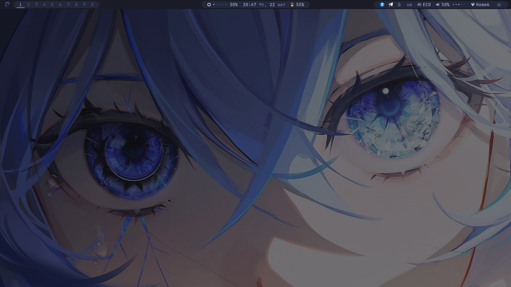
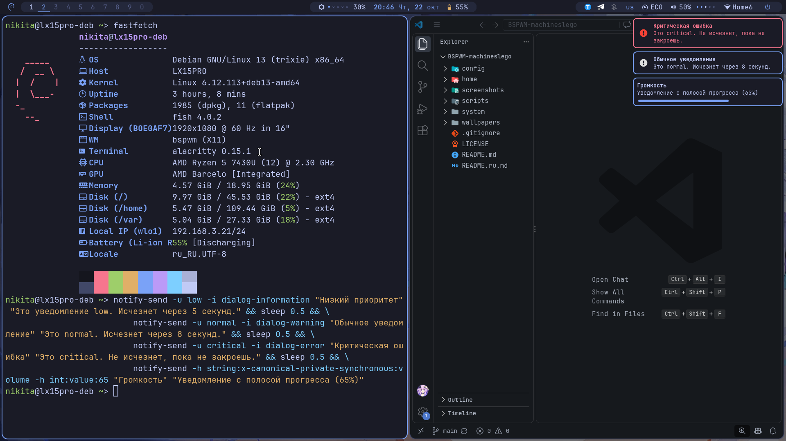
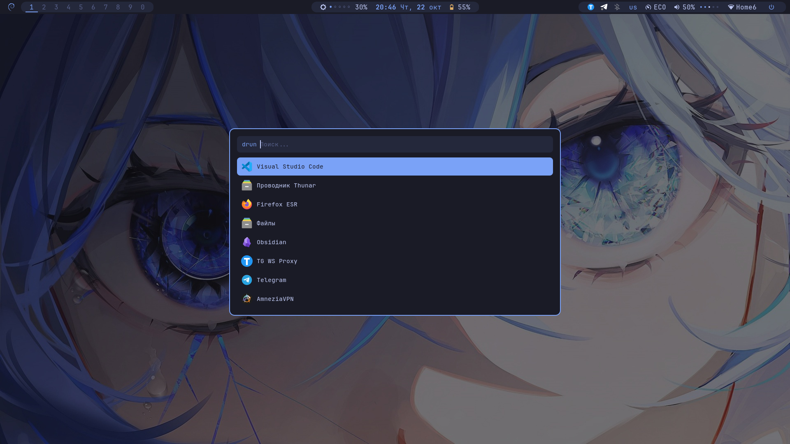
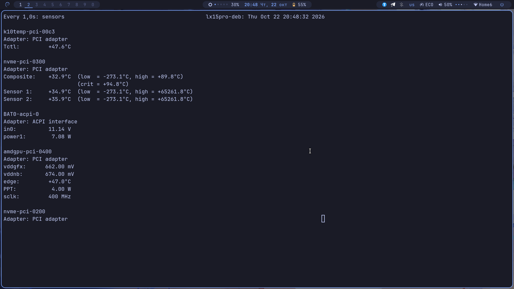
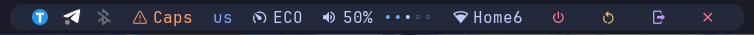
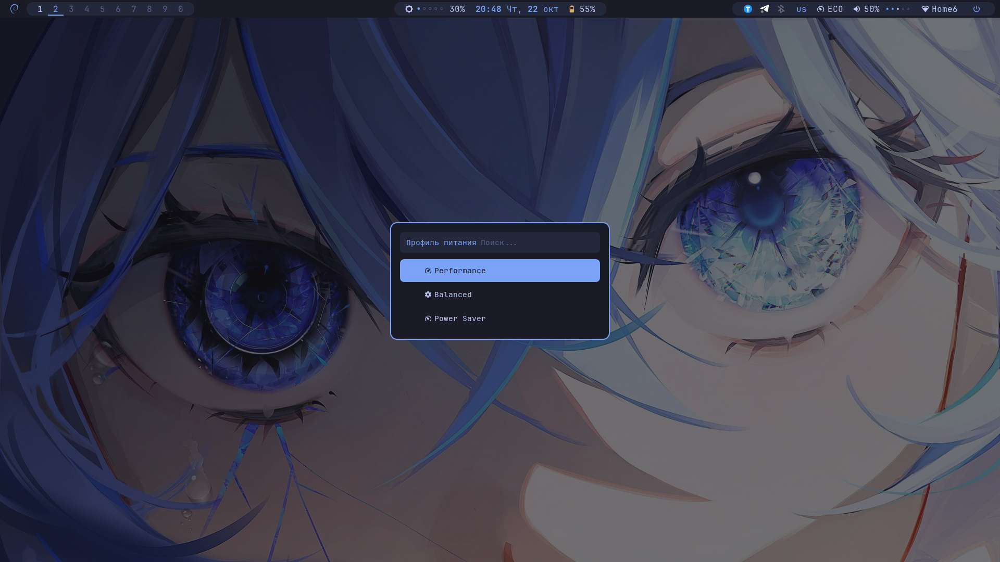
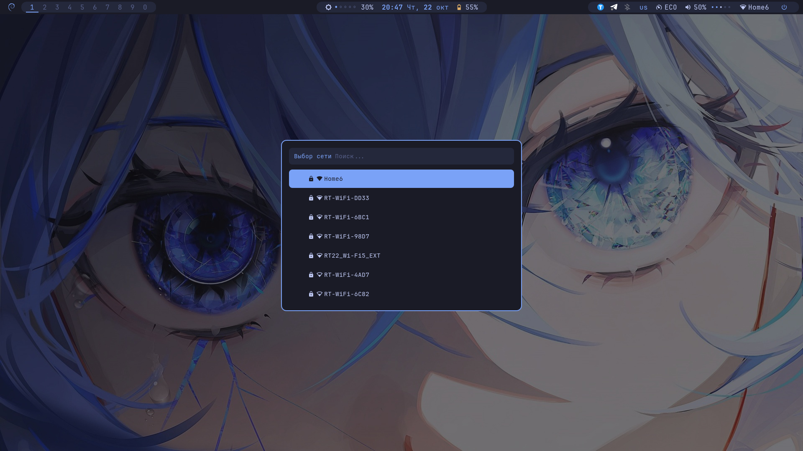
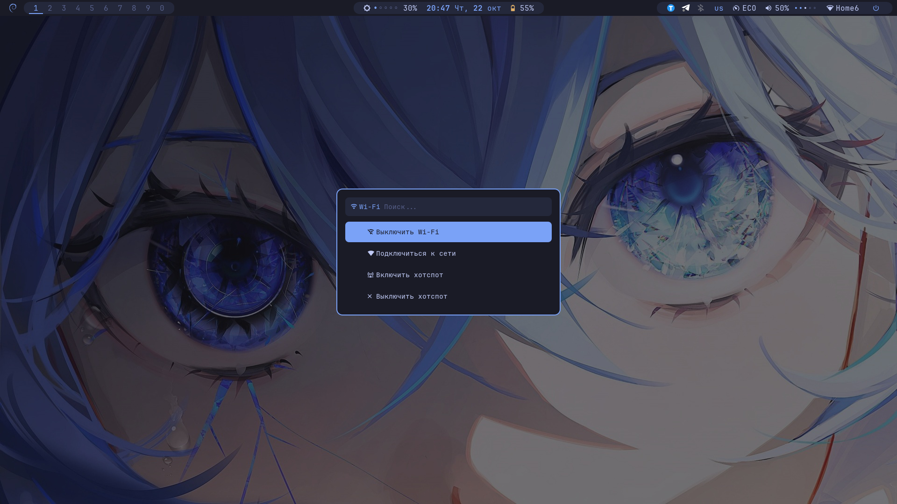
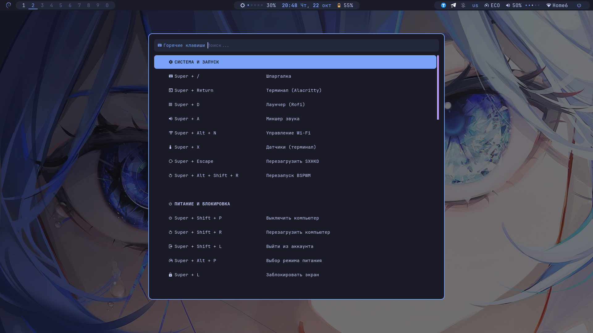

# BSPWM-machineslego

[English](./README.md) | **Русский**


Конфигурация рабочего окружения на базе BSPWM для Debian 13 Trixie в палитре Tokyo Night.




<details>
<summary><b>Показать больше скриншотов (Rofi, Polybar, Питание, Wi-Fi, Шпаргалка)</b></summary>
<br>

**Rofi**



**Polybar (правая часть, все модули включены)**


**Профили питания**


**Wi-Fi**



**Шпаргалка**


</details>

## Особенности

- **Native Modules First:** Стоковые модули Polybar для батареи, сети и звука.
- **Без прозрачности и блюра:** Отключено в Alacritty, Polybar и Picom. Только строгие цвета Tokyo Night.
- **Статичная шпаргалка:** Меню `Super + /` с иконками и скрытыми тегами для поиска через Rofi.
- **Универсальное железо:** Автоопределение батарей и адаптеров питания. Яркость работает из коробки на ноутбуках.
- **Собственный Wi-Fi менеджер:** Легковесный скрипт `wifi.sh` (на Rofi и `nmcli`) для подключения к сетям, включения адаптера и создания хотспота. **Требует ручной настройки интерфейса.**
- **Управление без лишних апплетов:** Звук через `pavucontrol`. Исключение — `blueman` для Bluetooth.
- **Фикс сети:** Установщик копирует исправленный `/etc/network/interfaces` и настройки NetworkManager.
- **Продвинутая поддержка мониторов:** Настраиваемый блок в `bspwmrc` для ПК с двумя экранами: 144 Гц, смещение, портретный режим и разные обои.
- **Доработанные уведомления Dunst:** Обновленный дизайн с полосой прогресса, расширенными иконками и OSD-индикаторами для громкости и яркости.

## 📦 Структура

```text
BSPWM-machineslego/
├── config/                 # Симлинки в ~/.config/*
│   ├── alacritty, bspwm, dunst, fastfetch, picom, rofi
│   ├── gtk-3.0, gtk-4.0    # Настройки тем GTK
│   ├── polybar/
│   │   ├── config.ini      # Стоковые модули + кастомная яркость
│   │   └── scripts/
│   │       ├── battery.sh          # Фолбэк-скрипт батареи
│   │       ├── brightness.sh       # Скрипт яркости
│   │       ├── power-profile-ppd.sh # Профиль питания для PPD
│   │       └── power-profile-tlp.sh # Профиль питания для TLP
│   └── sxhkd/
│       ├── sxhkdrc         # Горячие клавиши
│       └── scripts/        # cheatsheet, powermenu, volume, wifi
├── home/                   # Симлинки в ~/*
├── system/                 # Копируется в /etc
├── scripts/                # install.sh, link.sh, unlink.sh
├── screenshots/
└── wallpapers/
```

## 📋 Требования

- **ОС:** Debian 13 Trixie (или совместимый дистрибутив).
- **Базовые утилиты:** `git`, `sudo`, интернет.
- **Nerd Font** (устанавливается автоматически).
- **Права sudo** для установки пакетов и копирования файлов в `/etc`.

## 🛠 Установка

**Способ 1: Через Git (Рекомендуемый)**
```bash
git clone https://github.com/machineslego-wq/BSPWM-machineslego ~/BSPWM-machineslego
cd ~/BSPWM-machineslego
chmod +x scripts/*.sh
./scripts/install.sh
```

**Способ 2: Через ZIP-архив**
GitHub распакует архив в папку `BSPWM-machineslego-X.X.X`. 
⚠️ **Важно:** Переименуйте папку в `BSPWM-machineslego` и переместите в `~/`.
```bash
mv ~/Downloads/BSPWM-machineslego* ~/BSPWM-machineslego
cd ~/BSPWM-machineslego
chmod +x scripts/*.sh
./scripts/install.sh
```

**Если не нужно трогать `/etc`:** используйте `./scripts/link.sh`.
**Откат:** `./scripts/unlink.sh`.
**Запуск:** `startx` (или через LightDM).

### ⚙️ Кастомизация

**Настройка мониторов (ПК)**
Настройте их в `~/.config/bspwm/bspwmrc`. Найдите блок `--- НАСТРОЙКА МОНИТОРОВ ---`.
1. Замените `"lamer-deb"` на ваш `hostname`.
2. Настройте `xrandr` (порты, `--rate 144.00`, поворот, позицию).
3. Установите разные обои через `feh --output`.

**Wi-Fi и Хотспот (Требуется ручная настройка)**
Скрипт `wifi.sh` предварительно настроен под мои устройства (например, `wlo1`, `wlp3s0`). **Вы должны вручную добавить имя интерфейса вашего устройства** в блок `if/elif`. 
Узнать имя можно командой `ip a` или `nmcli device`. На некоторых машинах это `wlan0`, а на других (например, ПК с PCIe-картой) это может быть `wlp7s0`.
Также не забудьте задать свой `HOTSPOT_SSID` и `HOTSPOT_PASSWORD` в начале `~/.config/sxhkd/scripts/wifi.sh`.

## 🖼️ Обои и тема

Затемнение обоев под палитру Tokyo Night через ImageMagick:
```bash
convert /path/to/original.jpg -fill "#1a1b26" -colorize 50% -modulate 80,80,100 /path/to/tokyo-night-wallpaper.jpg
```

## ⌨️ Горячие клавиши

**Полная шпаргалка:** `Super + /` (Rofi, поиск по скрытым тегам).

| Комбинация | Действие |
|---|---|
| `Super + Enter` | Терминал (Alacritty) |
| `Super + /` | Шпаргалка (Rofi) |
| `Super + W` | Закрыть окно |
| `Super + 1…0` | Переключение рабочих столов |
| `Super + Shift + 1…0` | Переместить окно на рабочий стол |
| `Super + D` | Лаунчер (Rofi drun) |
| `Super + Alt + N` | Wi-Fi менеджер (Rofi) |
| `Super + Alt + P` | Меню профиля питания |
| `Super + X` | Датчики (`watch` в терминале) |
| `Print` | Скриншот всего экрана (maim) |
| `Shift + Print` | Скриншот окна (maim) |
| `Super + Shift + S` | Скриншот области (maim) |

## 🎨 Экосистема

Если вы хотите, чтобы ваши заметки в Obsidian выглядели так же строго, обратите внимание на тему:

**[Tokyo Night Flat Theme для Obsidian](https://github.com/machineslego-wq/tokyo-night-by-machineslego-wq)**

## 🔧 Устранение неполадок

- **Скрипт Wi-Fi не работает / Ошибка в `wifi.sh`** → В скрипте жестко прописаны имена интерфейсов для моих устройств. Вам нужно открыть `~/.config/sxhkd/scripts/wifi.sh` и вручную добавить имя вашего интерфейса в блок `if/elif`. Запустите `ip a`, чтобы узнать его (например, `wlan0`, `wlo1`, `wlp7s0`).
- **Нет иконок в Polybar/Rofi** → Не установлен Nerd Font. Проверьте: `fc-list | grep -i "nerd"`.
- **`startx` не запускается** → Проверьте `exec bspwm` в `~/.xinitrc`.
- **Не работают горячие клавиши** → Перезапустите `sxhkd`: `pkill -USR1 -x sxhkd`.
- **Нет модуля яркости на ПК** → Это намеренно. На ПК используйте кнопки монитора.
- **Polybar не стартует** → Проверьте симлинк `~/.config/polybar` и права на `launch.sh`.

## 📄 Лицензия

- Конфигурации и скрипты — **MIT**.
- Шрифты (JetBrains Mono Nerd Font) — **SIL Open Font License 1.1**.