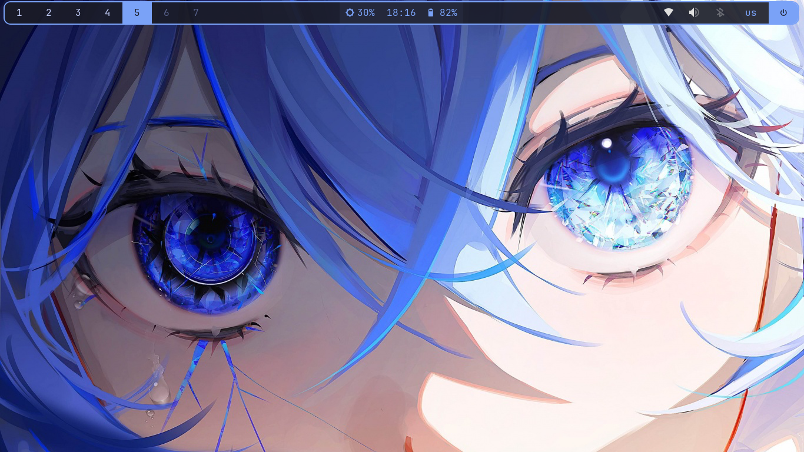

# BSPWM-machineslego

Конфигурация рабочего окружения на базе BSPWM для Debian 13 Trixie с оформлением в палитре Tokyo Night.

## Аппаратная база

Конфигурация собрана и протестирована на:

- Ноутбук: Acer TravelMate B1 (TMB118 C0EA)
- Экран: 1366×768
- ОЗУ: 4 ГБ
- Накопитель: 120 ГБ SSD
- Процессор: Intel Celeron N4120
- Wi-Fi: Intel Wireless 9260
- Видео: Intel UHD Graphics 600

Все размеры и настройки подобраны под низкое разрешение и слабое железо. При переносе на другую машину часть параметров нужно скорректировать — см. раздел «Перенос на 1920×1080».

## Состав

| Компонент | Назначение |
|---|---|
| BSPWM | Тайловый оконный менеджер |
| SXHKD | Демон горячих клавиш |
| Polybar | Статус-панель |
| Rofi | Лаунчер и меню |
| Dunst | Уведомления |
| Picom | Композитор |
| Alacritty | Терминал |
| Feh | Установка обоев |
| Scrot | Скриншоты |
| i3lock-fancy | Блокировка экрана |
| Fastfetch | Информация о системе в терминале |
| JetBrainsMono Nerd Font | Шрифт с иконками |
| LXAppearance | Настройка GTK-темы и курсора |
| Thunar | Файловый менеджер |
| Blueman | Bluetooth-апплет в трее |
| Pasystray | Апплет звука в трее |
| nm-applet | Апплет Wi-Fi в трее |
| Syncthing | Синхронизация файлов |

Цветовая палитра: Tokyo Night (background `#1a1b26`, акцент `#7aa2f7`).

## Установка пакетов

Базовые зависимости:

```
sudo apt install -y \
  xorg xinit \
  bspwm sxhkd \
  polybar rofi dunst picom feh \
  lxappearance \
  papirus-icon-theme \
  fonts-jetbrains-mono fonts-font-awesome \
  fonts-noto-color-emoji \
  brightnessctl scrot \
  network-manager-gnome pavucontrol \
  blueman pasystray \
  thunar alacritty \
  i3lock-fancy libnotify-bin \
  fish
```

Опционально:

```
sudo apt install -y syncthing
```

`zutty` устанавливается как автоматическая зависимость при установке крупных наборов пакетов, но не используется. Удаляется командой `sudo apt autoremove --purge`.

### Шрифты Nerd Font

В репозиториях Debian пакета `fonts-jetbrains-mono-nerd` нет. Шрифт ставится вручную:

1. Скачать `JetBrainsMono.zip` с https://www.nerdfonts.com/font-downloads
2. Установить `unzip`: `sudo apt install unzip`
3. Распаковать и положить `.ttf` в `~/.local/share/fonts/`:
   ```
   mkdir -p ~/.local/share/fonts
   unzip JetBrainsMono.zip -d ~/.local/share/fonts/
   fc-cache -fv
   ```
4. Проверить: `fc-list | grep -i "Nerd"`

### Эмодзи

После установки `fonts-noto-color-emoji` выполнить:

```
sudo dpkg-reconfigure fontconfig-config
```

В интерактивном меню разрешить растровые шрифты (bitmap fonts = Yes). Затем:

```
fc-cache -fv
```

Без этого шага эмодзи могут отображаться как чёрно-белые символы или квадраты.

## Применение конфигов

```
git clone https://github.com/machineslego-wq/BSPWM-machineslego ~/dotfiles
cp -r ~/dotfiles/.config/* ~/.config/
chmod +x ~/.config/polybar/launch.sh
chmod +x ~/.config/polybar/scripts/*.sh
chmod +x ~/.config/bspwm/bspwmrc
```

Создать `~/.xinitrc`:

```
#!/bin/sh
exec bspwm
```

Дать права: `chmod +x ~/.xinitrc`. Запуск: `startx` из TTY.

## Настройка окружения

### Wi-Fi через NetworkManager

Debian-установщик по умолчанию настраивает Wi-Fi через `ifupdown`, из-за чего NetworkManager не может управлять адаптером (статус `unmanaged` или `unavailable`). Для передачи управления:

1. В `/etc/network/interfaces` закомментировать строки, относящиеся к Wi-Fi:
   ```
   # allow-hotplug wlp3s0
   # iface wlp3s0 inet dhcp
   #     wpa-ssid MyNetwork
   #     wpa-psk  mypassword
   ```
2. В `/etc/NetworkManager/NetworkManager.conf` установить:
   ```
   [ifupdown]
   managed=true
   ```
3. Отключить системный `wpa_supplicant`, иначе он держит сокет и мешает NetworkManager запустить свой экземпляр:
   ```
   sudo systemctl stop wpa_supplicant
   sudo systemctl disable wpa_supplicant
   ```
   Не использовать `mask` — иначе NetworkManager не сможет запустить свой экземпляр.
4. Если сокет остался: `sudo pkill -9 wpa_supplicant && sudo rm -rf /run/wpa_supplicant/*`
5. Перезапустить: `sudo systemctl restart NetworkManager`
6. Проверить: `nmcli device status` — статус Wi-Fi должен стать `disconnected`.
7. Подключиться: `nmcli device wifi connect "SSID" password "password"`

Пароль сохранится в `/etc/NetworkManager/system-connections/` и подхватится автоматически при следующей загрузке.

### Тачпад

Создать `/etc/X11/xorg.conf.d/30-touchpad.conf`:

```
Section "InputClass"
    Identifier "touchpad"
    Driver "libinput"
    MatchIsTouchpad "on"
    Option "Tapping" "on"
    Option "TappingButtonMap" "lrm"
    Option "NaturalScrolling" "true"
    Option "DisableWhileTyping" "true"
    Option "ClickMethod" "clickfinger"
    Option "ScrollMethod" "twofinger"
EndSection
```

После перезагрузки тачпад поддерживает тапы, естественную прокрутку и отключение во время набора текста.

### Курсор

Файл `~/.Xresources`:

```
Xcursor.theme: Adwaita
Xcursor.size: 48
```

Применить: `xrdb -merge ~/.Xresources`. Строка `xrdb -merge ~/.Xresources` должна быть в `~/.xinitrc` перед `exec bspwm`.

Тема и иконки GTK настраиваются через `lxappearance`.

### Горячие клавиши яркости и звука

Клавиши `Fn` на Acer TravelMate отправляют стандартные XF86-события. Бинды в `sxhkdrc`:

```
XF86MonBrightnessUp
    brightnessctl set +5%

XF86MonBrightnessDown
    brightnessctl set 5%-

XF86AudioRaiseVolume
    pactl set-sink-volume @DEFAULT_SINK@ +5%

XF86AudioLowerVolume
    pactl set-sink-volume @DEFAULT_SINK@ -5%

XF86AudioMute
    pactl set-sink-mute @DEFAULT_SINK@ toggle
```

Если комбинации не срабатывают — проверить через `xev`, какие keysym посылает клавиатура. При использовании PipeWire вместо PulseAudio заменить `pactl` на `wpctl`.

### Права на выключение

Если `systemctl poweroff` и `systemctl reboot` требуют пароль, заменить на `loginctl poweroff` / `loginctl reboot` — они работают без пароля в активной локальной сессии.

## Горячие клавиши

| Комбинация | Действие |
|---|---|
| Super + Enter | Терминал (Alacritty) |
| Super + D | Лаунчер Rofi |
| Super + Q | Закрыть окно |
| Super + W | Закрыть / убить процесс |
| Super + Стрелки | Фокус между окнами |
| Super + Shift + Стрелки | Поменять окна местами |
| Super + 1..7 | Переключить рабочий стол |
| Super + Shift + 1..7 | Переместить окно на другой стол |
| Super + T | Переключить режим окна (тайл / плавающий) |
| Super + F | Полный экран |
| Super + Tab | Переключение между двумя последними окнами |
| Super + L | Блокировка экрана (i3lock-fancy) |
| Super + Shift + L | Выйти из аккаунта |
| Super + Shift + P | Выключение (с подтверждением) |
| Super + Shift + R | Перезагрузка (с подтверждением) |
| Super + Escape | Перезагрузить конфиг SXHKD |
| Super + Alt + R | Перезапустить BSPWM |
| Super + Alt + Shift + R | Перезапустить SXHKD и BSPWM одновременно |
| Print | Скриншот всего экрана |
| Shift + Print | Скриншот активного окна |
| Super + Shift + S | Скриншот выделенной области |
| Super + Shift + N | Тест уведомления Dunst |
| XF86MonBrightnessUp / Down | Яркость |
| XF86AudioRaiseVolume / Lower | Громкость |
| XF86AudioMute | Мьют |

## Особенности конфигурации

- Polybar имеет «парящий» вид: `width = 99%`, `offset-x = 0.5%`, `offset-y = 2`, `border-size = 2`, `radius = 10`. Отступ под панель задаётся через `bspc config top_padding 36` в `bspwmrc` (значение соответствует высоте панели в пикселях).
- Скругления окон обеспечивает Picom (`corner-radius = 8`). В конфиге отключены тени и размытие для экономии ресурсов слабого железа.
- Dunst использует ту же палитру, что и остальное окружение. Скругления уведомлений рисует сам Dunst (`corner_radius = 10`), Picom исключает класс `Dunst` из обработки через `rounded-corners-exclude`.
- Меню питания в Polybar реализовано через `custom/menu` с подтверждением через Rofi.
- Апплеты (Bluetooth, звук, Wi-Fi) запускаются в `bspwmrc` с `pkill -x <applet>` перед стартом, чтобы избежать дублей при `Super + Alt + R`.
- Обои задаются через `feh --bg-fill` в `bspwmrc`. Формат имени файла — полный путь без экранирования пробелов.

## Перенос на 1920×1080

Для Full HD изменить:

**Polybar** (`~/.config/polybar/config.ini`):

```
height = 36px
```
заменить на:
```
height = 44px
```

**BSPWM** (`~/.config/bspwm/bspwmrc`):

```
bspc config top_padding 36
```
заменить на:
```
bspc config top_padding 44
```

**Зазоры между окнами**: при желании увеличить `bspc config window_gap` с `2` до `4–6`.

**Шрифт Polybar** (`config.ini`): оставить `size=12` или увеличить до `13`.

**Обои**: подобрать картинку под 1920×1080.

Остальные параметры (цвета, скрипты, бинды) не зависят от разрешения.

## Известные ограничения

- На Celeron N4120 с 4 ГБ ОЗУ не рекомендуется включать эффекты размытия в Picom и тяжёлые модули в Polybar (CPU, memory, graph).
- Шрифты Nerd Font ставятся вручную.
- Если `echo -e` в скриптах не работает — заменить на `printf`. Polybar и SXHKD запускают команды через `/bin/sh` (dash), который не поддерживает `-e` у встроенного `echo`.
- В `.ini`-конфиге Polybar inline-комментарии (`;` после значения) не поддерживаются — парсер берёт всё после `=` как буквальное значение. Комментарии только на отдельных строках.

## Скриншот




## Лицензия

Конфигурация свободна к использованию и модификации.