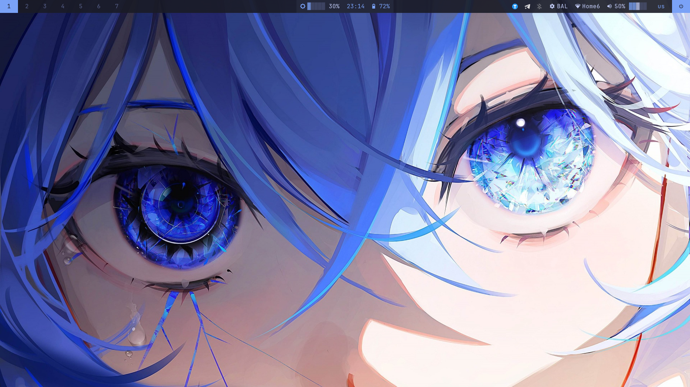
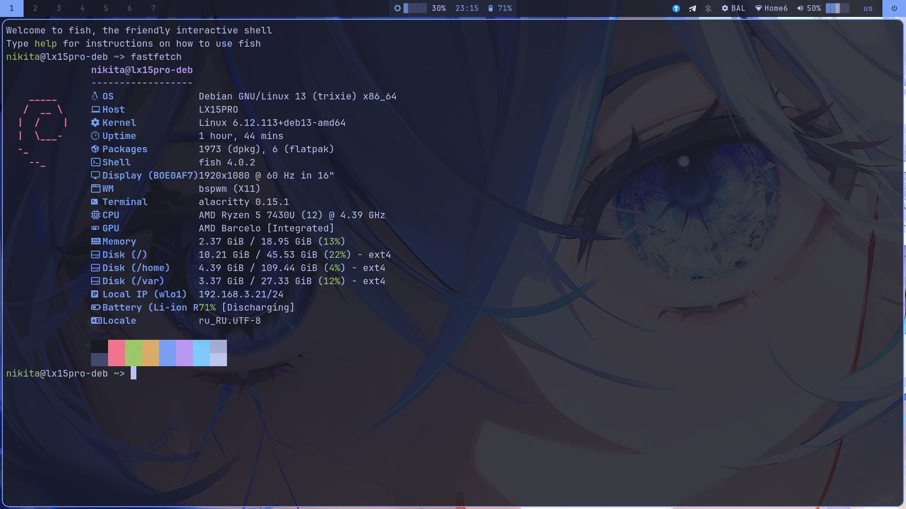
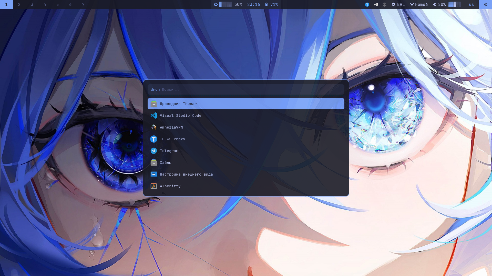
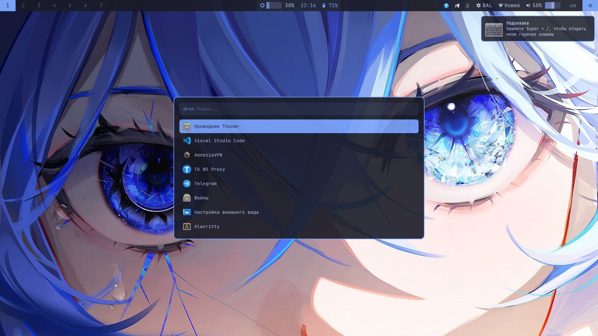
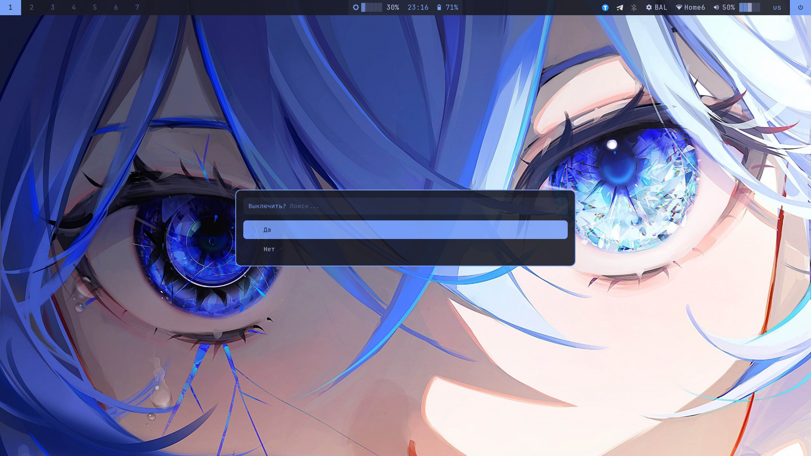
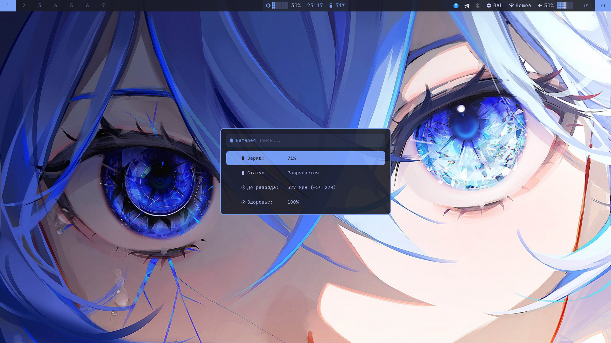
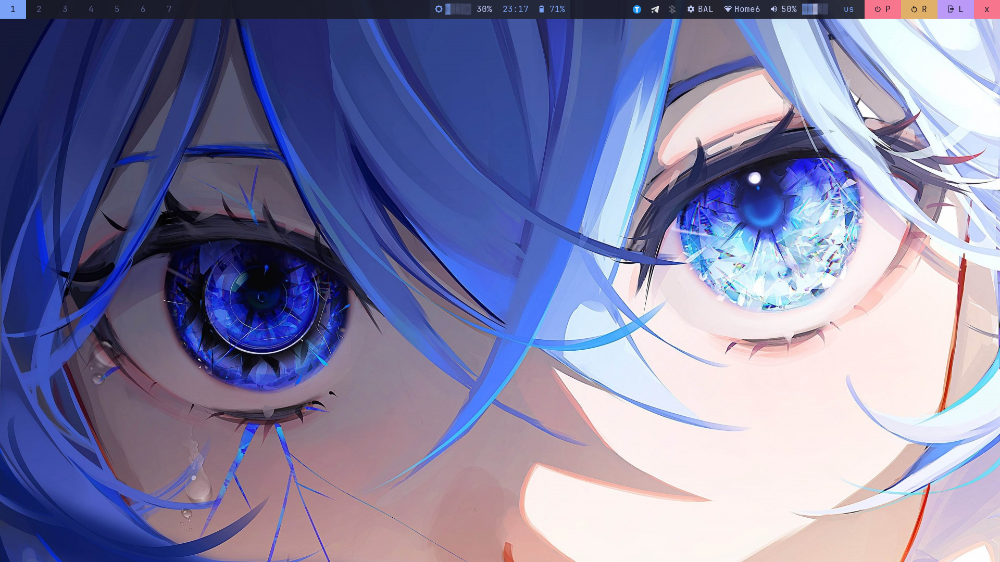
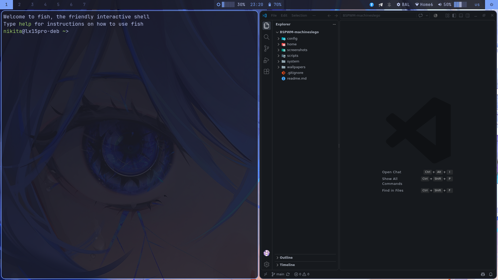
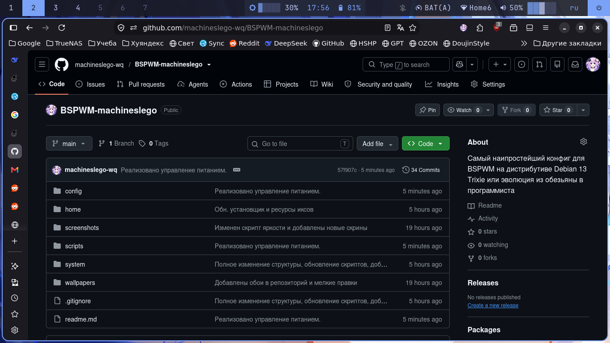
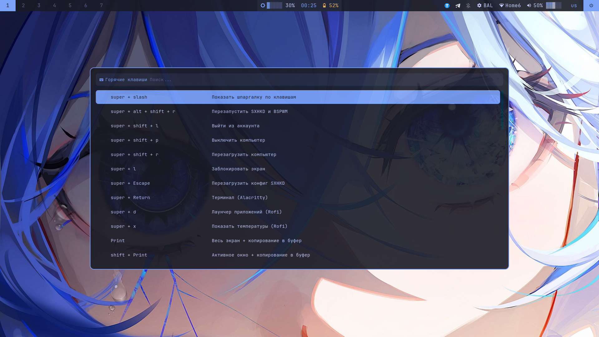

# BSPWM-machineslego

Конфигурация рабочего окружения на базе BSPWM для Debian 13 Trixie с оформлением в палитре Tokyo Night.



## TODO

- Полностью заменить `blueman-applet` на собственное меню в Rofi.

## Последние изменения

- **Мониторинг температур:** Добавлен скрипт `sensors.sh`, который по нажатию `Super + X` выводит температуры CPU, GPU (включая Hotspot и VRAM) и дисков в Rofi. Скрипт универсален и автоматически скрывает несуществующие датчики (работает на Intel, AMD, Nvidia, а также на SATA/NVMe).
- **Шпаргалка по клавишам:** Добавлен скрипт `autocheatsheet.sh`, который автоматически читает `sxhkdrc` и выводит красивое меню в Rofi по нажатию `Super + /`.
- **Установщик шрифтов:** `install.sh` автоматически скачивает JetBrainsMono Nerd Font. Также добавлен отдельный скрипт `install-fonts.sh` для ручной установки других шрифтов.
- **Динамическая батарея:** Скрипт `battery.sh` теперь определяет ноутбук или ПК (показывает розетку для ПК). Иконки меняют цвет в зависимости от заряда. По клику открывается подробное меню в Rofi.
- **Универсальный звук:** Горячие клавиши вызывают `volume.sh`, который сам определяет PipeWire (`wpctl`) или PulseAudio (`pactl`).
- **Копирование скриншотов:** При снятии скриншота он сохраняется в папку и мгновенно копируется в буфер обмена (благодаря `xclip`).
- **Гибридное питание:** Установщик сам определяет наличие `power-profiles-daemon`, батареи (TLP) или настраивает `cpupower` для ПК.
- **Фикс клавиатуры:** В `bspwmrc` добавлена принудительная установка раскладки `setxkbmap` (CapsLock).

## Аппаратная база

Конфигурация собрана и протестирована на двух ноутбуках:
1. **Acer TravelMate B1 (TMB118 C0EA)** — 1366×768, 4 ГБ ОЗУ, Celeron N4120.
2. **Nipogi LX15 Pro** — 1920×1080, 20 ГБ ОЗУ, Ryzen 5 7430U.

*Конфиги полностью универсальны по разрешению: настройки, подобранные под 1366×768, отлично смотрятся и на экранах FullHD.*

## Состав

| Компонент | Назначение |
|---|---|
| BSPWM / SXHKD | Оконный менеджер и горячие клавиши |
| Polybar / Rofi | Панель и лаунчер |
| Dunst / Picom | Уведомления и композитор |
| Alacritty | Терминал |
| Feh / Scrot / Xclip | Обои, скриншоты и работа с буфером |
| i3lock-fancy | Блокировка |
| lm-sensors | Мониторинг температур (CPU/GPU/Диски) |
| TLP / cpupower / PPD | Управление питанием (автоопределение) |

Цветовая палитра: Tokyo Night (background `#1a1b26`, акцент `#7aa2f7`).

## Структура репозитория

```text
BSPWM-machineslego/
├── config/                 # Симлинки в ~/.config/*
│   ├── alacritty, bspwm, dunst, fastfetch, picom, rofi, sxhkd
│   └── polybar/scripts/    # battery, volume, power-profile, sensors, autocheatsheet и др.
├── home/                   # Симлинки в ~/* (.xinitrc, .Xresources)
├── system/                 # Копируется в /etc (тачпад, NetworkManager)
├── scripts/                # install.sh, link.sh, unlink.sh, install-fonts.sh
├── screenshots/            # Скриншоты
└── wallpapers/             # Обои
```

## Установка на новую машину

### Шаг 1. Клонирование и запуск
```bash
git clone https://github.com/machineslego-wq/BSPWM-machineslego ~/BSPWM-machineslego
cd ~/BSPWM-machineslego
chmod +x scripts/*.sh
./scripts/install.sh
```
Установщик сам скачает шрифты (если их нет), установит пакеты (включая `lm-sensors`), настроит `sudoers` для питания, создаст папку для скриншотов и симлинки. 
*Если системные файлы в `/etc` менять не нужно, используйте только `./scripts/link.sh`.*

### Шаг 2. Запуск
```bash
startx
```

## 🚨 Шпаргалка по горячим клавишам

Запомнить всё сразу невозможно, поэтому в райс встроена умная шпаргалка.

**Как открыть:** Нажмите **`Super + /`** (слэш) на клавиатуре. 

Откроется меню Rofi со всеми доступными комбинациями, красиво сгруппированными по разделам. 
*Особенность:* Шпаргалка генерируется **автоматически** из комментариев в файле `sxhkdrc`. Если ты добавишь новый бинд и напишешь над ним комментарий, он сразу появится в этом меню.

## Особенности и управление

- **Универсальный звук:** `volume.sh` сам выбирает команду (`wpctl` или `pactl`) в зависимости от запущенного демона.
- **Умная батарея:** На ПК покажет `󰚥 PC`, на ноутбуке — иконку с процентом. Цвет: зеленый (зарядка/100%), желтый (<60%), красный (<40%). По клику открывается Rofi с подробной информацией и временем работы.
- **Питание:** Модуль в Polybar (`power-profile`) управляет TLP, `cpupower` или `power-profiles-daemon` (в зависимости от того, что установлено). Работает без пароля благодаря автонастройке `sudoers`.
- **Температуры:** Нажатие `Super + X` открывает меню Rofi с температурами. Скрипт `sensors.sh` умеет находить датчики Intel/AMD, дискретные Nvidia/AMD (с Hotspot и VRAM), а также NVMe и SATA диски. Если датчика нет, строка просто скрывается.
- **Скриншоты:** `Print` (весь экран), `Shift + Print` (окно), `Super + Shift + S` (область), `Super + Print` (с задержкой для Rofi). Все снимки сразу попадают в буфер обмена.

## Известные ограничения (Управление без апплетов)

В целях экономии ресурсов мы отказались от некоторых фоновых апплетов. Вот как управлять системами через терминал:

**1. Wi-Fi (без `nm-applet`)**
Для подключения к сети откройте текстовое меню в терминале:
```bash
nmtui
```
Или подключитесь одной командой:
```bash
nmcli device wifi connect "SSID" password "пароль"
```

**2. Звук (смена наушников/колонок)**
Если звук пошел не туда, откройте графический микшер:
```bash
pavucontrol
```
Или через терминал посмотрите ID устройств и переключите:
```bash
wpctl status
wpctl set-default <ID_устройства>
```

**3. Bluetooth**
Сейчас управление идет через `blueman-applet` (иконка в трее, по клику открывается `blueman-manager`). Полная замена на Rofi-меню в планах, так как требует написания сложного скрипта для сопряжения (Pairing/Trust).

**4. CapsLock**
Если CapsLock перестал переключать язык после перезагрузки, нажмите `Super + Alt + R` (перезапуск BSPWM), так как раскладка принудительно применяется в `bspwmrc`.

**5. SATA Диски**
Если у вас старый SATA SSD и `sensors` не показывает его температуру, загрузите модуль ядра (он будет загружаться автоматически после перезагрузки):
```bash
sudo modprobe drivetemp
echo "drivetemp" | sudo tee /etc/modules-load.d/drivetemp.conf
```

## Галерея скриншотов

<details>
<summary>Нажмите, чтобы развернуть все скриншоты (12 шт.)</summary>
<br>

| | |
|---|---|
|  |  |
|  |  |
|  |  |
|  |  |
|  |  |
|  |  |

</details>

## Лицензия

Конфигурация свободна к использованию и модификации.