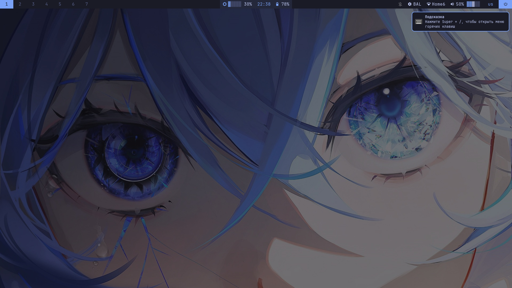
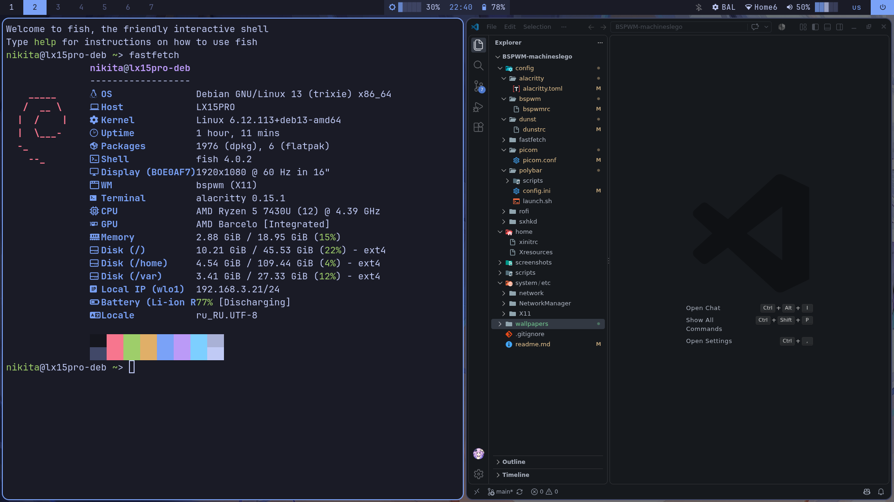
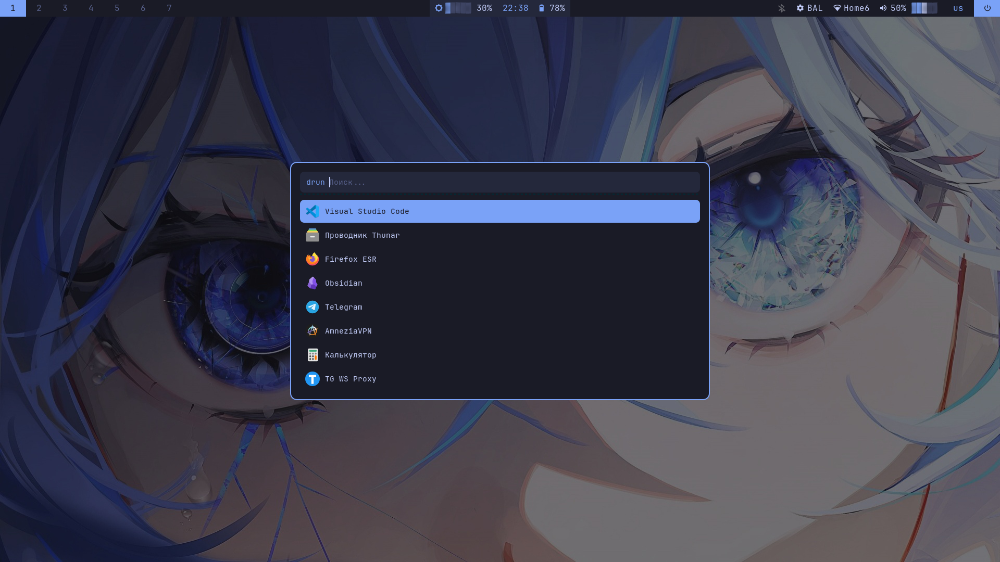
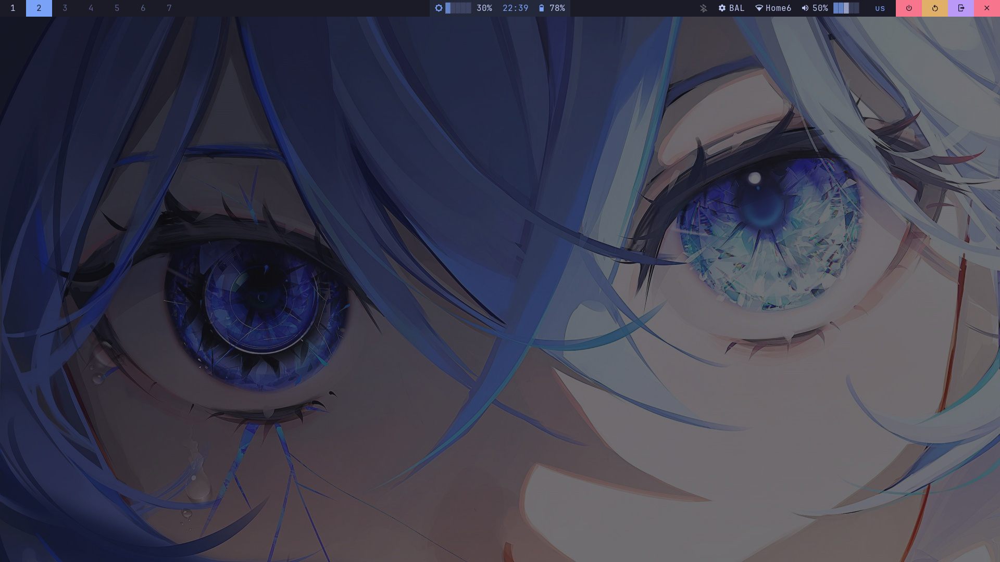
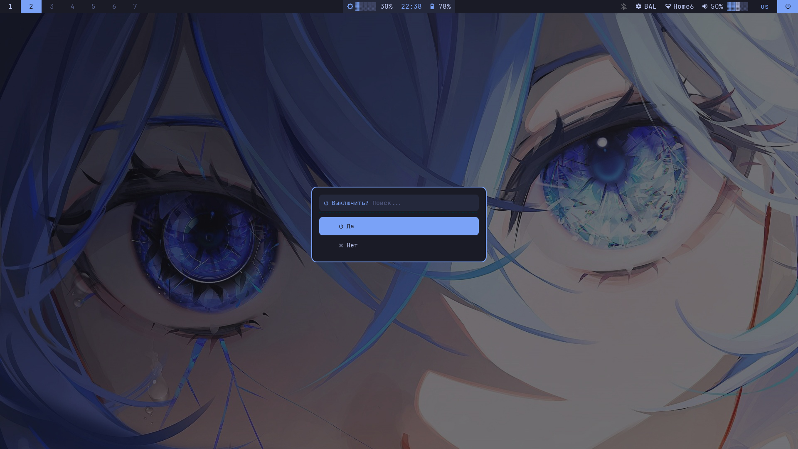
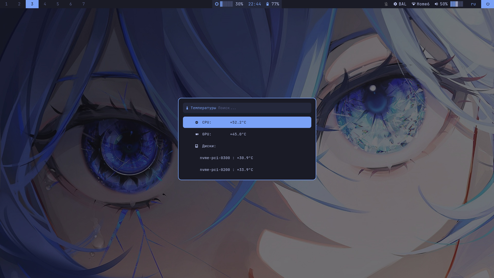

# BSPWM-machineslego

Конфигурация рабочего окружения на базе BSPWM для Debian 13 Trixie с оформлением в палитре Tokyo Night.


## 🎯 Философия проекта

Главный принцип этого репозитория — **надёжность и универсальность**. Мы отошли от сложных bash-скриптов для управления системами в пользу стоковых (встроенных) модулей Polybar, которые работают на C++ и не потребляют ресурсы. 

**Polybar отвечает только за индикацию.** Всё управление (Wi-Fi, звук, питание) вынесено на горячие клавиши и вызовы терминальных утилит. Это исключает конфликты и поломки при смене оборудования или обновлении системы.

## 🚀 Ключевые изменения

- **Native Modules First:** Для батареи, сети и звука используются стоковые модули `internal/battery`, `internal/network`, `internal/pulseaudio`. Они молниеносны и надёжны.
- **Отказ от прозрачности:** Убраны все эффекты прозрачности и размытия (в Alacritty, Polybar и Picom). Это снижает нагрузку на видеокарту (особенно на слабом железе) и делает интерфейс строже, не отвлекая от работы.
- **Затемненные обои:** Оригинальные обои затемняются через ImageMagick и подкрашиваются в цвет фона панели, чтобы глаза не уставали, а интерфейс выглядел монолитно.
- **Статичная шпаргалка:** Меню `Super + /` больше не парсит `sxhkdrc` (что ломалось при длинных комментариях). Теперь это красивый статичный список с иконками и скрытыми тегами для мгновенного поиска. При добавлении нового бинда нужно просто дописать одну строчку в `autocheatsheet.sh`.
- **Универсальное железо:** Переменные окружения в `launch.sh` (автоопределение `BAT0`/`BAT1`, `AC`/`ADP1`) позволяют конфигу работать на разных ноутбуках без правок.
- **Управление без апплетов:** Отказались от `nm-applet` и `pasystray`. Управление Wi-Fi — через `nmtui` или `nmcli`, звуком — через `pavucontrol` или горячие клавиши.

## 📦 Структура репозитория

```text
BSPWM-machineslego/
├── config/                 # Симлинки в ~/.config/*
│   ├── alacritty, bspwm, dunst, fastfetch, picom, rofi
│   ├── polybar/
│   │   ├── config.ini      # Стоковые модули + кастомная яркость
│   │   └── scripts/
│   │       ├── battery.sh          # Фолбэк-скрипт (если стоковый модуль не видит батарею)
│   │       ├── brightness.sh       # Скрипт яркости
│   │       ├── power-profile-ppd.sh # Профиль питания для GNOME (PPD)
│   │       └── power-profile-tlp.sh # Профиль питания для TLP (ноутбуки)
│   └── sxhkd/
│       ├── sxhkdrc         # Горячие клавиши
│       └── scripts/
│           ├── autocheatsheet.sh   # Статичная шпаргалка по клавишам (Super + /)
│           ├── powermenu.sh        # Меню питания (Super + Shift + P/R/L)
│           ├── sensors.sh          # Мониторинг температур (Super + X)
│           └── volume.sh           # Универсальная громкость (PipeWire / PulseAudio)
├── home/                   # Симлинки в ~/* (.xinitrc, .Xresources)
├── system/                 # Копируется в /etc (тачпад, NetworkManager)
├── scripts/                # install.sh, link.sh, unlink.sh
├── screenshots/
└── wallpapers/
```

## 🛠 Установка

### Шаг 1. Клонирование и запуск
```bash
git clone https://github.com/machineslego-wq/BSPWM-machineslego ~/BSPWM-machineslego
cd ~/BSPWM-machineslego
chmod +x scripts/*.sh
./scripts/install.sh
```
Установщик сам скачает шрифты, установит пакеты (`polybar`, `rofi`, `dunst`, `picom` и т.д.), настроит `sudoers` для питания, создаст папку для скриншотов и симлинки. 
*Если системные файлы в `/etc` менять не нужно, используйте только `./scripts/link.sh`.*

### Шаг 2. Запуск
```bash
startx
```

## 🖼️ Обои и прозрачность

Мы отказались от прозрачности интерфейса (Alacritty и Polybar полностью непрозрачные, Picom не накладывает эффекты). Это экономит ресурсы GPU и делает текст максимально читаемым. 

Чтобы обои не «кричали» и не перебивали панель, они **затемняются и подкрашиваются** в базовый цвет темы (`#1a1b26`) через ImageMagick. 

**Команда для обработки обоев:**
```bash
# Замените пути на свои
convert /path/to/original_wallpaper.jpg -fill "#1a1b26" -colorize 50% -modulate 80,80,100 /path/to/tokyo-night-wallpaper.jpg
```
*   `-fill "#1a1b26"` — цвет, которым мы тонируем.
*   `-colorize 50%` — степень тонирования (на 50% картинка становится темнее и приобретает сине-фиолетовый оттенок).
*   `-modulate 80,80,100` — уменьшает яркость и насыщенность на 20% (глаза не устают, цвета становятся благородными).

Результат сохраняется как новый файл, а в `bspwmrc` для установки используется `feh`.

## ⌨️ Горячие клавиши и шпаргалка

Запомнить всё сразу невозможно, поэтому в райс встроена умная шпаргалка.

**Как открыть:** Нажмите **`Super + /`** (слэш). Откроется меню Rofi со всеми комбинациями, иконками и цветными заголовками.
*Особенность:* Поиск работает по скрытым тегам. Начните печатать «окно», «скрин» или «звук» — Rofi мгновенно отфильтрует нужные команды. При добавлении нового бинда в `sxhkdrc` не забудьте добавить его и в скрипт `autocheatsheet.sh`.

### Управление системами (без апплетов)

**1. Wi-Fi (без `nm-applet`)**
Для подключения к сети откройте текстовое меню:
```bash
nmtui
```
Или одной командой:
```bash
nmcli device wifi connect "SSID" password "пароль"
```
*Индикация в Polybar:* стоковые модули `[module/wlan]` и `[module/eth]`.

**2. Звук (без `pasystray`)**
Громкость меняется клавишами (`XF86AudioRaiseVolume`/`Lower`), которые вызывают `sxhkd/scripts/volume.sh`. Скрипт сам определяет PipeWire (`wpctl`) или PulseAudio (`pactl`).
Для смены устройства вывода (наушники/колонки) используйте:
```bash
pavucontrol
```
*Индикация в Polybar:* стоковый модуль `[module/pulseaudio]`.

**3. Питание**
- **Ноутбук (TLP):** Клик по модулю в Polybar открывает меню Rofi (Авто / От сети / От батареи).
- **Ноутбук (GNOME/PPD):** Используется `power-profiles-daemon`.
- **ПК:** Управление через Polybar не настраивается. Рекомендуется использовать **CoreCtrl** (GUI) или BIOS.

**4. Скриншоты**
Все снимки (`Print`, `Shift+Print`, `Super+Shift+S`, `Super+Print`) сохраняются в `~/Изображения/Screenshots/` и **сразу копируются в буфер обмена** (через `xclip`).

## 🖥️ Специфика для разных машин

Конфиг универсален, но есть нюансы:
- **Батарея:** Переменные `POLYBAR_BAT` и `POLYBAR_AC` задаются в `launch.sh` (автоопределение). Если стоковый модуль не видит батарею (редкие ноутбуки), используется фолбэк-скрипт `battery.sh`.
- **Яркость:** В Polybar нет нативного модуля, поэтому используется `brightness.sh` с выбором стиля отображения (иконка / полоса / всё вместе).
- **Температуры:** Нажатие **`Super + X`** открывает меню Rofi с температурами CPU, GPU (включая Hotspot/VRAM для дискретных карт) и дисков. Скрипт `sensors.sh` автоматически определяет датчики Intel/AMD/Nvidia.

## 🐛 Известные ограничения

- На Celeron N4120 (Acer) не рекомендуется включать размытие в Picom (в нашем конфиге оно и так отключено).
- Шрифты Nerd Font ставятся вручную (скрипт установщика делает это автоматически).
- `internal/pulseaudio` в Polybar 3.7.2 не поддерживает format-теги `%{T1}` (размер только иконок громкости изменить нельзя).

## 📸 Скриншоты

<details>
<summary>Нажмите, чтобы развернуть галерею</summary>
<br>

| | |
|---|---|
|  |  |
|  |  |
|  |  |
|  |  |

</details>

## 📄 Лицензия

Конфигурация свободна к использованию и модификации.
