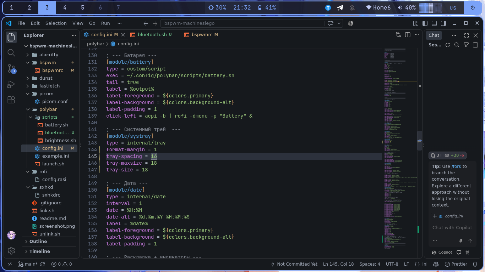
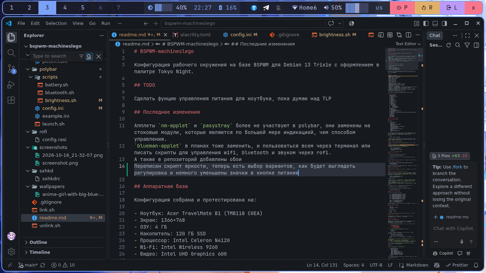

# BSPWM-machineslego

Конфигурация рабочего окружения на базе BSPWM для Debian 13 Trixie с оформлением в палитре Tokyo Night.

## TODO

Сделать фунцию управления питания для ноутбука, пока думаю над TLP

## Последние изменения

Апплеты `nm-applet` и `pasystray` более не участвуют в polybar, они заменены на стоковые модули, которые являются по большей мере индикацией, чем способом управления.
`blueman-applet` в планах тоже заменить, и пользоваться всем через терминал или писать скрипты для управления wifi, bluetooth и звуком через rofi.
А также в репозиторий добавлены обои
Переписан скрипт яркости, теперь есть выбор вариантов, как будет выглядеть регулировка и немного уменьшены значки в кнопке питания

## Аппаратная база

Конфигурация собрана и протестирована на:

- Ноутбук: Acer TravelMate B1 (TMB118 C0EA)
- Экран: 1366×768
- ОЗУ: 4 ГБ
- Накопитель: 120 ГБ SSD
- Процессор: Intel Celeron N4120
- Wi-Fi: Intel Wireless 9260
- Видео: Intel UHD Graphics 600

Все размеры и настройки подобраны под низкое разрешение и слабое железо. При переносе на другую машину часть параметров нужно скорректировать — см. раздел «Перенос на 1920×1080».

## Состав

| Компонент | Назначение |
|---|--- |
| BSPWM | Тайловый оконный менеджер |
| SXHKD | Демон горячих клавиш |
| Polybar | Статус-панель |
| Rofi | Лаунчер и меню |
| Dunst | Уведомления |
| Picom | Композитор |
| Alacritty | Терминал |
| Feh | Установка обоев |
| Scrot | Скриншоты |
| i3lock-fancy | Блокировка экрана |
| Fastfetch | Информация о системе в терминале |
| JetBrainsMono Nerd Font | Шрифт с иконками |
| LXAppearance | Настройка GTK-темы и курсора |
| Thunar | Файловый менеджер |
| ~~Blueman~~ | ~~Bluetooth-апплет в трее (собираюсь убрать)~~ Временно оставлен, управление через `blueman-manager` по клику на модуль в Polybar |
| ~~Pasystray~~ | ~~Апплет звука в трее (устаревшее)~~ Заменён на `internal/pulseaudio` в Polybar (иконки + полоса + процент) |
| ~~nm-applet~~ | ~~Апплет Wi-Fi в трее (устаревшее)~~ Заменён на `internal/network` в Polybar (`wlan` и `eth`) |
| Syncthing | Синхронизация файлов (опционально) |

Цветовая палитра: Tokyo Night (background `#1a1b26`, акцент `#7aa2f7`).

## Структура репозитория

    BSPWM-machineslego/
    ├── alacritty/
    │   └── alacritty.toml
    ├── bspwm/
    │   └── bspwmrc
    ├── dunst/
    │   └── dunstrc
    ├── fastfetch/
    │   └── config.jsonc
    ├── picom/
    │   └── picom.conf
    ├── polybar/
    │   ├── config.ini
    │   ├── launch.sh
    │   └── scripts/
    │       ├── battery.sh
    │       ├── bluetooth.sh
    │       ├── powermenu.sh
    │       └── brightness.sh
    ├── rofi/
    │   └── config.rasi
    ├── screenshots/
    │   ├── screenshot.png
    │   └── 2026-10-16_21-32-07.png
    ├── wallpapers/
    │   └── anime-girl-with-big-blue-eyes-and-blue-hair-wallpaper-1366x768.jpg
    ├── sxhkd/
    │   └── sxhkdrc
    ├── link.sh
    ├── unlink.sh
    ├── .gitignore
    └── readme.md

## Установка на новую машину

### Шаг 1. Установить пакеты

Базовый набор:

    sudo apt install -y \
      xorg xinit \
      bspwm sxhkd \
      polybar rofi dunst picom feh \
      lxappearance \
      papirus-icon-theme \
      fonts-jetbrains-mono fonts-font-awesome \
      fonts-noto-color-emoji \
      brightnessctl scrot \
      network-manager-gnome pavucontrol \
      blueman \
      thunar alacritty \
      i3lock-fancy libnotify-bin \
      fish

Убрано: `pasystray` (заменён модулем Polybar). `network-manager-gnome` оставлен для `nm-connection-editor` — GUI-настройка соединений. `blueman` оставлен — управление Bluetooth через `blueman-manager` по клику на модуль.

Опционально:

    sudo apt install -y syncthing

Примечание: `zutty` может устанавливаться как автоматическая зависимость при установке крупных наборов пакетов, но в конфигурации не используется. Удаляется командой `sudo apt autoremove --purge`.

### Шаг 2. Установить шрифты Nerd Font

В репозиториях Debian пакета `fonts-jetbrains-mono-nerd` нет — шрифт ставится вручную:

1. Скачать `JetBrainsMono.zip` с https://www.nerdfonts.com/font-downloads
2. Установить `unzip`: `sudo apt install unzip`
3. Распаковать и положить `.ttf` в `~/.local/share/fonts/`:

       mkdir -p ~/.local/share/fonts
       cd ~/.local/share/fonts
       unzip ~/Загрузки/JetBrainsMono.zip
       fc-cache -fv

4. Проверить: `fc-list | grep -i "Nerd"`

### Шаг 3. Настроить эмодзи

После установки `fonts-noto-color-emoji` выполнить:

    sudo dpkg-reconfigure fontconfig-config

В интерактивном меню разрешить растровые шрифты (bitmap fonts = Yes). Затем:

    fc-cache -fv

Без этого шага эмодзи могут отображаться как чёрно-белые символы или квадраты.

### Шаг 4. Клонировать репозиторий

    git clone https://github.com/machineslego-wq/BSPWM-machineslego ~/bspwm-machineslego
    cd ~/bspwm-machineslego

Если репозиторий нужен в другом месте — запомни путь, он понадобится для скрипта установки через переменную `DOTFILES`.

### Шаг 5. Установить конфиги

Есть два способа: автоматический через `link.sh` (рекомендуется) и ручной через `cp`.

#### Способ A: автоматическая установка через link.sh

Скрипт `link.sh` создаёт символические ссылки из `~/.config/<пакет>` на папки репозитория. Это значит, что правки в `~/.config/polybar/config.ini` физически изменяют файл в `~/bspwm-machineslego/polybar/config.ini`, и достаточно сделать `git commit`, чтобы сохранить их.

    chmod +x ~/bspwm-machineslego/link.sh
    ~/bspwm-machineslego/link.sh

Что делает скрипт:

- создаёт симлинки из `~/.config/<пакет>` в `~/bspwm-machineslego/<пакет>` для всех пакетов (`alacritty`, `bspwm`, `dunst`, `fastfetch`, `picom`, `polybar`, `rofi`, `sxhkd`);
- если в `~/.config/<пакет>` уже есть реальная папка — переносит её в `~/.dotfiles-backup-<дата>/`, ничего не теряя;
- выставляет права `+x` на `polybar/launch.sh`, `polybar/scripts/*.sh`, `bspwm/bspwmrc`.

Если репозиторий лежит не в `~/bspwm-machineslego`, указать путь явно:

    DOTFILES=/путь/к/репо ~/bspwm-machineslego/link.sh

Откатить установку (удалить симлинки, оставив репозиторий целым):

    ~/bspwm-machineslego/unlink.sh

#### Способ B: ручное копирование

Если не хочется использовать симлинки:

    cp -r ~/bspwm-machineslego/alacritty ~/.config/
    cp -r ~/bspwm-machineslego/bspwm ~/.config/
    cp -r ~/bspwm-machineslego/dunst ~/.config/
    cp -r ~/bspwm-machineslego/fastfetch ~/.config/
    cp -r ~/bspwm-machineslego/picom ~/.config/
    cp -r ~/bspwm-machineslego/polybar ~/.config/
    cp -r ~/bspwm-machineslego/rofi ~/.config/
    cp -r ~/bspwm-machineslego/sxhkd ~/.config/

    chmod +x ~/.config/polybar/launch.sh
    chmod +x ~/.config/polybar/scripts/*.sh
    chmod +x ~/.config/bspwm/bspwmrc

Недостаток: правки в `~/.config` не будут автоматически попадать в репозиторий — их нужно копировать вручную.

### Шаг 6. Создать ~/.xinitrc

    #!/bin/sh
    xrdb -merge ~/.Xresources
    exec bspwm

Дать права и запустить:

    chmod +x ~/.xinitrc
    startx

`xrdb -merge ~/.Xresources` нужен для применения размера курсора (см. ниже).

### Шаг 7. Настроить систему

См. раздел «Настройка окружения» — там описано, как перевести Wi-Fi на NetworkManager, настроить тачпад, курсор и Fn-клавиши.

## Настройка окружения

### Wi-Fi через NetworkManager

Debian-установщик по умолчанию настраивает Wi-Fi через `ifupdown`, из-за чего NetworkManager не может управлять адаптером (статус `unmanaged` или `unavailable`). Для передачи управления:

1. В `/etc/network/interfaces` закомментировать строки, относящиеся к Wi-Fi:

       # allow-hotplug wlp3s0
       # iface wlp3s0 inet dhcp
       #     wpa-ssid MyNetwork
       #     wpa-psk  mypassword

2. В `/etc/NetworkManager/NetworkManager.conf` установить:

       [ifupdown]
       managed=true

3. Отключить системный `wpa_supplicant`, иначе он держит сокет и мешает NetworkManager запустить свой экземпляр:

       sudo systemctl stop wpa_supplicant
       sudo systemctl disable wpa_supplicant

   Не использовать `mask` — иначе NetworkManager не сможет запустить свой экземпляр.

4. Если сокет остался: `sudo pkill -9 wpa_supplicant && sudo rm -rf /run/wpa_supplicant/*`
5. Перезапустить: `sudo systemctl restart NetworkManager`
6. Проверить: `nmcli device status` — статус Wi-Fi должен стать `disconnected`.
7. Подключиться: `nmcli device wifi connect "SSID" password "password"`

Пароль сохранится в `/etc/NetworkManager/system-connections/` и подхватится автоматически при следующей загрузке.

### Тачпад

Создать `/etc/X11/xorg.conf.d/30-touchpad.conf`:

    Section "InputClass"
        Identifier "touchpad"
        Driver "libinput"
        MatchIsTouchpad "on"
        Option "Tapping" "on"
        Option "TappingButtonMap" "lrm"
        Option "NaturalScrolling" "true"
        Option "DisableWhileTyping" "true"
        Option "ClickMethod" "clickfinger"
        Option "ScrollMethod" "twofinger"
    EndSection

После перезагрузки тачпад поддерживает тапы, естественную прокрутку и отключение во время набора текста.

### Курсор

Создать `~/.Xresources`:

    Xcursor.theme: Adwaita
    Xcursor.size: 48

Применить: `xrdb -merge ~/.Xresources`. Эта строка уже добавлена в `~/.xinitrc` на шаге 6.

Тема и иконки GTK настраиваются через `lxappearance`.

### Горячие клавиши яркости и звука

Клавиши `Fn` на Acer TravelMate отправляют стандартные XF86-события. Бинды в `sxhkdrc`:

    XF86MonBrightnessUp
        brightnessctl set +5%

    XF86MonBrightnessDown
        brightnessctl set 5%-

    XF86AudioRaiseVolume
        pactl set-sink-volume @DEFAULT_SINK@ +5%

    XF86AudioLowerVolume
        pactl set-sink-volume @DEFAULT_SINK@ -5%

    XF86AudioMute
        pactl set-sink-mute @DEFAULT_SINK@ toggle

Если комбинации не срабатывают — проверить через `xev`, какие keysym посылает клавиатура. При использовании PipeWire вместо PulseAudio заменить `pactl` на `wpctl`.

### Права на выключение

Если `systemctl poweroff` и `systemctl reboot` требуют пароль, заменить на `loginctl poweroff` / `loginctl reboot` — они работают без пароля в активной локальной сессии. В конфигурации меню питания в Polybar и бинды в `sxhkdrc` уже используют `loginctl`.

## Горячие клавиши

| Комбинация | Действие |
|---|---|
| Super + Enter | Терминал (Alacritty) |
| Super + D | Лаунчер Rofi |
| Super + Q | Закрыть окно |
| Super + W | Закрыть / убить процесс |
| Super + Стрелки | Фокус между окнами |
| Super + Shift + Стрелки | Поменять окна местами |
| Super + 1..7 | Переключить рабочий стол |
| Super + Shift + 1..7 | Переместить окно на другой стол |
| Super + T | Переключить режим окна (тайл / плавающий) |
| Super + F | Полный экран |
| Super + Tab | Переключение между двумя последними окнами |
| Super + L | Блокировка экрана (i3lock-fancy) |
| Super + Shift + L | Выйти из аккаунта |
| Super + Shift + P | Выключение (с подтверждением) |
| Super + Shift + R | Перезагрузка (с подтверждением) |
| Super + Escape | Перезагрузить конфиг SXHKD |
| Super + Alt + R | Перезапустить BSPWM |
| Super + Alt + Shift + R | Перезапустить SXHKD и BSPWM одновременно |
| Print | Скриншот всего экрана |
| Shift + Print | Скриншот активного окна |
| Super + Shift + S | Скриншот выделенной области |
| Super + Shift + N | Тест уведомления Dunst |
| XF86MonBrightnessUp / Down | Яркость |
| XF86AudioRaiseVolume / Lower | Громкость |
| XF86AudioMute | Мьют |

## Особенности конфигурации

- Polybar имеет «парящий» вид: `width = 99%`, `offset-x = 0.5%`, `offset-y = 2`, `border-size = 2`, `radius = 10`. Отступ под панель задаётся через `bspc config top_padding 36` в `bspwmrc` (значение соответствует высоте панели в пикселях).
- Скругления окон обеспечивает Picom (`corner-radius = 8`). В конфиге отключены тени и размытие для экономии ресурсов слабого железа.
- Dunst использует ту же палитру, что и остальное окружение. Скругления уведомлений рисует сам Dunst (`corner_radius = 10`), Picom исключает класс `Dunst` из обработки через `rounded-corners-exclude`. Прозрачность задаётся параметром `transparency = 15`.
- Меню питания в Polybar реализовано через `custom/menu` с подтверждением через Rofi.
- ~~Апплеты (Bluetooth, звук, Wi-Fi) запускаются в `bspwmrc` с `pkill -x <applet>` перед стартом, чтобы избежать дублей при `Super + Alt + R`.~~ В `bspwmrc` из апплетов запускается только `blueman-applet` (с `pkill -x blueman-applet` перед стартом). Индикация звука, Wi-Fi и Ethernet — через модули Polybar: `internal/pulseaudio`, `internal/network` (`wlan`, `eth`). Статус Bluetooth — через `custom/script` со скриптом `bluetooth.sh`, клик по модулю открывает `blueman-manager`.
- Обои задаются через `feh --bg-fill` в `bspwmrc`.
- Меню питания работает единообразно: и кнопки в Polybar, и горячие клавиши Super+Shift+P/R/L вызывают один скрипт ~/.config/polybar/scripts/powermenu.sh с аргументом (poweroff/reboot/logout). Скрипт показывает Rofi-окно с выбором «Да/Нет», защищённое от ручного ввода (-no-custom).

## Перенос на 1920×1080

Для Full HD изменить:

**Polybar** (`~/.config/polybar/config.ini`):

    height = 36px

заменить на:

    height = 44px

**BSPWM** (`~/.config/bspwm/bspwmrc`):

    bspc config top_padding 36

заменить на:

    bspc config top_padding 44

**Зазоры между окнами**: при желании увеличить `bspc config window_gap` с `2` до `4–6`.

**Шрифт Polybar** (`config.ini`): оставить `size=12` или увеличить до `13`.

**Обои**: подобрать картинку под 1920×1080.

Остальные параметры (цвета, скрипты, бинды) не зависят от разрешения.

## Известные ограничения

- На Celeron N4120 с 4 ГБ ОЗУ не рекомендуется включать эффекты размытия в Picom и тяжёлые модули в Polybar (CPU, memory, graph).
- Шрифты Nerd Font ставятся вручную — в репозиториях Debian их нет.
- Если `echo -e` в скриптах не работает — заменить на `printf`. Polybar и SXHKD запускают команды через `/bin/sh` (dash), который не поддерживает `-e` у встроенного `echo`.
- В `.ini`-конфиге Polybar inline-комментарии (`;` после значения) не поддерживаются — парсер берёт всё после `=` как буквальное значение. Комментарии только на отдельных строках.
- Проверка `git status` в `~/.config` не сработает — там нет `.git`. Репозиторий живёт в `~/bspwm-machineslego`, работать с git нужно оттуда.

## Скриншот

## Лицензия

Конфигурация свободна к использованию и модификации.